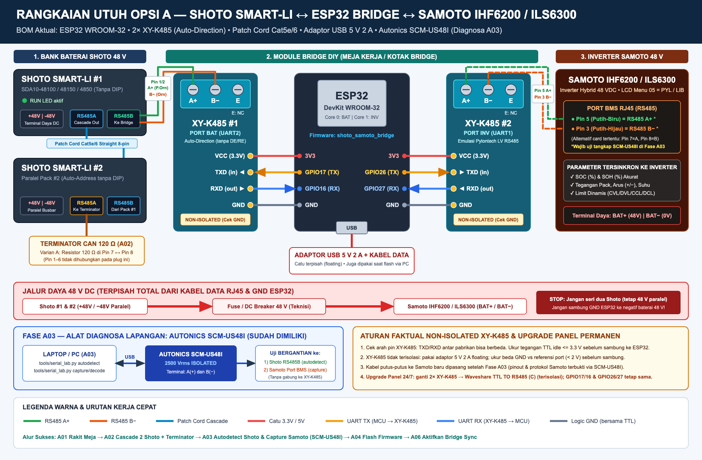
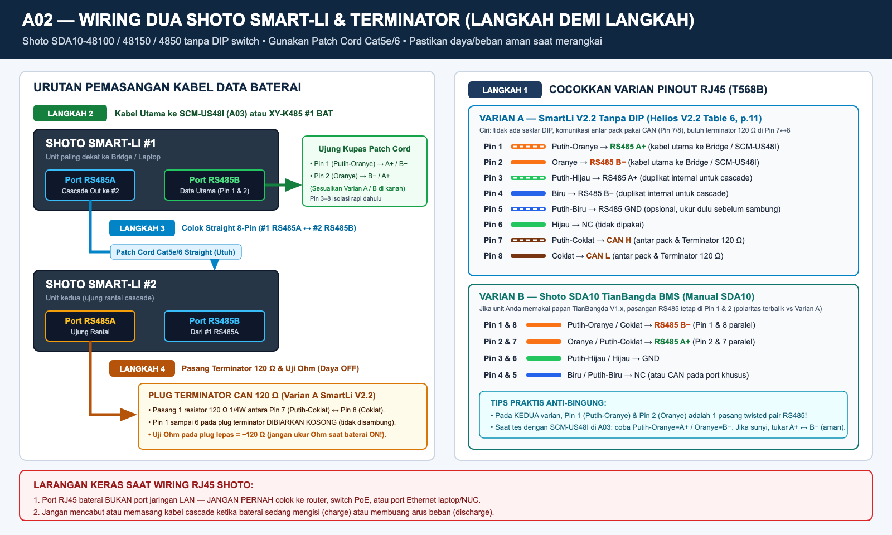
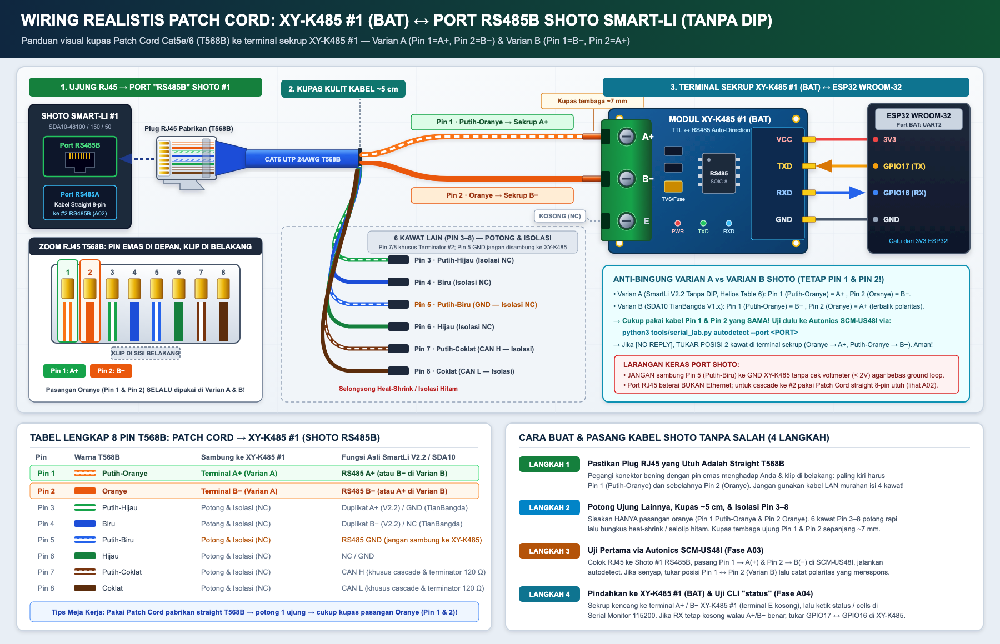
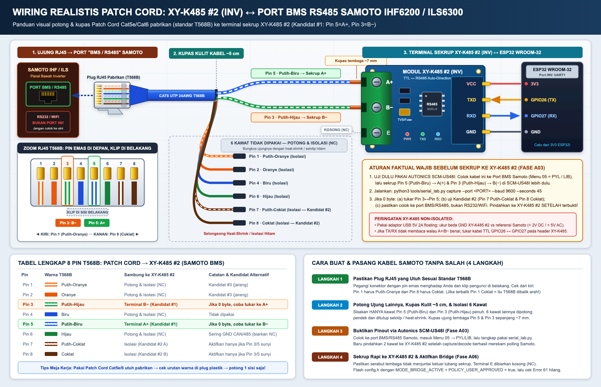

# Panduan Praktis Opsi A (DIY XY-K485): Sinkronisasi Shoto SmartLi (Tanpa DIP) ↔ Samoto IHF6200 / ILS6300

> **Panduan Induk:** [GUIDE.md](GUIDE.md) · **Versi Siap Print (3 Lembar A4):** [GUIDE-A-DIY-PRINT.pdf](GUIDE-A-DIY-PRINT.pdf) · **Alternatif PCB Terisolasi (Opsi B):** [GUIDE-B-WAVESHARE.md](GUIDE-B-WAVESHARE.md)  
> **Target Sistem:** Inverter **Samoto IHF6200 / ILS6300 (48 VDC)** ↔ **Module Bridge DIY (`ESP32 DevKit WROOM-32` + `2× XY-K485`)** ↔ **2× Shoto SmartLi `SDA10-48100 / SDA10-48150 / SDA10-4850` (tanpa DIP switch)**  
> **Status Dokumen:** v3.0 — Diperbarui berdasarkan Reverse Engineering (RE) paket referensi [`reference/2019-07-31  TianBangda LFP MS-ShotoV1.1.exe`](reference/) (`Shoto BMS Modbus V1.2`, `TianBangda Binary .NET`, `YD/T 1363.3 V2.8`), manual Helios V2.2, serta parser Pylontech LV RS485.

---

## Ringkasan Sistem & Prinsip Faktual

Tujuan utama rangkaian ini adalah **membaca parameter asli dari BMS baterai Shoto SmartLi** (Tegangan Pack, Arus +/-, SOC %, SOH %, Tegangan Sel Min/Maks, Suhu, serta Status Proteksi/Alarm) lalu **menerjemahkan & menyinkronkannya secara real-time** ke inverter **Samoto IHF6200 / ILS6300** (protokol Pylontech LV RS485 `PYL` / `LIB`) sehingga inverter menampilkan **SOC (%) yang akurat** dan menerima **batas pengisian/pengosongan aman (`CVL`, `DVL`, `CCL`, `DCL`)**.

Untuk menjaga tingkat keberhasilan **100% faktual tanpa asumsi**, seluruh panduan ini memisahkan secara tegas:

| Kategori | Cakupan di Panduan Ini | Dasar Pembuktian |
|---|---|---|
| **Fakta Terverifikasi RE & Dokumen Resmi** | 4 protokol Shoto/TianBangda (`SHOTO_MODBUS_V12`, `TBD_BINARY`, `TBD_1363`, `SMARTLI_DCDC`), konvensi tanda arus berbeda antar protokol, pinout RJ45 Varian A/B, format frame Pylontech RS485 `0x61/0x62/0x63`, serta logika failsafe `safety_core.hpp`. | Reverse engineering biner `.NET` (`SHA-256: 75d3bdf7...`), PDF `Modbus V1.2` (`SDA10-48100`), DOC `V2.8`, PDF `Helios V2.2 Table 6`, serta unit test `tests/test_serial_lab.py` (Python) & `tests/bridge_test.cpp` (C++17). |
| **Fakta Lapangan Unit Anda (Wajib Uji di Fase A03)** | Varian protokol/baud yang aktif pada baterai Shoto fisik Anda, serta pinout RJ45 + format polling aktual pada port BMS unit **Samoto IHF6200 / ILS6300** milik Anda. | **Diukur langsung sebelum sambung ke ESP32** memakai **Autonics SCM-US48I** (2500 Vrms isolated) yang sudah Anda miliki + script `tools/serial_lab.py`. |

---

## Peta Jalan Langkah demi Langkah (Phase A00 – A09)

```
[A00 Cek BOM Anda] ─▶ [A01 Rakit Meja ESP32 + 2× XY-K485] ─▶ [A02 Cascade 2 Shoto + Terminator]
        │                                                               │
        └──────────────────────▶ [A03 Uji & Capture via SCM-US48I] ◀────┘
                                         │
        ┌────────────────────────────────┘
        ▼
[A04 Flash Firmware Siap Pakai] ─▶ [A05 Uji Keselamatan] ─▶ [A06 Aktifkan Sinkron ke Samoto]
        │
        ▼
[A07 HA Opsional] ─▶ [A08 Commissioning 15 Uji] ─▶ [A09 Pemeliharaan & Upgrade Panel]
```

**Aturan Wajib:** Selesaikan **Gate / Ceklis** di akhir setiap phase sebelum pindah ke phase berikutnya. Jangan mencolokkan kabel RS485 ke Samoto sebelum **Fase A03** selesai membuktikan pinout & frame Samoto Anda.

---

## Phase A00 — Inventaris BOM Aktual & Alat Uji Anda

**Tujuan Phase Ini:** Memastikan komponen yang sudah Anda siapkan lengkap dan menambahkan sedikit komponen bantu murah agar perakitan meja kerja lancar.

### A00.1 BOM Utama Anda (Sudah Tersedia)

| No | Item Anda | Fungsi dalam Rangkaian Utuh | Status |
|---|---|---|---|
| 1 | **ESP32 DevKit WROOM-32** | Otak dual-core bridge: Core 0 poll BMS Shoto (`UART2`), Core 1 melayani inverter Samoto (`UART1`) & CLI USB `115200`. | Sudah dimiliki |
| 2 | **2 pcs TTL-to-RS485 `XY-K485`** (Auto-Direction) | `#1` terhubung ke `Shoto #1 RS485B` (`GPIO17/16`); `#2` terhubung ke `Port BMS Samoto` (`GPIO26/27`). **Perhatian: non-isolated!** | Sudah dimiliki |
| 3 | **Patch cord Cat5e / Cat6** | 1 kabel utuh *straight 8-pin* untuk cascade `#1 RS485A ↔ #2 RS485B`; 1 kabel dikupas ujungnya (`Pin 1 & Pin 2`) untuk `#1 RS485B → XY-K485 #1`; 1 kabel dikupas untuk `#2 → Samoto` setelah A03. | Sudah dimiliki |
| 4 | **Autonics `SCM-US48I`** (USB-to-RS485, **2500 Vrms Isolated**) | Alat diagnosa lapangan Fase A03: memindai protokol Shoto (`autodetect`) dan menangkap pinout/frame asli Samoto (`capture`) dengan aman tanpa risiko ground loop. Terminal sekrup: **`A(+)`** dan **`B(-)`**. | Sudah dimiliki |
| 5 | **Adaptor USB 5 V 2 A + Kabel USB Data** | Catu daya *floating* terpisah untuk ESP32 saat beroperasi di meja kerja maupun mem-flash firmware dari PC/laptop. | Sudah dimiliki |

### A00.2 Perlengkapan Bantu Wajib di Meja Kerja

Pastikan barang kecil berikut tersedia sebelum masuk Phase A01:
- **1–2 pcs Resistor `120 Ω` (1/4 W) + konektor RJ45 cadangan / tang crimping** → untuk membuat **Plug Terminator CAN** pada `Shoto #2 RS485A` (Varian A SmartLi V2.2: `Pin 7 ↔ Pin 8`).
- **Kabel jumper Dupont Female-to-Female (minimal 8 helai)** → menghubungkan pin header `ESP32` ke `2× XY-K485` (`3V3`, `TX`, `RX`, `GND`).
- **Multimeter Digital** → wajib untuk mengukur tegangan idle pin TTL `XY-K485` (`<= 3.3 V`), hambatan terminator (`~120 Ω` saat lepas), dan beda potensial GND (`< 2 V`).
- **Laptop/PC** dengan Python 3.10+ + library `pyserial` (`pip install pyserial`) untuk menjalankan `tools/serial_lab.py` pada Fase A03, dan **Arduino IDE 2.x** (atau PlatformIO) untuk mem-flash firmware di Fase A04.

> **Catatan Upgrade Panel 24/7 (Opsional Setelah Meja Kerja Berhasil):**  
> Modul **`XY-K485` bersifat NON-ISOLATED** (ground logika ESP32 tersambung langsung ke board RS485) dan memakai switching auto-direction pasif. Ia **aman untuk meja kerja dengan adaptor 5 V 2 A floating** (jika lulus cek GND Fase A05), tetapi untuk instalasi panel permanen 24/7 di dekat inverter high-frequency seperti `IHF6200`, nantinya sangat disarankan menukar kedua `XY-K485` ke **`Waveshare TTL TO RS485 (C)` (terisolasi)** karena pin `GPIO17/16` dan `GPIO26/27` **tetap sama persis**.

**Gate A00 (Ceklis):**
- [ ] Seluruh 5 item BOM utama ada di meja kerja.
- [ ] Resistor `120 Ω`, multimeter, kabel Dupont, dan laptop dengan Python + `pyserial` siap.

---

## Phase A01 — Rangkaian Utuh & Urutan Perakitan di Meja Kerja

**Tujuan Phase Ini:** Merakit **Module Bridge DIY** (`ESP32` + `2× XY-K485` + `Adaptor 5 V 2 A`) secara rapi, benar arah TX/RX-nya, dan terverifikasi aman **tanpa tersambung ke baterai maupun inverter terlebih dahulu**.

### A01.1 Peringatan Keras Khusus `XY-K485` (Jangan Dilanggar)

1. **Verifikasi Arah `TXD` & `RXD` pada Papan Anda:** Modul berlabel `XY-K485` dari penjual berbeda terkadang menandai `TXD` sebagai *"input data dari MCU"* atau *"output data ke MCU"*. **Solusi faktual:** jangan langsung sambung ke Samoto. Uji loopback atau periksa saat A04 (`serial_lab` / monitor `scan`). Jika `RX count = 0` sementara baterai aktif, cukup tukar kabel `TXD ↔ RXD` antara ESP32 dan XY-K485 tersebut.
2. **Jangan Memberi VCC `5 V` jika Level TTL Board Tidak Dijamin `<= 3.3 V`:** Data `XY-K485` mendukung supply `3.0–30 V`. Gunakan pin **`3V3`** dari ESP32 sebagai VCC kedua `XY-K485` supaya logika TTL ke GPIO ESP32 **dijamin `<= 3.3 V`** (ESP32 tidak 5 V-tolerant).
3. **Jalur Daya `48 V DC` Selalu Terpisah:** Kabel tebal `+48 V / -48 V` baterai ↔ Fuse/Breaker ↔ Samoto **tidak pernah boleh** menyentuh `GND` ESP32 atau pin `RJ45`.

### A01.2 Diagram Lengkap 1 Rangkaian Utuh (Opsi A)

Diagram di bawah menggambarkan 1 rangkaian penuh sistem Anda: Bank Baterai Shoto (`#1` & `#2` + Terminator), Module Bridge DIY (`2× XY-K485` + `ESP32` + `Adaptor 5 V 2 A`), Inverter `Samoto IHF6200 / ILS6300`, Jalur Daya `48 V DC`, serta jalur diagnosa `Autonics SCM-US48I`.



> **File vektor asli:** [`diagrams/diy-xy-k485.svg`](diagrams/diy-xy-k485.svg)

### A01.3 Tabel Koneksi Pin Meja Kerja (Referensi Cepat)

| Komponen Asal | Pin Asal | Hubungkan Ke | Komponen Tujuan | Fungsi Sinyal |
|---|---|---|---|---|
| **ESP32 WROOM-32** | `3V3` | `VCC` | **XY-K485 #1 (BAT)** | Catu `3.3 V` aman untuk TTL |
| **ESP32 WROOM-32** | `GPIO17` (`UART2 TX`) | `TXD` *(data masuk modul)* | **XY-K485 #1 (BAT)** | Mengirim frame query ke Shoto |
| **ESP32 WROOM-32** | `GPIO16` (`UART2 RX`) | `RXD` *(data keluar modul)* | **XY-K485 #1 (BAT)** | Menerima balasan BMS Shoto |
| **ESP32 WROOM-32** | `GND` | `GND` | **XY-K485 #1 (BAT)** | Referensi logika TTL |
| **XY-K485 #1 (BAT)** | `A+`, `B-`, `E` | **Putih-Oranye**, **Oranye**, *(biarkan kosong)* | **Kabel Kupas Shoto #1 `RS485B`** | **Sisi Varian A (`Pin 1=A+, Pin 2=B-`)** *(tukar jika Varian B)* |
| **ESP32 WROOM-32** | `3V3` | `VCC` | **XY-K485 #2 (INV)** | Catu `3.3 V` aman untuk TTL |
| **ESP32 WROOM-32** | `GPIO26` (`UART1 TX`) | `TXD` *(data masuk modul)* | **XY-K485 #2 (INV)** | Mengirim emulasi Pylontech ke Samoto |
| **ESP32 WROOM-32** | `GPIO27` (`UART1 RX`) | `RXD` *(data keluar modul)* | **XY-K485 #2 (INV)** | Menerima poll dari Samoto |
| **ESP32 WROOM-32** | `GND` | `GND` | **XY-K485 #2 (INV)** | Referensi logika TTL |
| **XY-K485 #2 (INV)** | `A+`, `B-` | **JANGAN dipasang dulu!** | **Port BMS Samoto** | **Baru dipasang setelah Fase A03 lulus** |

> **Catatan Pin `E` pada `XY-K485`:** Pin sekrup `E` adalah *earth/shield*. Untuk kabel jarak pendek meja kerja/rak `< 3 m`, **biarkan kosong (NC)**. Jangan dihubungkan ke negatif baterai.

### A01.4 Urutan Perakitan di Meja Kerja (7 Langkah Mudah)

Ikuti langkah berurutan ini saat **semua catu daya dalam keadaan lepas/mati**:

1. **Langkah 1 — Beri Label Kedua Modul `XY-K485`:** Tempel selotip kertas pada modul pertama bertuliskan **`#1 BAT (Shoto)`** dan pada modul kedua **`#2 INV (Samoto)`** agar tidak pernah tertukar saat troubleshooting.
2. **Langkah 2 — Siapkan Base ESP32 & Breadboard / Alas Isolator:** Letakkan `ESP32 DevKit WROOM-32` dan kedua `XY-K485` di atas alas non-konduktif (meja kayu/karet/breadboard). Pastikan tidak ada pin solderan yang menyentuh logam.
3. **Langkah 3 — Pasang Kabel Sisi `#1 BAT` (4 Helai Dupont):** Sambungkan pin **ESP32 ↔ `XY-K485 #1 BAT`**:
   - `ESP32 3V3` → `XY-K485 #1 VCC` (merah)
   - `ESP32 GPIO17` → `XY-K485 #1 TXD` (oranye)
   - `ESP32 GPIO16` → `XY-K485 #1 RXD` (biru)
   - `ESP32 GND` → `XY-K485 #1 GND` (hitam/abu)
4. **Langkah 4 — Pasang Kabel Sisi `#2 INV` (4 Helai Dupont):** Sambungkan pin **ESP32 ↔ `XY-K485 #2 INV`**:
   - `ESP32 3V3` → `XY-K485 #2 VCC` (merah)
   - `ESP32 GPIO26` → `XY-K485 #2 TXD` (oranye)
   - `ESP32 GPIO27` → `XY-K485 #2 RXD` (biru)
   - `ESP32 GND` → `XY-K485 #2 GND` (hitam/abu)
   *(Tip: apabila `ESP32` Anda hanya memiliki 1 pin `3V3`, gabungkan 2 kabel VCC menggunakan Wago/pin-splitter atau baris rel breadboard, jangan dipelintir longgar).*
5. **Langkah 5 — Uji Tegangan Idle Meja Kerja (Wajib Sebelum Sambung ke Baterai):** Colokkan **Adaptor USB 5 V 2 A + Kabel USB Data** ke ESP32 (**tanpa kabel RJ45 baterai maupun inverter terpasang!**).
   - Cek LED power pada ESP32 dan kedua `XY-K485` menyala normal, tidak ada chip panas.
   - Setel multimeter ke **DC Volt (`20 V`)**, probe hitam ke `ESP32 GND`, probe merah ke:
     - `XY-K485 #1 VCC` & `#2 VCC` → harus terbaca **`3.25 V – 3.35 V`**.
     - `XY-K485 #1 RXD` & `#2 RXD` (dalam kondisi idle) → harus **`<= 3.35 V`** *(jika terbaca ~5 V, hentikan pemakaian modul tersebut!)*.
6. **Langkah 6 — Cabut USB & Siapkan Ujung Kupas Kabel Baterai:** Kupas satu ujung `Patch Cord Cat5e/6` sepanjang ~5 cm. Pisahkan pasangan warna **T568B Pin 1 (`Putih-Oranye`)** dan **Pin 2 (`Oranye`)** untuk disekrup nanti di Fase A03/A04. **Isolasi rapi ujung kawat Pin 3–8** dengan selotip listrik agar tidak pernah menyentuh apa pun.
7. **Langkah 7 — Biarkan Terminal Sekrup `A+/B-` `XY-K485 #2 INV` Tetap Kosong:** Jangan pasang kabel ke inverter Samoto sebelum **Fase A03** membuktikan pinout RJ45 Samoto Anda dengan `Autonics SCM-US48I`.

**Gate A01 (Ceklis):**
- [ ] Kedua `XY-K485` sudah berlabel `#1 BAT` dan `#2 INV`.
- [ ] Seluruh 8 kabel TTL (`GPIO17/16` & `GPIO26/27` + `3V3/GND`) terpasang kencang.
- [ ] Uji multimeter meja kerja menunjukkan `VCC = ~3.3 V` dan `RXD idle <= 3.35 V` (tidak ada chip panas).
- [ ] Terminal bus `A+/B-` ke baterai dan ke Samoto masih terlepas.

---

## Phase A02 — Wiring Dua Shoto SmartLi & Terminator (Langkah demi Langkah)

**Tujuan Phase Ini:** Merangkai komunikasi paralel antar 2 unit baterai **Shoto SmartLi `SDA10-48100 / 48150 / 4850` (tanpa DIP switch)** sehingga Pack `#1` dan Pack `#2` saling mengenali (auto-addressing) tanpa refleksi sinyal.

> **Keselamatan Fisik & Elektrikal:**  
> 1. **Jalur Daya DC (`+48 V / -48 V`):** Kedua baterai harus dirangkai **PARALEL** (`+` ke busbar `+`, `-` ke busbar `-`) dengan beda tegangan antarbaterai `< 0.5 V` sebelum dikopel. **JANGAN PERNAH di-seri** menjadi 96 V!  
> 2. **Port RJ45 Baterai BUKAN Port LAN/Ethernet:** Jangan pernah colok ke router, switch PoE, atau port LAN laptop.  
> 3. **Kerjakan Saat Beban/Charging OFF:** Jangan memasang atau mencabut kabel cascade ketika sistem sedang mengisi atau menarik arus besar.

### A02.1 Diagram Wiring Dua Shoto & Terminator



> **File vektor asli:** [`diagrams/shoto-cascade.svg`](diagrams/shoto-cascade.svg)

### A02.2 Langkah 1 — Cocokkan Varian Pinout RJ45 Shoto Anda (Standar Kabel T568B)

Pada kabel `Patch Cord Cat5e/6` standar **T568B** (clip RJ45 menghadap ke bawah / menjauh, hitung dari kiri ke kanan `Pin 1..8`), urutan warnanya adalah:
`1: Putih-Oranye`, `2: Oranye`, `3: Putih-Hijau`, `4: Biru`, `5: Putih-Biru`, `6: Hijau`, `7: Putih-Coklat`, `8: Coklat`.

Dokumen teknis Shoto menunjukkan **2 varian pinout RJ45 RS485** pada lini SmartLi/SDA10 tanpa DIP switch. Untungnya, **pada KEDUA varian, pasangan kabel utama berada di `Pin 1 (Putih-Oranye)` dan `Pin 2 (Oranye)`**:

| Pin (T568B) | Warna Kabel | **Varian A: SmartLi V2.2 Tanpa DIP** *(Helios V2.2 Table 6, p.11)* | **Varian B: Shoto SDA10 TianBangda** *(Manual SDA10-48100/150/50)* |
|---|---|---|---|
| **Pin 1** | **Putih-Oranye** | **`RS485 A+`** *(utama ke bridge)* | **`RS485 B-`** *(paralel dgn Pin 8)* |
| **Pin 2** | **Oranye** | **`RS485 B-`** *(utama ke bridge)* | **`RS485 A+`** *(paralel dgn Pin 7)* |
| **Pin 3** | Putih-Hijau | `RS485 A+` *(duplikat internal)* | `GND` |
| **Pin 4** | Biru | `RS485 B-` *(duplikat internal)* | `NC` |
| **Pin 5** | Putih-Biru | `RS485 GND` *(jangan asal disambung)* | `NC` |
| **Pin 6** | Hijau | `NC` | `GND` |
| **Pin 7** | **Putih-Coklat** | **`CAN H`** *(cascade CAN & Terminator 120 Ω)* | `RS485 A+` *(paralel dgn Pin 2)* |
| **Pin 8** | **Coklat** | **`CAN L`** *(cascade CAN & Terminator 120 Ω)* | `RS485 B-` *(paralel dgn Pin 1)* |

> **Fakta Praktis Anti-Bingung:** Anda **tidak perlu menebak** varian mana yang terpasang di dalam baterai Anda. Pada **Fase A03** menggunakan `Autonics SCM-US48I`, cukup coba pasangan default Varian A (`Putih-Oranye → A+`, `Oranye → B-`). Jika tidak ada respon sama sekali pada `autodetect`, tukar menjadi `Putih-Oranye → B-`, `Oranye → A+`. RS485 toleran terhadap uji polaritas sesaat.

### A02.3 Langkah 2, 3, dan 4 — Merangkai Kabel Data Dua Shoto

#### Panduan Visual Kupas Patch Cord Baterai (`XY-K485 #1 ↔ Shoto RS485B`)



> **File vektor asli:** [`diagrams/patchcord-xy-k485-shoto.svg`](diagrams/patchcord-xy-k485-shoto.svg)

1. **Langkah 2 (Kabel Utama Keluar dari Pack `#1`):**  
   Tentukan unit baterai yang paling dekat dengan posisi bridge sebagai **Shoto `#1`**. Colokkan **Patch Cord Cat5e/6 Ujung Kupas** ke port **`RS485B`** pada Shoto `#1`. Ujung kupasnya (`Pin 1 Putih-Oranye` & `Pin 2 Oranye`) **belum dicolok ke `XY-K485 #1`** — di Fase A03 akan dicolok dulu ke `Autonics SCM-US48I`!
2. **Langkah 3 (Kabel Cascade `#1 ↔ #2`):**  
   Ambil 1 buah **Patch Cord Cat5e/6 Straight 8-pin Utuh** *(wajib straight 1-to-1 semua 8 kabel tersambung, bukan kabel LAN isi 4 kabel murah!)*.  
   - Colok ujung pertama ke **`Shoto #1` port `RS485A`**.  
   - Colok ujung kedua ke **`Shoto #2` port `RS485B`**.
3. **Langkah 4 (Buat & Pasang Plug Terminator `120 Ω` pada `Shoto #2 RS485A`):**  
   Menurut **Helios V2.2 Table 6 (p.11)**, komunikasi cascade antarpaket SmartLi tanpa DIP berjalan lewat jalur CAN internal (`Pin 7 CAN H` & `Pin 8 CAN L`) yang memerlukan terminasi di ujung rantai agar auto-addressing stabil:
   - **Cara buat:** Ambil 1 konektor RJ45 (atau potong patch cord pendek ~5 cm), hubungkan **1 resistor `120 Ω` (1/4 W)** antara **Pin 7 (`Putih-Coklat`)** dan **Pin 8 (`Coklat`)**. Pastikan **Pin 1 sampai Pin 6 DIBIARKAN KOSONG / tidak terhubung ke apa pun**.
   - **Cara uji multimeter (SAAT PLUG BELUM DICOLOK ke baterai!):** Setel multimeter ke **Ohm (`Ω`)**, ukur ujung `Pin 7 ↔ Pin 8` pada plug terminator yang masih terlepas. Nilai harus **`115 Ω – 125 Ω`** *(umumnya `119–121 Ω`)*. Jangan pernah mengukur Ohm ketika plug sudah terpasang ke baterai hidup!
   - **Pemasangan:** Colokkan plug terminator yang sudah lulus ukur ke **`Shoto #2` port `RS485A`** *(ujung terakhir rantai)*.
4. **Penomoran Otomatis:** Nyalakan kedua unit Shoto sesuai prosedur standar baterai (`RUN` LED aktif). Tanpa DIP switch, auto-addressing SmartLi secara umum memberikan urutan alamat berdasarkan rantai fisik cascade (diidentifikasi saat **Fase A03** apakah terbaca ID `38` & `39`, `1` & `2`, atau hanya 1 unit agregat di Master).

**Gate A02 (Ceklis):**
- [ ] Patch cord cascade `#1 RS485A ↔ #2 RS485B` memakai kabel straight 8-pin penuh.
- [ ] Plug Terminator terpasang di `#2 RS485A`, terukur `~120 Ω` (saat plug lepas), Pin 1–6 kosong.
- [ ] Kabel utama dari `#1 RS485B` ujung kupasnya (`Pin 1 Putih-Oranye`, `Pin 2 Oranye`) sudah rapi dan Pin 3–8 diisolasi.
- [ ] Kedua unit baterai menyala normal tanpa lampu `ALM`.

---

## Phase A03 — Uji Faktual & Capture Lapangan dengan `Autonics SCM-US48I`

**Tujuan Phase Ini:** Membuktikan 100% secara faktual di unit fisik Anda (tanpa menebak):
1. Protokol, baud rate, alamat ID, varian polaritas RJ45 (`Pin 1/2`), serta **apakah 1 atau 2 baterai muncul di bus** pada Shoto SmartLi Anda.
2. **Pinout RJ45 & format polling aktual** pada port BMS inverter **Samoto IHF6200 / ILS6300** milik Anda.

> **Penting:** Di phase ini, `ESP32` dan `2× XY-K485` **TIDAK ikut disambung**. Anda menggunakan **`Autonics SCM-US48I`** (terisolasi 2500 Vrms) secara bergantian ke baterai lalu ke Samoto!

### A03.1 Langkah 1 — Siapkan Tool Python di Laptop Anda

Buka terminal pada folder proyek `shoto_samoto_bridge`, lalu jalankan pengujian bawaan untuk memastikan environment Python Anda siap:

```bash
pip install pyserial
python3 -m unittest discover -s tests -v
```
*Hasil yang Benar:* `Ran 7 tests ... OK`.  
Sambungkan **`Autonics SCM-US48I`** ke USB laptop dan cari nama port serialnya:
- **macOS:** `ls /dev/cu.*` (biasanya `/dev/cu.usbserial-*` atau `/dev/cu.SLAB_*`)
- **Linux:** `ls /dev/ttyUSB*`
- **Windows:** lihat di Device Manager → Ports (mis. `COM5`)

### A03.2 Langkah 2 — Auto-Detect Protokol Shoto Anda (`autodetect`)

1. Saat laptop/SCM-US48I belum membaca apa pun, sekrup ujung kupas kabel dari **`Shoto #1 RS485B`** ke terminal **`Autonics SCM-US48I`**:
   - **`Putih-Oranye` (Pin 1)** → Terminal **`A(+)`**
   - **`Oranye` (Pin 2)** → Terminal **`B(-)`**
2. Jalankan perintah **read-only auto-detect** *(menguji ke-4 protokol hasil RE di `9600` & `19200` baud pada alamat `38, 39, 40, 1, 2, 3, 4` tanpa menulis register apa pun)*:

```bash
python3 tools/serial_lab.py autodetect --port /dev/cu.usbserial-XXXX
```
*(Ganti `/dev/cu.usbserial-XXXX` dengan port COM/tty SCM-US48I Anda).*

3. **Jika hasilnya `[NO REPLY]` di semua protokol:**
   - **Tukar polaritas** di terminal sekrup `SCM-US48I`: `Oranye (Pin 2) → A(+)`, `Putih-Oranye (Pin 1) → B(-)` *(ciri Varian B TianBangda)*. Lalu ulangi perintah `autodetect` di atas.
   - Pastikan baterai Shoto dalam status menyala (`RUN` berkedip/nyala, bukan sleep mode — tekan tombol SW reset/bangunkan baterai jika perlu).
4. **Setelah terdeteksi 1 atau 2 ID (catat hasilnya!):**
   Ambil detail lengkap (termasuk apakah `Pack #2` ikut menjawab di `ID 39` atau `ID 2`, atau apakah keduanya digabung di 1 master ID):

```bash
# Contoh jika terdeteksi shoto_modbus_v12 di baud 9600:
python3 tools/serial_lab.py probe --port /dev/cu.usbserial-XXXX --baud 9600 --ids 38,39,1,2 --detail
```

5. **Simpan Catatan Fakta Shoto Anda (isi sebelum lanjut):**
   - Protokol terdeteksi: `__________________` *(mis. `shoto_modbus_v12` / `tbd_binary` / `tbd_1363` / `smartli_dcdc`)*
   - Baud rate: `________` (`9600` atau `19200`)
   - Polaritas Pin 1 (`Putih-Oranye`): `A(+)` atau `B(-)` (`Varian A` atau `Varian B`)
   - Alamat ID menjawab: `__________` *(contoh: hanya `38`, atau `38` dan `39`, atau `1` dan `2`)*

> **4 Protokol Hasil Deep RE yang Otomatis Diuji `autodetect` & Firmware Bridge:**
> 1. **`SHOTO_MODBUS_V12`** *(dari `Shoto BMS Modbus Communication Protocol V1.2_EN-20190110.pdf` yang secara eksplisit menyebut `SDA10-48100`)* — Modbus RTU FC `0x04`, `9600 8N1`, reg `0x0FFF..0x1025`, alamat `38 + DIP` (atau `38, 39, 1, 2`). **Catatan kritis PDF Note 3:** pada register `0x1000`, charge bernilai negatif dan discharge bernilai positif `(raw-10000)×0.1`; bridge otomatis menormalkannya ke `+A = charge, -A = discharge`.  
> 2. **`TBD_BINARY`** *(hasil disassembling biner `.NET` `TianBangda LFP MS-ShotoV1.1.exe`)* — Frame biner `9600 8N1`, wakeup `16× 0xAA`, poll `7C <addr> 01 00 <chk> 0D`, panjang balasan dinamis `56 + 2×N_cells` (`86 B` untuk 15S, `88 B` untuk 16S), arus `(30000 - raw)/100.0` (`+A = charge, -A = discharge`).  
> 3. **`TBD_1363`** *(dari `BMS Communication Protocol_V2_8_180807.doc` & `Form1.getcrc16checkcode`)* — Frame ASCII YD/T 1363.3 (`VER=26, ADR=00, CID1=46`), misalnya `~26004642E00201FD30\r`.  
> 4. **`SMARTLI_DCDC`** *(SmartLi DC/DC / Helios V2.2)* — Modbus RTU FC `0x04`, `9600/19200 8N1`, reg `0x0000/0x0001/0x1030..0x103F`.

### A03.3 Langkah 3 — Capture Pinout & Frame Asli Port BMS Samoto (`IHF6200 / ILS6300`)

Jangan menebak pinout atau protokol port BMS Samoto — tangkap frame polling aslinya sekarang juga!

1. **Lepas dulu `Autonics SCM-US48I` dari kabel baterai Shoto!** (Ingat: uji satu sisi secara bergantian, jangan digabung).
2. **Aktifkan Mode BMS di LCD Samoto:**
   - Masuk ke **Setting Menu `05`** (Battery Type) pada panel depan **Samoto `IHF6200 / ILS6300`**.
   - Pilih **`PYL`** *(jika tersedia; atau **`LIB` / `LIC`** sesuai opsi yang ada di menu IHF6200/ILS6300 Anda)*. Inverter mungkin memunculkan **Warning `61`** (BMS communication fault) karena baterai komunikasi belum tersambung — ini **normal**, artinya inverter aktif mencoba melakukan polling RS485!
3. **Siapkan 1 Kabel Patch Cord Uji untuk Port BMS Samoto:**
   - Kupas 1 ujung kabel Cat5e/6 sesuai panduan visual realistis di Fase [A06.2](#a062-langkah-2--pasang-kabel-rs485-ke-port-bms-samoto) ([`diagrams/patchcord-xy-k485-samoto.png`](diagrams/patchcord-xy-k485-samoto.png)), biarkan pin lain terisolasi, dan mulai dengan **Kandidat Pinout #1** *(umum pada motherboard OEM inverter tipe Pylontech/Voltronic)*:
     - **Pin 5 (`Putih-Biru`)** → `SCM-US48I A(+)`
     - **Pin 3 (`Putih-Hijau`)** → `SCM-US48I B(-)`
4. **Tangkap Lalu Lintas Data selama 30–60 detik** (`capture` bersifat pasif/listen-only):

```bash
python3 tools/serial_lab.py capture --port /dev/cu.usbserial-XXXX --baud 9600 --seconds 45 --out data/samoto_capture.log
```

5. **Jika hasil capture `0 bytes`:**
   - Coba **tukar `A(+) ↔ B(-)`** terlebih dahulu (`Pin 3 → A+`, `Pin 5 → B-`), lalu rekam ulang 30 detik.
   - Jika tetap `0 bytes`, coba **Kandidat Pinout #2** (`Pin 7 Putih-Coklat` & `Pin 8 Coklat`), atau **Kandidat Pinout #3** (`Pin 1 Putih-Oranye` & `Pin 2 Oranye`), atau baud `19200` / `115200` jika diperlukan. *(Catatan: beberapa board IHF/ILS juga menaruh BMS di port RS485 khusus berlabel `BMS` bukan `RS232/WiFi` — pastikan kabel dicolok ke port RJ45 berlabel **`BMS / RS485`** pada Samoto!).*
6. **Decode Hasil Tangkapan Samoto:**

```bash
python3 tools/serial_lab.py decode data/samoto_capture.log
```
*Hasil yang Benar:* Anda melihat frame polling berulang dari Samoto, misalnya YD/T 1363.3 (`~20014642...`, `~20014661...`, atau `0x4F/0x51`) atau pola `~200246...` pada `9600 8N1`.

7. **Simpan Catatan Fakta Samoto Anda:**
   - Model Samoto fisik: `IHF6200` / `ILS6300`
   - Menu 05 digunakan: `PYL` / `LIB` / `_____`
   - Pinout BMS Samoto terbukti: `Pin ___ (Warna _____) = A(+)` · `Pin ___ (Warna _____) = B(-)`
   - Baud Samoto: `______` · Contoh frame hasil `decode`: `______________________`

**Gate A03 (Ceklis Wajib Sebelum Lanjut):**
- [ ] `tools/serial_lab.py autodetect` berhasil membaca Shoto fisik Anda (protokol, baud, polaritas `A+/B-`, dan jumlah pack tercatat jelas).
- [ ] `tools/serial_lab.py capture` + `decode` berhasil menangkap frame polling asli dari port BMS Samoto Anda (pinout & baud tercatat jelas).
- [ ] Anda **SUDAH** lepas kembali kabel sementara dari port BMS Samoto sebelum mem-flash ESP32.

---

## Phase A04 — Firmware ESP32 Siap Pakai & Langkah Flash Mudah

**Tujuan Phase Ini:** Mem-flash firmware bridge siap pakai [`firmware/shoto_samoto_bridge/shoto_samoto_bridge.ino`](firmware/shoto_samoto_bridge/shoto_samoto_bridge.ino) ke `ESP32 DevKit WROOM-32` dan memastikan `XY-K485 #1 BAT` berhasil membaca baterai Shoto secara live via USB Serial Monitor (`MODE_MONITOR_ONLY`).

> **Struktur Firmware Siap Pakai:**  
> Folder [`firmware/shoto_samoto_bridge/`](firmware/shoto_samoto_bridge/) sudah dibuat *self-contained* (berisi `.ino`, [`config.h`](firmware/shoto_samoto_bridge/config.h), [`bridge_protocols.hpp`](firmware/shoto_samoto_bridge/bridge_protocols.hpp), [`safety_core.hpp`](firmware/shoto_samoto_bridge/safety_core.hpp), dan [`platformio.ini`](firmware/shoto_samoto_bridge/platformio.ini)) tanpa ketergantungan path luar, sehingga **langsung bisa dibuka & dicompile di Arduino IDE 2.x maupun PlatformIO** dengan nol edit tambahan! *(Di lingkungan kerja ini, seluruh codec & logika fail-safe sudah diverifikasi via `g++ -std=c++17` di `tests/bridge_test.cpp`; proses kompilasi target ESP32 & flashing dilakukan langsung pada PC Anda di langkah berikut).*

### A04.1 Langkah 1 — Sesuaikan [`firmware/shoto_samoto_bridge/config.h`](firmware/shoto_samoto_bridge/config.h) Berdasarkan Fakta Fase A03

Buka [`firmware/shoto_samoto_bridge/config.h`](firmware/shoto_samoto_bridge/config.h) dan periksa nilai default berikut:

1. **Board Default:** Sudah diset ke `#define BOARD_DIY_XY_K485` (`BAT_TX=17, BAT_RX=16`, `INV_TX=26, INV_RX=27`). **Biarkan seperti ini.**
2. **Protokol & Baud Baterai (`SHOTO_PROTOCOL`, `SHOTO_BAUD`):**
   - Default `#define SHOTO_PROTOCOL PROTO_AUTO` akan otomatis mendeteksi keempat protokol Shoto saat boot.
   - Jika di Fase A03 Anda ingin langsung mengunci protokol agar boot lebih cepat, Anda boleh menggantinya dengan `PROTO_MODBUS_V12`, `PROTO_TBD_BINARY`, `PROTO_TBD_1363`, atau `PROTO_SMARTLI_DCDC`.
   - Default `#define SHOTO_BAUD 9600` (ubah ke `19200` hanya jika A03 membuktikan baterai Anda memakai `19200`).
3. **Jumlah Pack & Alamat (`PACK_COUNT`, `PACK1_ADDR`, `PACK2_ADDR`):**
   - Default aman pertama kali adalah `PACK_COUNT 1`, `PACK1_ADDR 38`, `PACK2_ADDR 39`.
   - **Jika di Fase A03 Anda melihat 2 ID menjawab terpisah** (misal `38` & `39`, atau `1` & `2`): ubah `#define PACK_COUNT 2` dan sesuaikan `PACK1_ADDR` / `PACK2_ADDR` persis seperti hasil `autodetect` Anda.
   - **Jika di Fase A03 hanya 1 master ID menjawab untuk seluruh bank** (atau baru 1 baterai disambung): biarkan `#define PACK_COUNT 1`.
4. **Mode Keamanan Awal (Jangan Diubah Dulu di A04!):**
   - Pastikan `#define BRIDGE_MODE MODE_MONITOR_ONLY` (`0`) dan `#define POLICY_USER_APPROVED false` masih dalam posisi **default aman**. Kita baru mengaktifkannya di Fase A06 setelah cek keselamatan A05 lulus.

### A04.2 Langkah 2 — Flash Firmware (Pilih Salah Satu Cara di Bawah)

#### Cara A (Termudah untuk Pemula): Arduino IDE 2.x

1. **Install Board Support ESP32:** Buka Arduino IDE 2.x → buka *Boards Manager* (`Ctrl+Shift+B` / `Cmd+Shift+B`) → cari **`esp32` by Espressif Systems** → klik **Install**.
2. **Buka Project Firmware:** Klik *File → Open...* → pilih [`firmware/shoto_samoto_bridge/shoto_samoto_bridge.ino`](firmware/shoto_samoto_bridge/shoto_samoto_bridge.ino) *(file `.h`/`.hpp` di folder yang sama akan terbuka otomatis sebagai tab).*
3. **Pilih Board & Port USB:** Menu *Tools → Board* → pilih **`ESP32 Dev Module`**. Colokkan **ESP32 ke laptop** via kabel USB data (lepas dulu kabel baterai jika masih terpisah), lalu pilih Port COM/tty ESP32 di *Tools → Port*. *(Tidak perlu library eksternal tambahan — semua kode protokol & FreeRTOS sudah bawaan core ESP32!).*
4. **Klik Upload (`→`):** Tunggu hingga muncul `Done uploading` / `Hard resetting via RTS pin...`. *(Tip: pada sebagian board ESP32 WROOM-32, jika muncul `Connecting........_____`, tahan tombol **`BOOT`** di board ESP32 1–2 detik saat tulisan `Connecting` muncul, lalu lepas).*
5. **Buka Serial Monitor (`Ctrl+Shift+M` / `Cmd+Shift+M`):** Set baud rate ke **`115200`**, line ending **`Newline`**. Anda akan melihat banner boot bridge dan daftar perintah CLI: `status`, `cells`, `raw`, `scan`, `help`.

#### Cara B (Alternatif Developer): PlatformIO CLI

```bash
cd firmware/shoto_samoto_bridge
pio run -e diy_esp32_wroom32 -t upload
pio device monitor -b 115200
```

#### Cara C (Khusus Jika Anda Memilih Memakai Home Assistant / ESPHome Reader)

Apabila fokus Anda juga ingin membaca baterai langsung ke **Home Assistant** lewat Wi-Fi menggunakan YAML ESPHome:
- Jika hasil **A03** adalah **Shoto BMS Modbus V1.2** (`SDA10-48100`, addr `38`/`39`, `9600` baud): pakai [`firmware/diy-reader-modbus-v12.yaml`](firmware/diy-reader-modbus-v12.yaml).
- Jika hasil **A03** adalah **SmartLi DC/DC (`0x0000/0x1030`)**: pakai [`firmware/diy-reader.yaml`](firmware/diy-reader.yaml).
- Salin [`firmware/secrets.example.yaml`](firmware/secrets.example.yaml) ke `firmware/secrets.yaml`, isi Wi-Fi/API key Anda, lalu flash via ESPHome. *(Catatan: untuk sinkronisasi langsung dua arah ke inverter Samoto tanpa bergantung pada Wi-Fi/HA, **Firmware C++ `shoto_samoto_bridge.ino` pada Cara A/B adalah jalur utama yang direkomendasikan**).*

### A04.3 Langkah 3 — Sambungkan Kabel Baterai ke `XY-K485 #1 BAT` & Uji Pembacaan Live

1. Cabut USB dari laptop sejenak.
2. Sambungkan kabel dari **`Shoto #1 RS485B`** ke terminal sekrup **`XY-K485 #1 (BAT)`** sesuai polaritas yang sudah Anda buktikan dengan `SCM-US48I` di Fase A03 *(Varian A: `Putih-Oranye → A+`, `Oranye → B-`; Varian B: sebaliknya)*. **Terminal `XY-K485 #2 INV` tetap kosong!**
3. Colok kembali USB ESP32 ke laptop, buka Serial Monitor **`115200`**, lalu ketik **`status`** dan tekan Enter.
4. **Hasil yang Benar (contoh output Serial Monitor):**
   ```text
   Proto=SHOTO_MODBUS_V12 | Bridge=MONITOR_ONLY | PolicyApproved=NO | BankValid=INHIBIT
   Bank: V=52.14V I=0.00A SOC=68.5% SOH=100.0% CVL=54.40V DVL=46.00V CCL=0.0A DCL=0.0A
     Pack#1 (addr=38): age=420ms V=52.14V I=0.00A SOC=68.5% prot=0x0000 fault=0x00
   ```
   *(Catatan: selama `Bridge=MONITOR_ONLY` / `PolicyApproved=NO`, nilai `BankValid=INHIBIT` dan `CCL=0.0A, DCL=0.0A` memang disengaja demi keamanan meja kerja. Yang Anda pastikan di langkah ini: `Proto` bukan `AUTO`, nilai `V/I/SOC/SOH` masuk akal, dan `age` selalu `< 2500ms`!).*
   - Ketik **`cells`** → seluruh tegangan sel terbaca dalam **milivolt** (`C1=3320 C2=3321 ...`, normal `3100–3500` mV, rentang commissioning aman `2900–3600` mV) sesuai jumlah seri (`15` atau `16` sel).
   - *(Jika `status` tetap `Proto=AUTO` dan log menampilkan `[SCAN] Belum ada balasan dari Shoto`: lepas USB, tukar kabel `TXD ↔ RXD` antara ESP32 & `XY-K485 #1` atau periksa ulang polaritas `A+/B-` ke baterai, lalu uji lagi).*

**Gate A04 (Ceklis):**
- [ ] Firmware [`shoto_samoto_bridge.ino`](firmware/shoto_samoto_bridge/shoto_samoto_bridge.ino) berhasil di-upload ke `ESP32 WROOM-32`.
- [ ] Perintah `status` dan `cells` di Serial Monitor `115200` menampilkan protokol aktif, tegangan pack/sel (mV), serta `SOC/SOH` Shoto yang akurat.
- [ ] `XY-K485 #2 INV` masih belum terhubung ke Samoto dan `BRIDGE_MODE` masih `MODE_MONITOR_ONLY`.

---

## Phase A05 — Uji Keselamatan Elektrik & Ganda `XY-K485` Non-Isolated

**Tujuan Phase Ini:** Memastikan **zero ground-loop** dan kestabilan referensi `GND` sebelum kabel RS485 kedua dihubungkan ke **Samoto `IHF6200 / ILS6300`**.

Ikuti **4 Langkah Uji Multimeter** ini secara berurutan:

1. **Langkah 1 — Pisahkan Catu dari Laptop Saat Operasi Lapangan:** Pindahkan kabel USB ESP32 dari laptop ke **Adaptor USB 5 V 2 A** *(floating, 2-pin AC tanpa earth grounding yang terikat ke PE rumah)* agar ground bridge tidak terikat ke laptop.
2. **Langkah 2 — Uji Beda Potensial `GND` ke Sisi Samoto (Kritis untuk `XY-K485` Non-Isolated!):**  
   Dalam kondisi **Samoto & Baterai menyala**, tetapi kabel `XY-K485 #2 INV` **masih terlepas** dari port BMS Samoto:
   - Ukur dengan multimeter (**mode DC V dan AC V**): probe pertama di `XY-K485 #2 GND` (atau `ESP32 GND`), probe kedua di referensi `GND` port BMS Samoto / sasis ground Samoto.
   - **Batas Lulus Aman:** **`DC < 2.0 V`** dan **`AC < 5.0 V`** (jika lebih tinggi, pasang **isolator RS485** atau ganti kedua `XY-K485` dengan **`Waveshare TTL TO RS485 (C)`** sebelum menyambungkan!).
3. **Langkah 3 — Uji Jalur Daya `48 V DC`:** Pastikan kabel merah/hitam `48 V DC` antara kedua Shoto ↔ DC Breaker/Fuse ↔ Samoto terpisah minimal 10–15 cm dari kabel data RJ45, dan polaritas baterai paralel sudah kencang tanpa konektor panas.
4. **Langkah 4 — Verifikasi Parameter Batas Aman Awal (`config.h`):**  
   - `POLICY_CVL_MAX_V`: default **`54.4 V`** *(aman konservatif untuk LFP 15S maupun 16S; periksa di A06 apakah sel Anda 15S atau 16S dari perintah `cells`)*.
   - `POLICY_DVL_MIN_V`: default **`46.0 V`** *(batas konservatif aman)*.
   - `POLICY_CCL_CAP_A`: default **`50.0 A`** · `POLICY_DCL_CAP_A`: default **`80.0 A`**.
   - **Mekanisme Fail-Closed (`safety_core.hpp`):** Bila baterai gagal dibaca > **`5000 ms`** (`POLICY_FRESHNESS_MS`) atau beda tegangan antar 2 pack > **`1.0 V`** (`POLICY_MAX_DELTA_V`), firmware **otomatis mengunci `CCL = 0.0 A` dan `DCL = 0.0 A`** agar inverter berhenti mengisi/mengosongkan secara berlebih.

**Gate A05 (Ceklis):**
- [ ] Adaptor `5 V 2 A` beroperasi terpisah (bukan catu dari baterai `48 V`).
- [ ] Uji beda potensial `GND XY-K485 #2` terhadap referensi Samoto lulus (`DC < 2 V`, `AC < 5 V`).
- [ ] Jumlah seri sel (`15S` vs `16S`) sudah diketahui dari output `cells` di A04 dan batas `CVL/DVL` di `config.h` sudah sesuai.

---

## Phase A06 — Aktivasi Sinkronisasi Parameter ke Samoto IHF6200 / ILS6300

**Tujuan Phase Ini:** Menghubungkan `XY-K485 #2 INV` ke port BMS Samoto sesuai hasil Fase A03, mengaktifkan mode bridge aktif (`MODE_BRIDGE_ACTIVE` + `POLICY_USER_APPROVED`), dan memverifikasi parameter baterai tersinkron di LCD Samoto.

### A06.1 Langkah 1 — Aktifkan Mode Bridge di [`config.h`](firmware/shoto_samoto_bridge/config.h) & Upload Ulang

1. Buka [`firmware/shoto_samoto_bridge/config.h`](firmware/shoto_samoto_bridge/config.h) dan ubah **2 baris** berikut:
   ```cpp
   #define BRIDGE_MODE           MODE_BRIDGE_ACTIVE   // dari MODE_MONITOR_ONLY
   #define POLICY_USER_APPROVED  true                 // dari false
   ```
   *(Juga pastikan `INVERTER_BAUD` sesuai baud yang tertangkap di Fase A03 — default `9600`).*
2. Upload ulang firmware ke ESP32 melalui Arduino IDE 2.x (atau `pio run -e diy_esp32_wroom32 -t upload`).

### A06.2 Langkah 2 — Pasang Kabel RS485 ke Port BMS Samoto



> **File vektor asli:** [`diagrams/patchcord-xy-k485-samoto.svg`](diagrams/patchcord-xy-k485-samoto.svg)

1. Matikan sementara beban output AC Samoto (atau ikuti prosedur aman penyambungan BMS Samoto).
2. Sambungkan ujung kupas Patch Cord Port BMS Samoto yang sudah **terbukti pinout-nya di Fase A03** ke terminal sekrup **`XY-K485 #2 (INV)`**:
   - **Pin A(+) Samoto** *(hasil A03, kandidat umum `Pin 5 Putih-Biru`)* → **`XY-K485 #2 A+`**
   - **Pin B(-) Samoto** *(hasil A03, kandidat umum `Pin 3 Putih-Hijau`)* → **`XY-K485 #2 B-`**
   - Isolasi rapi semua pin lain pada kabel tersebut agar tidak menyentuh apa pun.
3. Colok RJ45 kabel tersebut ke port **`BMS / RS485` pada Samoto `IHF6200 / ILS6300`**, lalu nyalakan ESP32 bridge (via `Adaptor 5 V 2 A` atau laptop sesaat untuk memantau `status` di Serial Monitor).

### A06.3 Langkah 3 — Setel LCD Menu Samoto & Verifikasi Sinkronisasi Parameter

1. Pastikan Menu **`05`** pada LCD **Samoto `IHF6200 / ILS6300`** diatur ke **`PYL`** *(atau **`LIB`**, sesuai profil RS485 Pylontech yang teruji di A03)*.
2. Amati dalam **5–15 detik** pertama:
   - **Indikator 1 — Warning `Error 61` Hilang:** Ikon komunikasi baterai pada LCD Samoto berhenti berkedip / menjadi solid, dan kode peringatan **`61` menghilang**.
   - **Indikator 2 — Serial Monitor ESP32 (`status` & log 5-detik):** Baris status menampilkan `Bridge=ACTIVE | PolicyApproved=YES | BankValid=YES` serta `CCL > 0` dan `DCL > 0`, sementara log 5-detik `[BAT ...]` menunjukkan counter `INV rx=... tx=...` terus bertambah seiring polling Samoto.
   - **Indikator 3 — Parameter Sinkron di Layar LCD Samoto vs CLI `status`:**

| Parameter | Nilai di ESP32 CLI (`status`) | Apa yang Harus Terlihat di LCD Samoto (`IHF6200 / ILS6300`) | Toleransi Sinkronisasi |
|---|---|---|---|
| **SOC (%)** | `SOC=XX.X%` | Persentase kapasitas baterai (`%`) tampil di ikon baterai | Selisih `<= 1–2%` |
| **Tegangan Pack (V)** | `V=XX.XXV` | Pembacaan `Batt V` pada layar inverter | Selisih `<= 0.5 V` |
| **Arus Charge / Discharge (A)** | `I=+XX.XXA` / `I=-XX.XXA` | Arah panah & besar arus charging/discharging | Arah tanda cocok (`+` naik SOC saat isi) |
| **Batas Charge Voltage (`CVL`)** | `CVL=54.40V` *(sesuai `config.h`)* | Samoto tidak overcharge melampaui batas `CVL` BMS | Tertahan aman |
| **Status Error BMS** | `BankValid=YES`, `age < 2500ms` | Tidak muncul `Warning 61` | 0 error berkelanjutan |

> **Catatan tentang Samoto Polling:** Protokol Pylontech LV RS485 (`0x61`, `0x62`, `0x63` + `0x42`, `0x44`, `0x47`, `0x4F`, `0x51`, `0x92`) mengirim batas dinamis (`0x63`), tegangan/arus/suhu/SOC (`0x61` & `0x42`), dan status alarm (`0x62` & `0x44`). Jika pada log terlihat `INV rx` masuk tetapi `Error 61` tetap ada, ketik **`raw`** di Serial Monitor untuk memantau frame `[INV RX] ...` dan `[INV TX] ...` secara langsung.

**Gate A06 (Ceklis):**
- [ ] `BRIDGE_MODE = MODE_BRIDGE_ACTIVE` dan `POLICY_USER_APPROVED = true` sudah di-flash.
- [ ] Menu 05 Samoto (`PYL`/`LIB`) sinkron; `Warning 61` hilang.
- [ ] Nilai `SOC (%)`, `V`, dan `I` di LCD Samoto sesuai dengan pembacaan asli BMS Shoto pada perintah `status`.

---

## Phase A07 — Integrasi Home Assistant via ESPHome (Opsional)

**Tujuan Phase Ini:** Menampilkan grafik sel, arus, dan status BMS ke dashboard Home Assistant apabila diinginkan **tanpa mengganggu stabilitas bridge**.

- **Jalur Rekomendasi (Teraman):** Gunakan `ESP32` utama **khusus** untuk menjalankan `shoto_samoto_bridge.ino` (`A04–A06`), karena komunikasi inverter Samoto bersifat kritis dan tidak boleh terdampak restart Wi-Fi / OTA Home Assistant.
- Apabila Anda hanya butuh monitoring Home Assistant untuk sementara (atau memakai ESP32 terpisah sebagai logger pasif), gunakan template siap pakai:
  - [`firmware/diy-reader-modbus-v12.yaml`](firmware/diy-reader-modbus-v12.yaml) untuk baterai `Shoto Modbus V1.2` (`SDA10-48100`, addr `38`/`39`).
  - [`firmware/diy-reader.yaml`](firmware/diy-reader.yaml) untuk varian `SmartLi DC/DC`.
  - Lihat panduan pin [`firmware/secrets.example.yaml`](firmware/secrets.example.yaml) saat mengisi `secrets.yaml`.

**Gate A07 (Ceklis):**
- [ ] (Opsional) Jika memakai Home Assistant, fungsi bridge inverter tetap terisolasi dan stabil tanpa gangguan Wi-Fi.

---

## Phase A08 — Rencana Commissioning Lengkap (15 Pengujian Wajib)

Jalankan ke-15 uji berikut sebelum meninggalkan instalasi beroperasi penuh:

| ID | Pengujian | Cara Menguji | Hasil Lulus (Wajib 100%) |
|---|---|---|---|
| **T01** | Deteksi protokol Shoto | Restart ESP32, cek Serial `status` | `Proto` cocok hasil A03 dalam `< 5 dtk` |
| **T02** | Pembacaan Pack `#1` (& `#2`) | Ketik `status` | `BankValid=YES`, `SOC/V/T` wajar, tidak NaN |
| **T03** | Pembacaan per sel | Ketik `cells` | Semua sel (15S/16S) terbaca `2900–3600` mV |
| **T04** | Handshake Samoto awal | Colok ke Samoto Menu 05 `PYL`/`LIB` | `Error 61` hilang dalam `<= 15 dtk` |
| **T05** | Akurasi SOC di LCD | Bandingkan LCD Samoto vs `status` | Selisih SOC `<= 2%` |
| **T06** | Akurasi Tegangan di LCD | Bandingkan LCD Samoto vs `status` | Selisih tegangan `<= 0.5 V` |
| **T07** | Arah Arus **Charging** | Nyalakan PV / charger AC 5–10 A | CLI `I=` bernilai `+` *(positif)* & SOC naik |
| **T08** | Arah Arus **Discharging** | Matikan AC in / beri beban ~500 W | CLI `I=` bernilai `-` *(negatif)* & SOC turun wajar |
| **T09** | Uji **Fail-Closed Cabut Kabel** | Cabut patch cord dari `Shoto #1 RS485B` | Dalam `<= 5 dtk`, CLI menampilkan `BankValid=INHIBIT`, `CCL=0.0A DCL=0.0A` |
| **T10** | Auto-Recovery setelah cabut | Colok kembali patch cord ke `Shoto #1 RS485B` | Data segar lagi `< 3 dtk`, `CCL/DCL` pulih, Samoto kembali normal |
| **T11** | Uji `Vdelta` 2 pack *(jika 2 pack aktif)* | Pastikan selisih Pack #1 vs #2 di `status` | Jika `|V1 - V2| <= 1.0 V` normal; simulasi `> 1.0 V` memicu `CCL=0.0A DCL=0.0A` |
| **T12** | Uji Watchdog ESP32 | Jalankan terus 1 jam tanpa disconnect | Tidak ada reset/crash (`uptime` naik mulus) |
| **T13** | Uji Reboot Inverter + Bridge | Matikan adaptor 5 V bridge 10 dtk lalu nyalakan | Bridge langsung polling & menyinkron ulang Samoto otomatis |
| **T14** | Uji Beban Penuh Aman | Tarik beban bertahap hingga 50–70% kapasitas wajar | Tidak ada CRC error spike atau warning proteksi sel |
| **T15** | Observasi Suhu Bridge 2 jam | Sentuh casing ESP32 & kedua `XY-K485` setelah 2 jam | Hangat wajar (`< 45 °C`), LED `RUN` stabil |

**Gate A08 (Ceklis):**
- [ ] Seluruh T01–T15 diuji dan hasilnya lulus 100%.

---

## Phase A09 — Troubleshooting Cepat & Upgrade Panel Permanen 24/7

### A09.1 Tabel Diagnosa Cepat Masalah Lapangan

| Gejala | Penyebab Terbanyak | Langkah Perbaikan Pasti |
|---|---|---|
| `autodetect` & `status` selalu `NO REPLY` / `Rx timeout` | 1) Polaritas `A+/B-` terbalik (Varian A vs B)<br>2) `TXD ↔ RXD` pada `XY-K485` tertukar<br>3) Baterai sleep mode | 1) Tukar `A+ ↔ B-` di sekrup `XY-K485 #1` (atau `SCM-US48I`)<br>2) Tukar `GPIO17 ↔ GPIO16` di `XY-K485 #1`<br>3) Bangunkan tombol BMS baterai |
| Pack `#1` terbaca, tapi Pack `#2` tidak ikut terbaca | 1) Terminator `120 Ω` salah pin / putus<br>2) Kabel cascade `straight` hanya isi 4 kabel<br>3) SmartLi mengagregasi semua di Master ID | 1) Cek plug terminator di `#2 RS485A` terukur `~120 Ω` antara Pin 7↔8 saat lepas<br>2) Pakai Patch Cord 8-pin penuh<br>3) Jika `autodetect` hanya nemu 1 ID dengan `Total Ah` gabungan, biarkan `PACK_COUNT = 1` |
| `Current` terbalik tandanya (+ jadi -) saat isi/buang | Protokol terpilih salah atau unit kustom | Cek hasil `autodetect`; `MODBUS_V12` otomatis membalik tanda negatif charge menjadi `+`, sedangkan `TBD_BINARY` memakai `30000 - raw` |
| Samoto tetap muncul **`Warning 61`** padahal baterai terbaca | 1) `BRIDGE_MODE` masih `MODE_MONITOR_ONLY`<br>2) `A+/B-` ke Samoto terbalik / pin RJ45 salah<br>3) `TXD/RXD` pada `XY-K485 #2` terbalik | 1) Set `MODE_BRIDGE_ACTIVE` + `POLICY_USER_APPROVED true`<br>2) Cocokkan ulang capture `SCM-US48I` di A03<br>3) Tukar `TXD ↔ RXD` di `XY-K485 #2`, lalu pantau perintah `raw` |
| LCD Samoto berhenti update atau ESP32 sering reset | Noise EMI dari inverter `IHF6200` masuk lewat `XY-K485` *non-isolated* | **Wajib upgrade kedua `XY-K485` ke modul terisolasi (`Waveshare TTL TO RS485 (C)`)** — lihat bagian berikut! |

### A09.2 Rencana Upgrade Permanen ke Panel (Drop-in Tanpa Ganti Firmware!)

Setelah prototipe meja kerja Anda berjalan sukses 100% dan ingin dipasang permanen di panel PLTS selama bertahun-tahun:
1. Ganti `2× XY-K485` dengan **`2× Waveshare TTL TO RS485 (C)`** (*isolated power + signal 2500 Vrms* & *auto-direction*), atau beralih ke **Opsi B** (`Waveshare ESP32-S3-RS485-CAN`, lihat [GUIDE-B-WAVESHARE.md](GUIDE-B-WAVESHARE.md)).
2. Pinout `ESP32 DevKit WROOM-32` (`GPIO17/16`, `GPIO26/27`) dan firmware `shoto_samoto_bridge.ino` **TETAP SAMA PERSIS** — cukup pindahkan kabel saat pindah ke modul RS485 terisolasi!
3. Masukkan rangkaian ke **kotak panel DIN-rail** berventilasi, pisahkan routing kabel data Cat5e/6 minimal 15 cm dari kabel AC 220 V & DC 48 V.

---

## Lampiran Teknis: Bukti Reverse Engineering & Referensi Dokumen

| Sumber | Hash / Identitas Terverifikasi | Fakta Kunci yang Diterapkan di Proyek |
|---|---|---|
| `reference/.../TianBangda LFP MS-ShotoV1.1.634-26.exe` | PE32 .NET v2.0.50727 · SHA-256 `75d3bdf71d42923e2aa8ef86b89491d878593dc1a982cac6f1c05221db66ac84` · MVID `1bd976bb-eca2-46ed-bd9f-994b9e9bd1a0` | `Form1::check` `chk = (XOR ^ SUM) & 0xFF`, `timer_bms_Tick`, poll `7C 01 01 00 02 0D`, panjang frame `56 + 2×N_cells`, arus `(30000 - raw)/100.0`, serta `Form1::getcrc16checkcode`. |
| `Shoto BMS Modbus Communication Protocol V1.2_EN-20190110.pdf` | Eksplisit menyebut `SDA10-48100` (11 hal.) | `9600 8N1`, addr `38 + DIP`, FC `0x04` reg `0x0FFF..0x1025`, golden TX `27 04 0F FF 00 27 84 32`, Note 3: arus charge negatif `(raw-10000)×0.1` (otomatis dinormalisasi di firmware & `serial_lab.py`). |
| `BMS Communication Protocol_V2_8_180807.doc` | Protokol serial ASCII YD/T 1363.3 | `VER=26, ADR=00, CID1=46`, golden frame `~26004642E00201FD30\r`, suhu `(raw-2731)/10`, arus `S16/100`. |
| Manual `Shoto Helios V2.2` *(Table 6, p.11)* | SmartLi tanpa DIP switch `[S3]` | Pinout Varian A RJ45: `1=A+, 2=B-, 5=GND, 7=CAN H, 8=CAN L`, wajib terminator `120 Ω` di ujung rantai (`Pin 7 ↔ 8`). |
| Spesifikasi `Samoto IHF6200` / `ILS6300` | Inverter Hybrid 48 V `[S1][S2]` | Menu `05` (`PYL` / `LIB`), `Warning 61` = BMS fault; pinout BMS wajib diverifikasi via `Autonics SCM-US48I` di A03. |
| Parser `Fahmula/esphome-pylontech-rs485` | `[S5]` (`pylontech_rs485.cpp`) | Referensi frame YD/T 1363.3 Pylontech `0x61/0x62/0x63` & `0x42/0x44/0x47/0x4F/0x51/0x92` (di firmware ini diperbaiki bug formatting `%1X` saat `LENID=0` dan ditambahkan enable flag `0xC0` pada `0x63` sesuai spec). |

**Tautan Dokumen Rujukan:**

[S1]: https://samoto.co.id/products/ihf-3000/
[S2]: https://samoto.co.id/products/ihf-6200/
[S3]: https://heliosps.com/wp-content/uploads/2024/12/Helios-Manual-Smart-lithium-battery-V2.2.pdf
[S4]: https://github.com/hpeyerl/esphome-shoto-smartli
[S5]: https://github.com/Fahmula/esphome-pylontech-rs485
[S6]: https://docs.waveshare.com/ESP32-S3-RS485-CAN
[S7]: https://files.waveshare.com/wiki/ESP32-S3-RS485-CAN/ESP32-S3-RS485-CAN-Schematic.pdf
[S8]: https://docs.waveshare.com/ESP32-S3-RS485-CAN/Resources-And-Documents
[S9]: https://github.com/G414ng/Techfine-Samoto-MPPT
[S10]: https://github.com/Qu33zZ/esphome-yambms
[S11]: https://github.com/Qu33zZ/esphome-yambms/blob/main/documents/README/Board_Waveshare_ESP32-S3-RS485-CAN.md
[S12]: https://github.com/ai-republic/bms-to-inverter
[S13]: https://esphome.io/components/uart/
[S14]: https://esphome.io/components/modbus_controller/

`[S1]` [Samoto IHF-3000][S1] · `[S2]` [Samoto IHF-6200][S2] · `[S3]` [Shoto Helios V2.2 Manual (Table 6 p.11)][S3] · `[S4]` [esphome-shoto-smartli][S4] · `[S5]` [esphome-pylontech-rs485][S5] · `[S6]` [Waveshare Docs][S6] · `[S7]` [Waveshare Schematic][S7] · `[S8]` [Waveshare Resources][S8] · `[S9]` [Techfine-Samoto-MPPT][S9] · `[S10]` [esphome-yambms][S10] · `[S11]` [YamBMS Board Profile][S11] · `[S12]` [bms-to-inverter][S12] · `[S13]` [ESPHome UART][S13] · `[S14]` [ESPHome Modbus Controller][S14].
