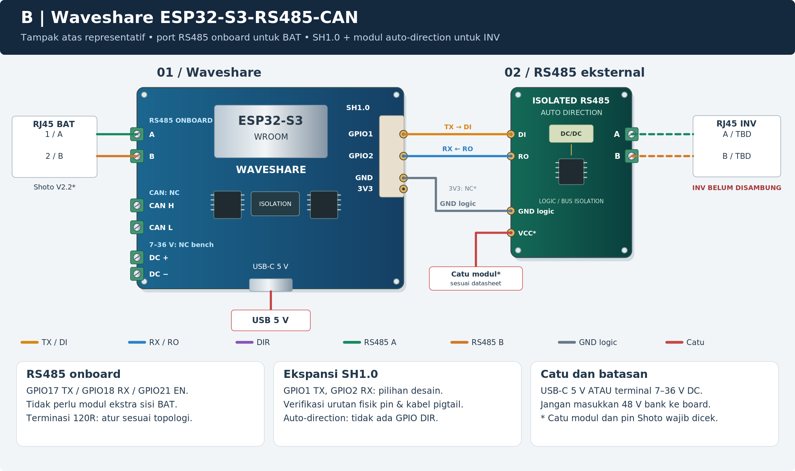
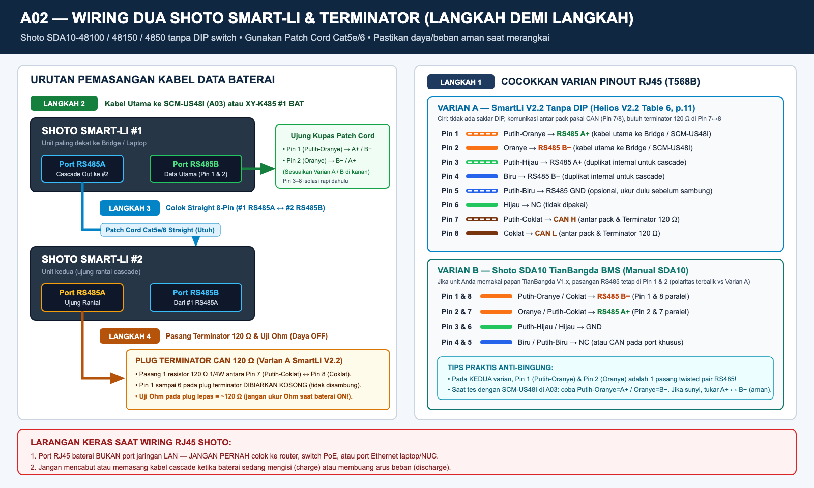

# Panduan Praktis Opsi B (Panel Permanen Terisolasi): Waveshare ESP32-S3-RS485-CAN ↔ Samoto IHF6200 / ILS6300

> **Panduan Induk:** [GUIDE.md](GUIDE.md) · **Jalur BOM Meja Kerja Anda (Opsi A):** [GUIDE-A-DIY.md](GUIDE-A-DIY.md)  
> **Target Sistem:** Inverter **Samoto IHF6200 / ILS6300 (48 VDC)** ↔ **Waveshare ESP32-S3-RS485-CAN (SKU 32154 / 34781)** + **1× Modul RS485 TTL Auto-Direction Terisolasi (`SH1.0`)** ↔ **2× Shoto SmartLi `SDA10-48100 / SDA10-48150 / SDA10-4850` (tanpa DIP switch)**  
> **Status Dokumen:** v3.0 — Diperbarui berdasarkan Reverse Engineering (RE) paket referensi [`reference/2019-07-31  TianBangda LFP MS-ShotoV1.1.exe`](reference/) (`Shoto BMS Modbus V1.2`, `TianBangda Binary .NET`, `YD/T 1363.3 V2.8`), dokumentasi resmi Waveshare ESP32-S3-RS485-CAN, manual Helios V2.2, serta parser Pylontech LV RS485.

---

## Ringkasan Opsi B & Prinsip Faktual

Opsi B dirancang untuk **instalasi panel PLTS permanen 24/7** dengan **isolasi galvanik penuh** pada sisi baterai (port RS485 onboard Waveshare sudah terisolasi) dan **isolasi galvanik tambahan** pada sisi inverter (`GPIO1/2` di header `SH1.0` menuju transceiver RS485 3.3 V terisolasi).

> **Catatan untuk BOM Anda Saat Ini:** Jika saat ini Anda baru menyiapkan **ESP32 DevKit WROOM-32 + 2× XY-K485 + Autonics SCM-US48I + Adaptor 5 V 2 A**, ikuti panduan utama Anda di **[GUIDE-A-DIY.md](GUIDE-A-DIY.md)** terlebih dahulu untuk membuktikan komunikasi di meja kerja! Gunakan **GUIDE-B-WAVESHARE.md** ini apabila Anda membeli/meng-upgrade ke hardware **Waveshare ESP32-S3-RS485-CAN**.

| Kategori | Cakupan di Panduan Ini | Dasar Pembuktian |
|---|---|---|
| **Fakta Terverifikasi RE & Dokumen Resmi** | 4 protokol Shoto/TianBangda (`SHOTO_MODBUS_V12`, `TBD_BINARY`, `TBD_1363`, `SMARTLI_DCDC`), pemetaan pin onboard Waveshare (`GPIO17 TX`, `GPIO18 RX`, `GPIO21 EN/DE`) & header `SH1.0` (`GPIO1/GPIO2/3V3/GND`), pinout RJ45 Shoto Varian A/B, frame Pylontech RS485 `0x61/0x62/0x63`, serta failsafe `safety_core.hpp`. | Disassembly biner `.NET` (`SHA-256: 75d3bdf7...`), PDF `Modbus V1.2` (`SDA10-48100`), DOC `V2.8`, Waveshare wiki/schematic `[S6][S7][S8]`, Helios V2.2 Table 6 `[S3]`, dan unit test C++17 / Python (`tests/bridge_test.cpp`, `tests/test_serial_lab.py`). |
| **Fakta Lapangan Unit Anda (Wajib Uji di Fase B03)** | Varian protokol/baud yang aktif pada Shoto fisik Anda, serta pinout RJ45 & format polling aktual pada port BMS **Samoto IHF6200 / ILS6300** Anda. | **Diukur langsung sebelum sambung ke Waveshare** memakai **Autonics SCM-US48I** (2500 Vrms isolated) + `tools/serial_lab.py`. |

---

## Peta Jalan Langkah demi Langkah (Phase B00 – B09)

```
[B00 Verifikasi Tegangan & Seri] ─▶ [B01 Rakit Waveshare + RS485 Isolasi] ─▶ [B02 Cascade 2 Shoto + Terminator]
               │                                                                      │
               └────────────────────────▶ [B03 Uji & Capture via SCM-US48I] ◀─────────┘
                                                        │
               ┌────────────────────────────────────────┘
               ▼
[B04 Flash Firmware BOARD_WAVESHARE_S3] ─▶ [B05 Cek Keselamatan] ─▶ [B06 Aktifkan Sinkron ke Samoto]
               │
               ▼
[B07 HA Opsional] ─▶ [B08 Commissioning 15 Uji] ─▶ [B09 Panel DIN-Rail & Troubleshooting]
```

**Aturan Keselamatan Keras Sebelum Mulai:**
1. **Pastikan sistem 48 VDC:** `IHF6200` dan `ILS6300` beroperasi pada bank **48 VDC** `[S2]`; jangan pernah menyerikan dua Shoto 48 V (tetap **paralel 48 V**).
2. **Jangan memasukkan 48 VDC (atau 5 V) ke terminal daya `7–36 V DC` Waveshare!** Terminal sekrup `7–36 V` hanya menerima catu terproteksi (mis. `12 V` / `24 V DC` din-rail), dan **jangan menggabungkan `USB-C 5 V` dan `7–36 V` secara bersamaan** kecuali manual revisi board Anda secara eksplisit mengizinkannya `[S6]`.
3. **Port CAN onboard Waveshare dibiarkan KOSONG (NC)** — jangan mencolokkan jalur CAN cascade antar-Shoto ke terminal CAN Waveshare atau ke port CAN inverter sebelum terbukti segmen & protokolnya.

---

## Phase B00 — Identifikasi Perangkat & Kompatibilitas

**Tujuan Phase Ini:** Memastikan kecocokan revisi baterai Shoto SmartLi tanpa DIP switch, model inverter Samoto `IHF6200 / ILS6300`, dan kesiapan proteksi DC eksternal.

1. **Langkah 1 — Catat Identitas Fisik Baterai:** Catat model pada stiker depan kedua unit (`SDA10-48100`, `SDA10-48150`, atau `SDA10-4850`), tegangan nominal (`48 V / 51.2 V`), kapasitas (`Ah`), dan foto panel depan port `RS485A` / `RS485B` (pastikan memang tanpa saklar DIP).
2. **Langkah 2 — Catat Identitas Samoto:** Catat model fisik (`IHF6200` atau `ILS6300`), opsi di LCD **Menu 05** (`PYL` / `LIB` / `LIC`), serta label port RJ45 pada sisi bawah inverter (`BMS / RS485` vs `RS232`).
3. **Langkah 3 — Rencana Proteksi DC:** Pastikan instalasi daya baterai memiliki **DC Breaker / Fuse 48 V**, busbar paralel memadai, dan selisih tegangan antarbaterai `< 0.5 V` sebelum dikopel paralel.

**Gate B00 (Ceklis):**
- [ ] Kedua Shoto dan inverter sama-sama kelas **48 VDC** dan diset paralel (bukan seri).
- [ ] Foto label perangkat & posisi port RJ45 sudah didokumentasikan.

---

## Phase B01 — BOM Khusus, Diagram & Urutan Perakitan Meja Kerja

**Tujuan Phase Ini:** Menyiapkan perangkat keras Opsi B dan merakit sisi Waveshare + modul RS485 eksternal secara bersih tanpa tersambung ke baterai maupun inverter terlebih dahulu.

### B01.1 Daftar Kebutuhan BOM Opsi B

| No. | Komponen & Spesifikasi | Qty | Fungsi |
|---:|---|---:|---|
| 1 | **Waveshare ESP32-S3-RS485-CAN** (`SKU 32154` antena internal / `34781` eksternal) | 1 | MCU ESP32-S3 + port **RS485 onboard terisolasi** (sisi **BAT Shoto**, `GPIO17/18/21`) + terminal `7–36 V` + USB-C `[S6]`. |
| 2 | **Modul TTL-to-RS485 3.3 V Isolated Auto-Direction** (mis. Waveshare *TTL TO RS485 (C)*) | 1 | Transceiver terisolasi kedua untuk sisi **INV Samoto**, tersambung ke konektor ekspansi `SH1.0` (`GPIO1/GPIO2`). |
| 3 | **Autonics SCM-US48I** *(sudah dimiliki)* | 1 | Diagnosa lapangan Fase B03 (2500 Vrms isolated): `autodetect` Shoto & `capture` Samoto. |
| 4 | **Patch cord Cat5e / Cat6** + **Resistor `120 Ω` 1/4 W** + **Konektor RJ45** | Secukupnya | 1 utuh straight 8-pin (cascade), 1 ujung kupas (BAT), 1 ujung kupas (INV setelah B03), 1 plug terminator `120 Ω`. |
| 5 | **Pigtail JST `SH1.0` 4-pin** | 1 | Menyambungkan pin `GPIO1`, `GPIO2`, `3V3`, `GND` dari header `SH1.0` Waveshare ke modul RS485 INV. |
| 6 | **Adaptor USB-C 5 V 2 A + Kabel Data** *(bench)* / **PSU Panel 12–24 V DC** *(permanen)* | 1 | Catu meja kerja lewat USB-C; saat masuk panel permanen pindah ke `7–36 V DC`. |

### B01.2 Diagram & Pemetaan Pin Opsi B



> **File vektor asli:** [`diagrams/waveshare.svg`](diagrams/waveshare.svg)

Pemetaan pin pada firmware [`config.h`](firmware/shoto_samoto_bridge/config.h) (`#define BOARD_WAVESHARE_S3`) cocok persis dengan skematik resmi Waveshare `[S6][S7][S8]`:

| Port / Antarmuka | Pin ESP32-S3 | Koneksi Tujuan | Catatan Penting |
|---|---|---|---|
| **RS485 Onboard (BAT)** | `GPIO17 (TX)`, `GPIO18 (RX)`, `GPIO21 (DE/RE)` | Terminal sekrup onboard `RS485 A+ / B-` → `Shoto #1 RS485B` | Kendali arah hardware lewat `GPIO21` (`BAT_DE_PIN = 21` aktif di `shoto_samoto_bridge.ino`). Cek saklar/jumper terminasi onboard board Anda! |
| **Header `SH1.0` (INV TX)** | `GPIO1` | `TXD / DI` modul RS485 Auto-Direction Terisolasi | UART1 (`INV_UART_NUM = 2`), kabel ke port BMS Samoto **baru dipasang di Fase B06**. |
| **Header `SH1.0` (INV RX)** | `GPIO2` | `RXD / RO` modul RS485 Auto-Direction Terisolasi | Pastikan logika IO modul `3.3 V`, jangan 5 V. |
| **Header `SH1.0` (`GND` & `3V3`)** | `GND`, `3V3` | `GND` & `VCC` sisi logika modul RS485 eksternal | Hanya hubungkan `3V3` jika konsumsi modul RS485 masuk batas regulator board (`< ~200 mA`). |
| **Terminal `CAN H / L`** | `GPIO15 / 16` | **DIBIARKAN KOSONG (NC)** | Tidak dipakai pada konfigurasi RS485 bridge ini. |
| **USB-C (`5 V`)** | Native USB CDC | PC/Laptop saat flash & `Adaptor 5 V 2 A` saat meja kerja | Saat masuk panel `7–36 V`, lepas USB-C dulu. |

### B01.3 Urutan Perakitan di Meja Kerja (6 Langkah Berurutan)

1. **Langkah 1 — Inspeksi Visual & Isolasi Mekanik:** Letakkan board **Waveshare ESP32-S3-RS485-CAN** dan modul RS485 terisolasi pada alas non-konduktif. Pastikan posisi terminal `7–36 V` dan `CAN` dalam keadaan terbuka (tanpa kabel).
2. **Langkah 2 — Cek Urutan Pin Pigtail `SH1.0` 4-Pin (Wajib Multimeter!):** Jangan pernah percaya warna kabel pigtail `JST SH1.0` bawaan toko. Gunakan multimeter mode *continuity* + skematik/silkscreen Waveshare `[S7]` saat kondisi mati untuk melabeli keempat helai kabel: **`3V3`**, **`GPIO1`**, **`GPIO2`**, dan **`GND`**.
3. **Langkah 3 — Sambungkan `SH1.0` ke Modul RS485 Eksternal (Sisi INV):**
   - `SH1.0 3V3` → `VCC` sisi TTL modul RS485 terisolasi
   - `SH1.0 GPIO1` → `TXD / DI` modul RS485 terisolasi
   - `SH1.0 GPIO2` → `RXD / RO` modul RS485 terisolasi
   - `SH1.0 GND` → `GND` sisi TTL modul RS485 terisolasi *(jangan sambung ke GND sisi bus terisolasi!)*
4. **Langkah 4 — Atur Jumper Terminasi RS485 Onboard:** Cek saklar/jumper `120 Ω RS485` pada board Waveshare; letakkan pada posisi sesuai panjang kabel RS485 (umumnya ON hanya jika board menjadi ujung bus RS485 ke Shoto, atau OFF sementara untuk jarak meja `< 1 m`).
5. **Langkah 5 — Uji Catu USB-C Meja Kerja (Tanpa Baterai/Inverter):** Colokkan USB-C `5 V`, ukur tegangan pada terminal logika modul RS485 eksternal (`3.25–3.35 V` di `VCC` & `RXD idle <= 3.35 V`), lalu cabut kembali USB-C.
6. **Langkah 6 — Biarkan Terminal `A+/B-` ke Baterai & ke Samoto Tetap Kosong** sampai **Fase B03 (`SCM-US48I`)** selesai.

**Gate B01 (Ceklis):**
- [ ] Urutan pin `SH1.0` (`GPIO1, GPIO2, 3V3, GND`) sudah diverifikasi dengan multimeter terhadap silkscreen/skematik Waveshare.
- [ ] Tegangan idle `VCC` dan `RXD` modul RS485 eksternal `<= 3.35 V`.
- [ ] Terminal `CAN`, `7–36 V`, dan terminal `A+/B-` ke baterai/Samoto masih lepas.

---

## Phase B02 — Wiring Dua Shoto SmartLi & Terminator (Langkah demi Langkah)

**Tujuan Phase Ini:** Menghubungkan 2 unit **Shoto SmartLi `SDA10-48100 / 48150 / 4850` (tanpa DIP switch)** dalam rantai cascade beserta **Terminator CAN `120 Ω`** agar auto-addressing berjalan stabil.

> **Larangan Keras:** Port RJ45 baterai bukan port Ethernet/PoE; jangan pernah mencolok/mencabut kabel cascade saat baterai sedang charge/discharge aktif, dan jangan men-seri daya 48 V.



> **File vektor asli:** [`diagrams/shoto-cascade.svg`](diagrams/shoto-cascade.svg)

1. **Langkah 1 — Cocokkan Varian Pinout `T568B` (`Pin 1 Putih-Oranye` & `Pin 2 Oranye`):**
   - **Varian A (`SmartLi V2.2 Tanpa DIP` — Helios Table 6, p.11):** `Pin 1 (Putih-Oranye) = RS485 A+`, `Pin 2 (Oranye) = RS485 B-`, `Pin 7 (Putih-Coklat) = CAN H`, `Pin 8 (Coklat) = CAN L`.
   - **Varian B (`SDA10 TianBangda BMS`):** `Pin 1 & 8 = RS485 B-`, `Pin 2 & 7 = RS485 A+`, `Pin 3 & 6 = GND`.
   - *Praktis:* Pada keduanya, sinyal utama selalu di `Pin 1` & `Pin 2` (`Putih-Oranye` & `Oranye`). Isolasi rapi `Pin 3–8` pada ujung kabel kupas yang menuju bridge.
2. **Langkah 2 — Kabel Utama dari `Shoto #1 RS485B`:** Colokkan Patch Cord Cat5e/6 berujung kupas (`Pin 1 & Pin 2`) ke port **`RS485B`** pada **Shoto #1** *(ujung kupasnya di Fase B03 akan masuk ke `SCM-US48I` lebih dulu)*.
3. **Langkah 3 — Kabel Cascade `#1 RS485A ↔ #2 RS485B`:** Gunakan **Patch Cord Cat5e/6 Straight 8-pin Utuh** *(wajib ke-8 kabel tersambung 1-to-1)*. Hubungkan `Shoto #1 RS485A` → `Shoto #2 RS485B`.
4. **Langkah 4 — Buat, Ukur & Pasang Terminator `120 Ω` pada `Shoto #2 RS485A`:**
   - Hubungkan 1 resistor `120 Ω` (1/4 W) antara **`Pin 7 (Putih-Coklat)` ↔ `Pin 8 (Coklat)`** pada konektor RJ45 tersendiri; biarkan **Pin 1–6 kosong**.
   - **Uji Ohm saat plug masih lepas** dengan multimeter → pastikan terbaca **`~120 Ω`**.
   - Colokkan ke **`Shoto #2 RS485A`**, lalu nyalakan kedua baterai (`RUN` aktif, tanpa `ALM`).

**Gate B02 (Ceklis):**
- [ ] Cascade `Shoto #1 RS485A ↔ Shoto #2 RS485B` menggunakan kabel straight 8-pin penuh.
- [ ] Terminator di `Shoto #2 RS485A` terukur `~120 Ω` pada Pin 7↔8 (saat lepas) dan Pin 1–6 kosong.
- [ ] Kedua baterai menyala sehat (`RUN` aktif).

---

## Phase B03 — Uji Faktual & Capture Lapangan dengan `Autonics SCM-US48I`

**Tujuan Phase Ini:** Membuktikan 100% faktual protokol Shoto fisik Anda dan pinout/polling BMS Samoto menggunakan **`Autonics SCM-US48I`** sebelum mengaktifkan Waveshare.

1. **Langkah 1 — Siapkan Tool Python & Uji Unit Test Bawaan:**
   ```bash
   pip install pyserial
   python3 -m unittest discover -s tests -v
   ```
   *(Wajib tampil `Ran 7 tests ... OK`).* Sambungkan `SCM-US48I` ke laptop (macOS `/dev/cu.usbserial-*`, Linux `/dev/ttyUSB*`, Windows `COMx`).
2. **Langkah 2 — Auto-Detect Protokol Shoto (`autodetect`):**
   - Hubungkan ujung kupas kabel dari `Shoto #1 RS485B` ke `SCM-US48I`: `Pin 1 (Putih-Oranye) → A(+)`, `Pin 2 (Oranye) → B(-)`.
   - Jalankan pemindaian read-only terhadap ke-4 protokol hasil RE (`SHOTO_MODBUS_V12`, `TBD_BINARY`, `TBD_1363`, `SMARTLI_DCDC`):
     ```bash
     python3 tools/serial_lab.py autodetect --port /dev/cu.usbserial-XXXX
     ```
   - Jika `[NO REPLY]`, **tukar `A(+) ↔ B(-)`** *(ciri Varian B TianBangda)* lalu ulangi. Setelah ketemu, cek detail 1 vs 2 pack:
     ```bash
     python3 tools/serial_lab.py probe --port /dev/cu.usbserial-XXXX --baud 9600 --ids 38,39,1,2 --detail
     ```
   - Catat: **Protokol**, **Baud**, **Polaritas A/B**, dan **ID yang menjawab**.
3. **Langkah 3 — Capture Frame Asli Port BMS Samoto (`IHF6200 / ILS6300`):**
   - **Lepas `SCM-US48I` dari baterai terlebih dahulu.**
   - Set **LCD Menu `05`** di Samoto ke **`PYL`** *(atau `LIB`/`LIC` jika opsi itu yang tersedia)*; abaikan bila `Warning 61` muncul karena kabel bridge belum terpasang.
   - Uji kabel kupas dari port **`BMS / RS485` Samoto** ke `SCM-US48I` dimulai dari kandidat #1 (`Pin 5 Putih-Biru → A(+)`, `Pin 3 Putih-Hijau → B(-)`):
     ```bash
     python3 tools/serial_lab.py capture --port /dev/cu.usbserial-XXXX --baud 9600 --seconds 45 --out data/samoto_capture.log
     python3 tools/serial_lab.py decode data/samoto_capture.log
     ```
   - Jika masih `0 bytes`, coba tukar `A(+) ↔ B(-)`, lalu kandidat `Pin 7/8` atau `Pin 1/2` hingga frame polling Samoto (`~200146...` atau polling BMS lainnya) terekam dan ter-decode.
   - **Lepas kembali kabel sementara dari port BMS Samoto.**

**Gate B03 (Ceklis):**
- [ ] `autodetect` & `probe` berhasil membaca Shoto fisik Anda (protokol, baud, polaritas, jumlah ID tercatat).
- [ ] `capture` & `decode` berhasil membuktikan pinout & frame asli port BMS Samoto Anda.

---

## Phase B04 — Flash Firmware Ready-to-Use ke Waveshare ESP32-S3

**Tujuan Phase Ini:** Mem-flash [`firmware/shoto_samoto_bridge/shoto_samoto_bridge.ino`](firmware/shoto_samoto_bridge/shoto_samoto_bridge.ino) dalam mode Waveshare ESP32-S3 (`#define BOARD_WAVESHARE_S3`) dan menguji pembacaan langsung ke baterai lewat terminal RS485 onboard.

### B04.1 Langkah 1 — Edit [`firmware/shoto_samoto_bridge/config.h`](firmware/shoto_samoto_bridge/config.h)

1. **Aktifkan Board Waveshare ESP32-S3:** Buka [`config.h`](firmware/shoto_samoto_bridge/config.h), beri komentar/biarkan `#ifndef BOARD_WAVESHARE_S3` dan **hapus tanda `//` di depan `#define BOARD_WAVESHARE_S3`**:
   ```cpp
   // #define BOARD_DIY_XY_K485
   #define BOARD_WAVESHARE_S3
   ```
   *(Catatan: Jika memakai PlatformIO env `waveshare_esp32s3`, `-DBOARD_WAVESHARE_S3` sudah diset otomatis dari [`platformio.ini`](firmware/shoto_samoto_bridge/platformio.ini)).*
2. **Sesuaikan Hasil B03:** Biarkan `SHOTO_PROTOCOL PROTO_AUTO` (atau kunci ke protokol hasil B03), atur `SHOTO_BAUD` (`9600`), serta atur `PACK_COUNT` (`1` atau `2`) dan `PACK1_ADDR` / `PACK2_ADDR` sesuai jumlah ID yang menjawab di B03.
3. **Biarkan Mode Aman Default:** Pastikan `BRIDGE_MODE = MODE_MONITOR_ONLY` (`0`) dan `POLICY_USER_APPROVED = false` belum diubah dulu.

### B04.2 Langkah 2 — Flash Firmware (Pilih Salah Satu Cara)

#### Cara A (Arduino IDE 2.x — Paling Mudah)
1. Install board **`esp32` by Espressif Systems** via *Boards Manager*.
2. Buka [`firmware/shoto_samoto_bridge/shoto_samoto_bridge.ino`](firmware/shoto_samoto_bridge/shoto_samoto_bridge.ino).
3. Menu *Tools*:
   - **Board:** `ESP32S3 Dev Module`
   - **USB CDC On Boot:** **`Enabled`** *(Wajib Enabled agar `Serial` monitor muncul lewat USB-C Waveshare!)*
   - **Port:** pilih port USB-C Waveshare ESP32-S3.
4. Klik **Upload (`→`)**. *(Jika gagal sync, tahan tombol `BOOT`, tekan `RESET` sebentar, lalu lepas `BOOT`).*
5. Buka Serial Monitor pada **`115200`** baud (`Newline`).

#### Cara B (PlatformIO CLI)
```bash
cd firmware/shoto_samoto_bridge
pio run -e waveshare_esp32s3 -t upload
pio device monitor -b 115200
```

#### Cara C (Alternatif Home Assistant / ESPHome Reader)
- Untuk `Shoto Modbus V1.2` (`SDA10-48100`, addr `38`/`39`, onboard RS485 `GPIO17/18/21`): gunakan [`firmware/waveshare-reader-modbus-v12.yaml`](firmware/waveshare-reader-modbus-v12.yaml).
- Untuk `SmartLi DC/DC`: gunakan [`firmware/waveshare-reader.yaml`](firmware/waveshare-reader.yaml) beserta [`firmware/secrets.example.yaml`](firmware/secrets.example.yaml).
- *Catatan:* Firmware utama untuk sinkronisasi real-time ke Samoto tetap [`shoto_samoto_bridge.ino`](firmware/shoto_samoto_bridge/shoto_samoto_bridge.ino).

### B04.3 Langkah 3 — Hubungkan Baterai ke RS485 Onboard Waveshare & Uji CLI

1. Lepas USB-C Waveshare, pasang kabel dari `Shoto #1 RS485B` (`Pin 1 & 2`) ke terminal sekrup **RS485 Onboard Waveshare (`A+`, `B-`)** sesuai polaritas terbukti B03. *(Kabel ke Samoto pada modul RS485 `SH1.0` masih lepas!).*
2. Colok kembali USB-C ke PC, buka Serial Monitor `115200`, lalu ketik **`status`** dan **`cells`**:
   ```text
   Proto=SHOTO_MODBUS_V12 | Bridge=MONITOR_ONLY | PolicyApproved=NO | BankValid=INHIBIT
   Bank: V=52.14V I=0.00A SOC=68.5% SOH=100.0% CVL=54.40V DVL=46.00V CCL=0.0A DCL=0.0A
     Pack#1 (addr=38): age=420ms V=52.14V I=0.00A SOC=68.5% prot=0x0000 fault=0x00
   ```
   *(Wajar `BankValid=INHIBIT` dan `CCL=0.0A` selama `PolicyApproved=NO` — yang terpenting `V`, `SOC`, `cells` mV terbaca akurat dan `age` selalu `< 2500ms`!).*

**Gate B04 (Ceklis):**
- [ ] Firmware berhasil di-flash dengan target `BOARD_WAVESHARE_S3` dan `USB CDC On Boot: Enabled`.
- [ ] Perintah `status` dan `cells` di Serial Monitor `115200` membaca baterai Shoto secara live & akurat.

---

## Phase B05 — Uji Isolasi & Kebijakan Keselamatan Sebelum Sambung Samoto

**Tujuan Phase Ini:** Memvalidasi isolasi galvanik dua sisi dan parameter proteksi di `config.h` sebelum menutup loop ke inverter Samoto.

1. **Langkah 1 — Verifikasi Isolasi Sisi Baterai vs Logic Waveshare:** Dengan baterai tersambung ke terminal `RS485 Onboard A+/B-`, pastikan modul RS485 onboard benar-benar terisolasi (tidak menghubungkan `GND` USB/logika ke negatif baterai 48 V).
2. **Langkah 2 — Verifikasi Isolasi & Logika Modul RS485 Eksternal (`SH1.0`):** Pastikan `SH1.0 GND` tidak tersambung ke bus-side GND modul RS485 eksternal, dan modul mampu merilis bus otomatis setelah stop bit terakhir tanpa menahan TX saat boot (`UART1 TX = GPIO1`).
3. **Langkah 3 — Cek Parameter `config.h` Terhadap Output `cells`:**
   - Cek apakah baterai Anda `15S` atau `16S` dari perintah **`cells`** (`C1=... C15=...`).
   - Pastikan nilai konservatif `POLICY_CVL_MAX_V` (`54.4f`), `POLICY_DVL_MIN_V` (`46.0f`), `POLICY_CCL_CAP_A` (`50.0f`), `POLICY_DCL_CAP_A` (`80.0f`), `POLICY_MAX_DELTA_V` (`1.0f`), dan `POLICY_FRESHNESS_MS` (`5000UL`) sesuai batas aman sistem.

**Gate B05 (Ceklis):**
- [ ] Tidak ada kontinuitas / ground loop antara `GND` logic ESP32-S3, sisi baterai 48 V, dan sisi bus inverter.
- [ ] Jumlah seri sel (`15S`/`16S`) terkonfirmasi via `cells`; batas `CVL/DVL/CCL/DCL` sudah diverifikasi.

---

## Phase B06 — Aktifkan Sinkronisasi Bridge ke Samoto IHF6200 / ILS6300

**Tujuan Phase Ini:** Mengaktifkan respon Pylontech LV RS485 di `shoto_samoto_bridge.ino` dan memastikan parameter Shoto terbaca presisi di LCD Samoto.

1. **Langkah 1 — Aktifkan Bridge di [`config.h`](firmware/shoto_samoto_bridge/config.h) & Upload Ulang:**
   ```cpp
   #define BRIDGE_MODE           MODE_BRIDGE_ACTIVE
   #define POLICY_USER_APPROVED  true
   ```
   Flash ulang (`Arduino IDE` atau `pio run -e waveshare_esp32s3 -t upload`).
2. **Langkah 2 — Sambung Terminal Bus Modul RS485 Eksternal (`SH1.0`) ke Port BMS Samoto:**
   Pasang kabel Patch Cord ke port **`BMS / RS485` Samoto** sesuai **pinout & polaritas `A(+)`/`B(-)` yang sudah terbukti di Fase B03**.
3. **Langkah 3 — Verifikasi LCD Samoto & Serial Monitor:**
   - Pastikan **Menu `05` Samoto** berada pada **`PYL`** *(atau `LIB` sesuai B03)*.
   - Dalam `<= 15 detik`, **`Warning 61` pada LCD Samoto menghilang**.
   - Ketik **`status`** di Serial Monitor → pastikan muncul `Bridge=ACTIVE | PolicyApproved=YES | BankValid=YES` serta `CCL > 0` dan `DCL > 0`, sementara log 5-detik `[BAT ...]` menunjukkan counter `INV rx=... tx=...` terus bertambah.
   - Cocokkan angka **SOC (%)**, **Batt Voltage (V)**, dan **arah arus charge/discharge** pada LCD Samoto dengan hasil `status` (selisih `SOC <= 2%`, `V <= 0.5 V`). Ketik **`raw`** jika perlu memantau frame `[INV RX]` / `[INV TX]` real-time.

**Gate B06 (Ceklis):**
- [ ] `Warning 61` hilang; `INV rx` dan `INV tx` meningkat stabil.
- [ ] Parameter SOC, tegangan pack, arah arus, dan proteksi aktif tersinkron di LCD Samoto IHF6200 / ILS6300.

---

## Phase B07 — Integrasi Home Assistant (Opsional)

- Rekomendasi utama panel 24/7: pertahankan Waveshare utama **khusus** menjalankan `shoto_samoto_bridge.ino` tanpa ketergantungan Wi-Fi/OTA agar sinkronisasi ke Samoto kebal dari restart jaringan.
- Jika ingin membaca ke Home Assistant sebagai monitoring terpisah, gunakan [`firmware/waveshare-reader-modbus-v12.yaml`](firmware/waveshare-reader-modbus-v12.yaml) atau [`firmware/waveshare-reader.yaml`](firmware/waveshare-reader.yaml).

**Gate B07 (Ceklis):**
- [ ] (Opsional) Integrasi HA tidak mengganggu determinisme tugas bridge RS485 ke Samoto.

---

## Phase B08 — Commissioning Wajib (T01 – T15)

Jalankan 15 pemeriksaan yang sama seperti Opsi A pada instalasi Opsi B:

| ID | Pengujian | Kriteria Lulus |
|---|---|---|
| **T01–T03** | Deteksi protokol + `status` Pack #1/(#2) + `cells` mV | Protokol cocok B03 `< 5 dtk`; semua sel (15S/16S) di `2900–3600 mV` |
| **T04–T06** | Handshake Samoto & kecocokan LCD (`SOC` & `Vpack`) | `Error 61` hilang `<= 15 dtk`; beda `SOC <= 2%`, beda `V <= 0.5 V` |
| **T07–T08** | Arah arus **Charging** (`+A`) & **Discharging** (`-A`) | Tanda dan nilai arus di `status` konsisten saat isi & saat beban |
| **T09–T10** | Cabut kabel `Shoto #1 RS485B` (**Fail-Closed**) & colok ulang (**Auto-Recovery**) | Dalam `<= 5 dtk` saat cabut → `BankValid=INHIBIT`, `CCL=0.0A, DCL=0.0A`; pulih `< 3 dtk` saat colok ulang |
| **T11** | Uji `Vdelta` 2 pack *(jika `PACK_COUNT=2`)* | Jika `|V1 - V2| > 1.0 V` memicu inhibit `CCL=0 / DCL=0` |
| **T12–T15** | Ketahanan watchdog 1 jam, reboot bridge, beban bertahap 50–70%, suhu 2 jam | Zero WDT reset/crash, reconnect otomatis, enclosure aman (`< 45 °C`) |

**Gate B08 (Ceklis):**
- [ ] T01–T15 seluruhnya lulus 100%.

---

## Phase B09 — Pemasangan Panel Permanen DIN-Rail & Troubleshooting

### B09.1 Pemasangan Panel 24/7 yang Rapi & Aman
1. Pasang Waveshare dan modul RS485 `SH1.0` dalam **enclosure DIN-rail** berventilasi; pindahkan catu ke PSU panel terproteksi **`12 V` / `24 V DC`** pada terminal `7–36 V` (**lepas USB-C sebelum menutup panel!**).
2. Beri label permanen pada setiap kabel: `BAT RS485 (Shoto #1)`, `CASCADE (#1↔#2)`, `TERMINATOR 120Ω`, `INV BMS (Samoto)`, dan `PSU 12/24V`.
3. Jaga jarak kabel data RS485 minimal **15 cm** dari kabel busbar `48 V DC` dan kabel AC 220 V inverter.

### B09.2 Tabel Troubleshooting Opsi B

| Gejala | Penyebab Terbanyak | Langkah Perbaikan |
|---|---|---|
| Onboard RS485 (`BAT`) `NO REPLY` | 1) Polaritas `A+/B-` Varian A/B tertukar<br>2) Pin `GPIO21 DE/RE` tidak tersambung / board butuh terminasi ON<br>3) Baterai sleep | 1) Tukar `A+ ↔ B-` di terminal onboard<br>2) Cek `BOARD_WAVESHARE_S3` aktif di `config.h` + saklar `120 Ω` onboard<br>3) Bangunkan BMS baterai |
| `BAT` terbaca normal, tapi Samoto tetap **`Warning 61`** | 1) Urutan kabel pigtail `SH1.0` (`GPIO1 TX / GPIO2 RX`) tertukar<br>2) `A+/B-` ke Samoto terbalik<br>3) Modul auto-direction menahan bus terlalu lama | 1) Cek ulang pin `SH1.0` sesuai skematik `[S7]`; coba tukar `TXD/RXD` di modul eksternal<br>2) Verifikasi pinout Samoto via `SCM-US48I`<br>3) Ketik **`raw`** di Serial Monitor untuk melihat apakah `[INV RX]` masuk |
| USB Serial Monitor kosong di Arduino IDE | `USB CDC On Boot` belum diaktifkan saat compile `ESP32S3` | Di *Tools → USB CDC On Boot* pilih **`Enabled`** lalu upload ulang (atau pakai `pio run -e waveshare_esp32s3`) |
| `PACK_COUNT=2` hanya muncul Pack #1 | Cascade kabel straight putus sebagian / terminator `Pin 7↔8` salah / unit menyatukan di Master ID | Ukur ohm plug terminator lepas (`~120 Ω`), pastikan kabel 8-pin penuh, cek hasil `probe` B03 |

---

## Lampiran Bukti RE & Dokumen Rujukan

| Sumber | Hash / Identitas | Fakta Kunci yang Dipakai |
|---|---|---|
| `TianBangda LFP MS-ShotoV1.1.634-26.exe` | SHA-256 `75d3bdf71d42923e2aa8ef86b89491d878593dc1a982cac6f1c05221db66ac84` | `Form1::check`, `TBD_BINARY` (`56+2×N_cells`, `(30000-raw)/100`), `getcrc16checkcode`. |
| `Shoto BMS Modbus V1.2_EN-20190110.pdf` | `SDA10-48100` (11 hal.) | Modbus FC `0x04` reg `0x0FFF..0x1025`, `9600 8N1`, Note 3 charge negatif `(raw-10000)×0.1`. |
| `BMS Communication Protocol_V2_8_180807.doc` | YD/T 1363.3 ASCII | `VER=26, ADR=00, CID1=46` (`~26004642E00201FD30\r`). |
| Dokumen Resmi & Skematik Waveshare | `[S6][S7][S8]` | RS485 onboard (`GPIO17/18/21`), CAN (`GPIO15/16`), `SH1.0` (`GPIO1/2/3V3/GND`), supply `7–36 V` vs USB-C `5 V`. |
| Shoto Helios V2.2 & Samoto Specs | `[S1][S2][S3]` | Table 6 p.11 (Varian A + terminator `120 Ω` Pin 7↔8), Samoto Menu 05 `PYL`/`LIB` + `Error 61`. |
| Parser Pylontech LV RS485 | `[S5]` | `0x61/0x62/0x63` & `0x42/0x44/0x47/0x4F/0x51/0x92` (diperbaiki di `bridge_protocols.hpp`). |

[S1]: https://samoto.co.id/products/ihf-3000/
[S2]: https://samoto.co.id/products/ihf-6200/
[S3]: https://heliosps.com/wp-content/uploads/2024/12/Helios-Manual-Smart-lithium-battery-V2.2.pdf
[S4]: https://github.com/hpeyerl/esphome-shoto-smartli
[S5]: https://github.com/Fahmula/esphome-pylontech-rs485
[S6]: https://docs.waveshare.com/ESP32-S3-RS485-CAN
[S7]: https://files.waveshare.com/wiki/ESP32-S3-RS485-CAN/ESP32-S3-RS485-CAN-Schematic.pdf
[S8]: https://docs.waveshare.com/ESP32-S3-RS485-CAN/Resources-And-Documents
[S9]: https://github.com/G414ng/Techfine-Samoto-MPPT
[S10]: https://github.com/Qu33zZ/esphome-yambms
[S11]: https://github.com/Qu33zZ/esphome-yambms/blob/main/documents/README/Board_Waveshare_ESP32-S3-RS485-CAN.md
[S12]: https://github.com/ai-republic/bms-to-inverter
[S13]: https://esphome.io/components/uart/
[S14]: https://esphome.io/components/modbus_controller/
