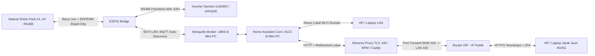

# Panduan Lengkap Step-by-Step: Integrasi BMS Shoto <-> Samoto ke Home Assistant (Mini PC + LAN + IP Publik)

Panduan ini menjelaskan langkah demi langkah dari nol sampai sistem siap dipantau dan dikontrol 24/7 melalui **Home Assistant** di **Mini PC** — baik saat Anda berada di rumah (**jaringan lokal/LAN**) maupun dari luar kota (**jarak jauh via IP Publik** menggunakan *port forwarding* router yang aman).

> [!IMPORTANT]
> **Prinsip Keselamatan Utama:**
> 1. **100% Read-Only ke BMS Shoto:** ESP32 dan Home Assistant **tidak pernah** menulis/mengubah setting internal EEPROM baterai Shoto.
> 2. **Inverter Tetap Prioritas Utama:** Komunikasi RS485 ke inverter Samoto (`ILS6300` / `IHF6200` / `ILS3600`) berjalan di jalur terpisah (`Core 1`). Jika Wi-Fi atau Mini PC mati, **bridge inverter tetap berjalan normal tanpa putus beban**.
> 3. **Akses IP Publik Wajib HTTPS (Port `443` saja):** Jangan pernah membuka langsung port `8123` (HTTP polos) atau `1883` (MQTT) ke internet.

---

## Daftar Isi
- [Bab 1: Gambaran Umum & Arsitektur Sistem](#bab-1-gambaran-umum--arsitektur-sistem)
- [Bab 2: Persiapan Hardware, Jaringan & IP Publik](#bab-2-persiapan-hardware-jaringan--ip-publik)
- [Bab 3: Instalasi Home Assistant di Mini PC](#bab-3-instalasi-home-assistant-di-mini-pc)
- [Bab 4: Instalasi & Konfigurasi Mosquitto MQTT Broker](#bab-4-instalasi--konfigurasi-mosquitto-mqtt-broker)
- [Bab 5: Konfigurasi & Flash Firmware ESP32 Bridge (Mode Home Assistant)](#bab-5-konfigurasi--flash-firmware-esp32-bridge-mode-home-assistant)
- [Bab 6: Setup Dashboard Lengkap & Function Action Menu](#bab-6-setup-dashboard-lengkap--function-action-menu)
- [Bab 7: Setup Akses Jarak Jauh via IP Publik & Port Forwarding Router](#bab-7-setup-akses-jarak-jauh-via-ip-publik--port-forwarding-router)
- [Bab 8: Pengujian End-to-End, Notifikasi HP & Troubleshooting](#bab-8-pengujian-end-to-end-notifikasi-hp--troubleshooting)

---

## Bab 1: Gambaran Umum & Arsitektur Sistem

### Alur Data Sistem



### Istilah Penting yang Perlu Dipahami
| Istilah | Arti Sederhana |
|---|---|
| **Home Assistant (HA)** | Server pemantau & otomatisasi rumah/PLTS yang diinstal di Mini PC. |
| **MQTT & Auto-Discovery** | Protokol pesan ringan untuk ESP32 mengirim puluhan sensor (tegangan sel, SOC, parameter EEPROM) sehingga otomatis muncul di HA tanpa input manual satu per satu. |
| **Mosquitto Broker** | "Kantor pos" MQTT lokal di Mini PC tempat ESP32 dan Home Assistant bertukar data. |
| **Reverse Proxy (NPM / Caddy)** | Penjaga pintu depan berbasis HTTPS yang mengenkripsi trafik internet masuk ke port `443` sebelum diteruskan secara lokal ke HA (`8123`). |
| **Port Forwarding (NAT)** | Aturan di router ISP untuk mengarahkan koneksi dari **IP Publik** di internet menuju Mini PC di jaringan rumah. |
| **2FA (Two-Factor Auth)** | Kode OTP 6 digit dari aplikasi HP (Google Authenticator / Authy) agar akun tidak bisa dibobol meski password bocor. |
| **Maintenance Unlock** | Pengaman 2 langkah di dashboard HA supaya tombol sensitif (seperti *Restart ESP32* atau ubah batas arus `CCL/DCL`) tidak kepencet tidak sengaja dari HP. Otomatis mengunci lagi dalam 5 menit. |

---

## Bab 2: Persiapan Hardware, Jaringan & IP Publik

### Checklist Persiapan
- [ ] **Mini PC x86_64** (Intel N100/Celeron/i3/i5 atau Ryzen, minimal RAM `4 GB`, SSD `32 GB+`, **wajib terhubung ke router via kabel LAN RJ45** agar stabil 24/7).
- [ ] **Flashdisk USB minimal `8 GB`** + laptop/PC untuk membuat installer Home Assistant.
- [ ] **ESP32 Bridge** yang sudah terpasang kabel RS485 ke baterai Shoto & inverter Samoto (mengacu [wiring diagram aktual](file:///Users/opusoctopus/Downloads/shoto_samoto_bridge/diagrams/diy-xy-k485.png)), dalam jangkauan sinyal **Wi-Fi 2.4 GHz** yang stabil.
- [ ] **IP Publik aktif dari ISP** + login admin Router ISP (Mikrotik / Huawei ONT / ZTE / TP-Link).
- [ ] *(Sangat Disarankan)* Nama **domain / subdomain** atau akun gratis **DuckDNS** (`namapltssaya.duckdns.org`) yang diarahkan ke IP Publik agar sertifikat HTTPS (gembok hijau browser) terbit otomatis dan aplikasi HP Android/iOS berfungsi tanpa error sertifikat.

### Kunci IP LAN Statis (DHCP Reservation) di Router
Sebelum instalasi, siapkan alamat IP tetap di jaringan lokal agar tidak pernah berubah saat listrik/router restart:

1. Login ke halaman admin router Anda (biasanya `192.168.1.1` atau `192.168.0.1`).
2. Masuk ke menu **LAN → DHCP Server / Address Reservation / Static Lease**.
3. Daftarkan MAC Address **Mini PC (port LAN Ethernet)** ke IP tetap, misalnya:
   - **Mini PC Home Assistant:** `192.168.10.250` *(gunakan IP contoh ini atau sesuaikan subnet router Anda di seluruh panduan)*
4. Setelah ESP32 menyala nanti, daftarkan juga MAC Address Wi-Fi **ESP32 Bridge** ke IP tetap, misalnya:
   - **ESP32 Bridge #1 (`IHF6200`):** DHCP atau IP statis mis. `192.168.10.61`
   - **ESP32 Bridge #2 (`ILS6300`, jika ditambah nanti):** DHCP atau IP statis mis. `192.168.10.62`

---

## Bab 3: Instalasi Home Assistant di Mini PC

Ada 2 cara instalasi. **Pilih Opsi A (HAOS)** jika Mini PC khusus didedikasikan sebagai server Home Assistant (paling stabil, ada *Add-on Store* 1 klik).

### Opsi A (Direkomendasikan): Home Assistant OS (HAOS) Bare-Metal

#### 1. Siapkan BIOS Mini PC
Sambungkan monitor & keyboard ke Mini PC, nyalakan lalu tekan `DEL` / `F2` masuk ke BIOS:
- **Boot Mode:** `UEFI` *(matikan Legacy/CSM)*.
- **Secure Boot:** `Disabled`.
- **Restore on AC Power Loss / Auto Power On:** `Power On` *(**Sangat Penting** untuk sistem PLTS agar Mini PC otomatis menyala sendiri setelah pemadaman atau maintenance MCB)*.
- Simpan & keluar BIOS (`Save & Exit`).

#### 2. Buat USB Live Installer & Flash HAOS ke SSD Mini PC
1. Di laptop Anda, download **Ubuntu Desktop ISO** dan **BalenaEtcher** (`https://etcher.balena.io/`).
2. Flash Ubuntu ISO ke flashdisk USB menggunakan BalenaEtcher, lalu colokkan USB ke Mini PC dan boot dari USB (*Try Ubuntu*).
3. Di dalam Ubuntu Mini PC, buka browser dan download image resmi **Home Assistant OS Generic x86-64** (`haos_generic-x86-64-xx.img.xz`) dari:
   `https://www.home-assistant.io/installation/generic-x86-64`
4. Buka aplikasi **Disks** (`gnome-disks`) di Ubuntu:
   - Pilih **SSD internal Mini PC** (periksa ukuran disk dengan teliti, jangan sampai salah pilih flashdisk USB!).
   - Klik ikon titik tiga di kanan atas → **Restore Disk Image...** → pilih file `haos_generic-x86-64-xx.img.xz` → klik **Start Restoring**.
5. Setelah selesai, **Shutdown**, cabut flashdisk USB, lalu nyalakan ulang Mini PC dengan kabel LAN terpasang.

#### 3. Onboarding Awal Home Assistant
1. Tunggu 3–5 menit hingga Mini PC selesai inisialisasi pertama.
2. Dari laptop/HP di Wi-Fi rumah yang sama, buka browser ke:
   `http://192.168.10.250:8123` *(atau `http://homeassistant.local:8123`)*.
3. Buat **Nama, Username, dan Password Admin yang kuat** (kombinasi huruf besar/kecil, angka, simbol — karena nanti bisa diakses dari internet!).
4. Atur lokasi rumah, zona waktu (`Asia/Jakarta`), dan mata uang (`IDR`).
5. **Wajib Aktifkan 2FA (Two-Factor Authentication):**
   - Klik profil nama Anda (pojok kiri bawah dashboard HA) → tab **Security** → aktifkan **Authenticator app (TOTP)** → scan QR code pakai **Google Authenticator / Aegis / Authy** di HP Anda.

---

### Opsi B (Alternatif): Docker Compose di Ubuntu/Debian Server
Gunakan opsi ini **hanya jika** Mini PC sudah menjalankan Ubuntu/Debian untuk aplikasi lain:

1. Pastikan Docker Engine & Docker Compose plugin sudah terpasang di Mini PC.
2. Salin direktori konfigurasi [homeassistant/](file:///Users/opusoctopus/Downloads/shoto_samoto_bridge/homeassistant/docker-compose.yml) dari repo ini ke `/opt/shoto-ha/` di Mini PC.
3. Salin `/opt/shoto-ha/.env.example` menjadi `/opt/shoto-ha/.env` lalu sesuaikan password/domain.
4. Jalankan stack:
   ```bash
   cd /opt/shoto-ha
   docker compose up -d
   ```
5. Buka `http://192.168.10.250:8123` dan selesaikan onboarding + aktifkan 2FA sama seperti langkah Opsi A.

*(Catatan: Pada Opsi B Docker, layanan add-on tidak ada di UI HA karena Mosquitto & Reverse Proxy Caddy sudah langsung berjalan sebagai container di `docker-compose.yml`.)*

---

## Bab 4: Instalasi & Konfigurasi Mosquitto MQTT Broker

*(Jika Anda memakai **Opsi A HAOS**, ikuti langkah di bawah ini.)*

1. Di Home Assistant, buka **Settings → Add-ons → Add-on Store** (kanan bawah).
2. Cari dan klik **Mosquitto broker** → klik **Install** → tunggu selesai, lalu **Start** dan aktifkan **Start on boot** + **Watchdog**.
3. Buat **user khusus untuk ESP32 Bridge** agar tidak memakai akun admin utama:
   - Buka **Settings → People → Users** *(aktifkan **Advanced Mode** di profil Anda jika menu Users belum terlihat)* → **Add User**.
   - Isi Name: `Shoto Bridge`, Username: `shoto_bridge`, Password: `<buat password kuat khusus MQTT>`, centang **Local access only** → **Create**.
4. Aktifkan integrasi **MQTT** di Home Assistant:
   - Buka **Settings → Devices & Services → Integrations**.
   - Jika kartu **MQTT** sudah muncul otomatis, klik **Configure → Submit**.
   - Jika belum muncul, klik **+ Add Integration** → cari `MQTT` → isi:
     - Broker: `core-mosquitto` *(untuk HAOS)* atau `127.0.0.1`
     - Port: `1883`
     - Username & Password: isi akun `shoto_bridge` yang baru dibuat.

> [!TIP]
> Port `1883` hanya dipakai komunikasi internal antara ESP32 dan Mini PC di Wi-Fi/LAN rumah. **Jangan di-port-forward ke internet.**

---

## Bab 5: Konfigurasi & Flash Firmware ESP32 Bridge (Mode Home Assistant)

### 1. Siapkan Kredensial Wi-Fi & MQTT (`secrets.h`)
1. Masuk ke folder firmware [firmware/shoto_samoto_bridge/](file:///Users/opusoctopus/Downloads/shoto_samoto_bridge/firmware/shoto_samoto_bridge/shoto_samoto_bridge.ino).
2. Salin berkas contoh `secrets.h.example` menjadi `secrets.h`:
   ```cpp
   #define WIFI_SSID       "NAMA_WIFI_RUMAH_24GHZ"
   #define WIFI_PASS       "PASSWORD_WIFI_ANDA"
   #define MQTT_HOST       "192.168.10.250"   // IP LAN statis Mini PC
   #define MQTT_PORT       1883
   #define MQTT_USER       "shoto_bridge"
   #define MQTT_PASS       "PASSWORD_MQTT_YANG_DIBUAT_DI_BAB_4"
   #define OTA_PASS        "PASSWORD_OTA_OPSIONAL"
   ```
   *(File `secrets.h` otomatis diabaikan oleh `.gitignore` sehingga kredensial Wi-Fi/MQTT Anda tidak akan ikut ter-upload ke Git.)*

### 2. Aktifkan Profil Unit & Mode Home Assistant di `config.h`
Buka [config.h](file:///Users/opusoctopus/Downloads/shoto_samoto_bridge/firmware/shoto_samoto_bridge/config.h). Cukup pilih **profil unit inverter** sebelum klik Upload:

- **Untuk ESP32 #1 — Samoto IHF6200 (default aktif, 3-pack):** biarkan default apa adanya (`SITE_PROFILE_IHF6200` aktif):
  ```cpp
  #ifndef SITE_PROFILE_ILS6300
    #define SITE_PROFILE_IHF6200   // Inverter #1: Samoto IHF6200 (default aktif)
  #endif
  // #define SITE_PROFILE_ILS6300
  ```
  Menghasilkan: `HA_DEVICE_ID = "shoto_ihf6200"`, `HA_SITE_NAME = "PLTS Samoto IHF6200"`, `MQTT_TOPIC_PREFIX = "shoto_bridge/ihf6200"`.

- **Untuk ESP32 #2 — Samoto ILS6300 (2-pack Shoto BMS saat ini):** cukup buka komentar baris `#define SITE_PROFILE_ILS6300`:
  ```cpp
  #define SITE_PROFILE_ILS6300  // Inverter #2: Samoto ILS6300
  ```
  Menghasilkan: `HA_DEVICE_ID = "shoto_ils6300"`, `HA_SITE_NAME = "PLTS Samoto ILS6300"`, `MQTT_TOPIC_PREFIX = "shoto_bridge/ils6300"`.

> [!IMPORTANT]
> **Kedua ESP32 berbagi broker Mosquitto & file `secrets.h` yang sama persis tanpa bentrok!**  
> Karena `client_id` MQTT (`shoto_ihf6200_esp32` vs `shoto_ils6300_esp32`), `MQTT_TOPIC_PREFIX` (`shoto_bridge/ihf6200` vs `shoto_bridge/ils6300`), hostname OTA, serta seluruh **`212` Entity ID** di Home Assistant otomatis terisolasi per profil.
>
> **Catatan Setup Inverter #2 (`ILS6300` + 2 Pack Shoto BMS):**
> - Dengan `DYNAMIC_PACK_DISCOVERY = true`, bridge otomatis mendeteksi **2 pack online (`200 Ah`)** dan mengirim limit aman `CVL = 53.6 V`, `DVL = 46.0 V`, `CCL = 60.0 A` (`30 A/pack`), `DCL = 100.0 A` (`50 A/pack`), serta otomatis naik jika kelak ditambah ke 3–4 pack.
> - Di sisi kabel & menu `ILS6300`: pastikan port BMS RS485 memakai **`Pin 2 (Oranye) = A(+)`**, **`Pin 1 (Putih-Oranye) = B(-)`**, serta menu **`24 BTT = USER`**, **`25 BnS = On`**, **`31 BPO = 0`**.

### 3. Install Library & Flash Firmware
- **Jika memakai Arduino IDE 2.x:**
  1. Buka **Library Manager** (`Ctrl+Shift+I` / `Cmd+Shift+I`), cari **`PubSubClient`** by Nick O'Leary → **Install**.
  2. Buka [shoto_samoto_bridge.ino](file:///Users/opusoctopus/Downloads/shoto_samoto_bridge/firmware/shoto_samoto_bridge/shoto_samoto_bridge.ino).
  3. Untuk ESP32 #1 (`IHF6200`) biarkan `config.h` default; untuk ESP32 #2 (`ILS6300`) uncomment `#define SITE_PROFILE_ILS6300`.
  4. Pilih Board `ESP32 Dev Module` *(atau `ESP32S3 Dev Module` jika pakai Waveshare S3)* dan Port USB ESP32 → klik **Upload**.
- **Jika memakai PlatformIO (tidak perlu edit `config.h`):**
  ```bash
  cd firmware/shoto_samoto_bridge
  # Flash Inverter #1 (IHF6200):
  pio run -e diy_esp32_wroom32 -t upload
  # Flash Inverter #2 (ILS6300):
  pio run -e diy_esp32_wroom32_ils6300 -t upload
  ```
  *(Untuk board Waveshare ESP32-S3, ganti `diy_esp32_wroom32` menjadi `waveshare_esp32s3` atau `waveshare_esp32s3_ils6300`.)*

### 4. Verifikasi Awal di Serial Monitor (`115200 baud`)
Pastikan baris berikut muncul tanpa error:
- `[PACK+] Pack#1 (addr=1) ONLINE ...` & `[PACK+] Pack#2 (addr=2) ONLINE ...`
- `[BAT TBD_BINARY] packs=2 valid=YES ...`
- `[HA MQTT] WiFi connected IP=192.168.1.xx RSSI=-xxdBm`
- `[HA MQTT] Broker connected, Discovery published`
- Ketik `diag` → pastikan `mode=PYL_FULL (63H+61H+62H)`, `inhibit=0`, `mtxMiss=0`.

---

## Bab 6: Setup Dashboard Lengkap & Function Action Menu

Begitu masing-masing ESP32 terhubung ke Mosquitto, buka **Settings → Devices & Services → MQTT → Devices**. Akan muncul 2 device terpisah otomatis:
- **`PLTS Samoto IHF6200`** (seluruh entity `*_shoto_ihf6200_*`)
- **`PLTS Samoto ILS6300`** (seluruh entity `*_shoto_ils6300_*`)

### Memasang 2 Dashboard Terpisah (*Multi-Inverter Sidebar Dashboards*)

Agar monitoring **IHF6200** dan **ILS6300** terpisah rapi di menu sidebar Home Assistant (masing-masing punya 4 view lengkap dan kontrol `Maintenance Unlock` sendiri):

1. **Buat Dashboard #1 — Inverter `IHF6200`:**
   - Buka **Settings → Dashboards → + Add Dashboard → New dashboard from scratch**.
   - Isi **Title:** `PLTS IHF6200`, **Icon:** `mdi:battery-charging-high`, URL slug (mis. `shoto-ihf6200`), centang **Show in sidebar** → **Create**.
   - Buka dashboard `PLTS IHF6200` → klik ikon **Pensil (Edit)** di pojok kanan atas → klik ikon **titik tiga (`⋮`)** → **Raw configuration editor**.
   - Hapus isi default, salin seluruh isi [shoto_bms_dashboard.yaml](file:///Users/opusoctopus/Downloads/shoto_samoto_bridge/homeassistant/dashboards/shoto_bms_dashboard.yaml) → tempelkan → klik **Save** → **Done**.

2. **Buat Dashboard #2 — Inverter `ILS6300`:**
   - Ulangi **Settings → Dashboards → + Add Dashboard → New dashboard from scratch**.
   - Isi **Title:** `PLTS ILS6300`, **Icon:** `mdi:solar-power`, URL slug (mis. `shoto-ils6300`), centang **Show in sidebar** → **Create**.
   - Buka dashboard `PLTS ILS6300` → ikon **Pensil (Edit)** → **titik tiga (`⋮`)** → **Raw configuration editor**.
   - Salin seluruh isi [shoto_ils6300_dashboard.yaml](file:///Users/opusoctopus/Downloads/shoto_samoto_bridge/homeassistant/dashboards/shoto_ils6300_dashboard.yaml) → tempelkan → klik **Save** → **Done**.

3. **Pasang Otomasi & Script Kedua Inverter Secara Bersamaan (Tanpa Bentrok):**
   Seluruh ID otomasi, alias, `notification_id`, dan nama script antara IHF6200 dan ILS6300 sudah dipisah total:
   - **Cara cepat lewat File Editor / Studio Code di `/config/`:**
     Salin 4 file berikut dari folder `homeassistant/` ke `/config/` di Home Assistant:
     - [automations_shoto_bms.yaml](file:///Users/opusoctopus/Downloads/shoto_samoto_bridge/homeassistant/automations_shoto_bms.yaml) *(IHF6200)*
     - [automations_shoto_ils6300.yaml](file:///Users/opusoctopus/Downloads/shoto_samoto_bridge/homeassistant/automations_shoto_ils6300.yaml) *(ILS6300)*
     - [scripts_shoto_bms.yaml](file:///Users/opusoctopus/Downloads/shoto_samoto_bridge/homeassistant/scripts_shoto_bms.yaml) *(IHF6200)*
     - [scripts_shoto_ils6300.yaml](file:///Users/opusoctopus/Downloads/shoto_samoto_bridge/homeassistant/scripts_shoto_ils6300.yaml) *(ILS6300)*
     Lalu tambahkan baris *named include* ini di `/config/configuration.yaml`:
     ```yaml
     automation shoto_ihf6200: !include automations_shoto_bms.yaml
     automation shoto_ils6300: !include automations_shoto_ils6300.yaml
     script shoto_ihf6200: !include scripts_shoto_bms.yaml
     script shoto_ils6300: !include scripts_shoto_ils6300.yaml
     ```
     Terakhir buka **Developer Tools → Check Configuration** (pastikan hijau/valid) → **Restart Home Assistant**.

### Daftar Lengkap Parameter yang Tampil

| View Dashboard | Informasi yang Ditampilkan |
|---|---|
| **1. Overview & Power Flow** | • `Bank SOC (%)`, `rawSOC (%)`, `SOH (%)`, `Bank Voltage (V)`, `Bank Current (A)`, `Bank Power (W)` *(charge/discharge real-time)*, `Sisa Kapasitas (Ah)`<br>• `Bridge Status` (`ACTIVE` / `MONITOR_ONLY`), `Bank Valid` (`YES` / `INHIBIT` + alasan inhibit)<br>• `Active Packs` (`2/4`), `Protocol` (`TBD_BINARY`), `Inverter Mode` (`PYL_FULL 63H+61H+62H`)<br>• Limit Aktif `63H` ke Inverter: `CVL (53.60 V)`, `DVL (46.00 V)`, `CCL (60.0 A)`, `DCL (100.0 A)`<br>• Grafik histori 24 jam Tegangan, Arus, SOC, dan Suhu |
| **2. Packs & 15-Cell Matrix** | • Untuk setiap slot **Pack #1..#4**: Status `ONLINE/OFFLINE`, `V`, `I`, `SOC`, `SOH`, `Cycles`, `Prot Flags`, `Warn/Fault Flags`, `Miss Count`<br>• **Seluruh 15 Tegangan Sel (`C01..C15`) per pack** dalam mV, `Cell Min`, `Cell Max`, dan `Cell ΔV` (selisih tertinggi–terendah)<br>• Seluruh **5 Sensor Suhu (`T1..T5`)** per pack + suhu min/max/rata-rata |
| **3. Shoto EEPROM Audit (Read-Only)** | • **13 Register Proteksi (`cmd 0x06..0x50`)**: `Cell OV/Rec (3.850/3.340 V)`, `Cell UV/Rec (2.000/3.200 V)`, `Pack OV/Rec (57.00/50.10 V)`, `Pack UV/Rec (40.00/48.00 V)`, `Const Charge V (52.00 V)`, `Const Charge I (50.0 A)`, `Cell Sleep V (3.200 V)`, `UV Off Interval`, `Sleep Time (1440 min)`<br>• **Seluruh 43 Tag Alarm (`cmd 0x43`)**: Cell OV/UV (`3.700/2.500 V`), Pack OV/UV (`54.00/42.00 V`), Charge/Discharge OC (`105/100 A`), suhu Chg OT/UT (`60/-5 °C`), Dsg OT/UT (`85/-20 °C`), MOS OT (`110 °C`), Env OT/UT (`65/-20 °C`), Low SOC (`20%/25%`), Cell `ΔV` (`1000/500 mV`) beserta semua delay & recovery<br>• Timestamp audit terakhir + tombol **Audit EEPROM** |
| **4. Action Center & Diagnostics** | • Menu Aksi lengkap (lihat tabel fungsi di bawah)<br>• Counter frame inverter (`60H`, `61H`, `62H`, `63H`, `mtxMiss`), `peakDV`, `dvRetry`, frame hex TX terakhir<br>• Kesehatan ESP32 (`Wi-Fi RSSI`, `Free Heap`, `Uptime`) |

### Panduan Function Action Menu & Keamanan 2 Langkah

| Kategori | Nama Kontrol di Dashboard | Wajib Unlock? | Fungsi & Efek Nyata |
|---|---|---|---|
| **Pengaman** | **Maintenance Unlock (Switch)** | — | Membuka izin sementara selama **5 menit** (*auto-relock*) untuk aksi sensitif agar tidak kepencet dari HP. |
| **Diagnostik Aman** | **Rescan All Packs (Button)** | Tidak | Memindai ulang slot `Pack #1..#4` di RS485 secara instan (mis. setelah pasang baterai baru). |
| **Diagnostik Aman** | **Audit EEPROM — All / Pack 1 / Pack 2 (Button)** | Tidak | Membaca ulang seluruh 13 proteksi + 43 alarm EEPROM Shoto secara **100% read-only**. |
| **Diagnostik Aman** | **Reset Diag Counters (Button)** | Tidak | Me-reset hitungan `inhibit`, `peakDV`, `dvRetry` di monitor (tidak memutus daya inverter). |
| **Diagnostik Aman** | **Re-Publish Discovery (Button)** | Tidak | Mendaftarkan ulang entitas MQTT ke Home Assistant tanpa restart ESP32. |
| **Mode Log** | **Auto Cell Log (Switch)** | Tidak | Mengaktifkan/mematikan log sel di Serial Monitor USB. |
| **Kritis (Guarded)** | **Bridge Mode (`ACTIVE` / `MONITOR_ONLY`)** | **YA** | Memindahkan ESP32 antara mode aktif membalas inverter vs mode intip pasif *(perhatian: pindah ke `MONITOR_ONLY` akan memutus komunikasi BMS ke inverter)*. |
| **Kritis (Guarded)** | **Dynamic Pack Discovery (`ON`/`OFF`)** | **YA** | Mengaktifkan/mematikan deteksi hot-plug baterai paralel otomatis. |
| **Policy Safety** | **Slider `CVL` (`51.0–54.4 V`), `DVL` (`44.0–48.0 V`), `CCL` (`10–90 A`), `DCL` (`10–120 A`), `Max ΔV` (`0.5–1.5 V`)** | **YA** | Mengatur batas arus/tegangan yang dikirim ke inverter melalui frame `63H` dan otomatis tersimpan di NVS ESP32. Tetap dibatasi keras agar aman untuk LFP 15S. |
| **Policy Safety** | **Reset Policy Safe Defaults (Button)** | **YA** | Mengembalikan batas `63H` ke standar awet 24/7 (`CVL=53.6V`, `DVL=46.0V`, `CCL=30A/pack max 90A`, `DCL=50A/pack max 120A`). |
| **Sistem** | **Restart ESP32 Bridge (Button)** | **YA** | Me-reboot ESP32 dari jarak jauh *(komunikasi RS485 ke inverter jeda ±3 detik saat boot)*. |

---

## Bab 7: Setup Akses Jarak Jauh via IP Publik & Port Forwarding Router

> [!CAUTION]
> **JANGAN PERNAH** men-forward port **`8123`** (Home Assistant tanpa enkripsi), port **`1883`** (Mosquitto MQTT), port **`22`** (SSH), atau port OTA ESP32 langsung di router ke internet. Jika password terendus atau aplikasi HP mencoba terhubung tanpa HTTPS, sistem berisiko dibobol. **Hanya buka port `443` (HTTPS)** lewat Reverse Proxy!

### Langkah 7.1 — Arahkan Subdomain / DuckDNS ke IP Publik Anda
Meskipun akses dilakukan menuju **IP Publik yang sudah Anda miliki**, sertifikat HTTPS resmi (Let's Encrypt) dan aplikasi resmi **Home Assistant Companion App** membutuhkan nama host/domain yang menunjuk ke IP Publik tersebut:
1. **Jika Anda sudah punya domain sendiri:** Buat *DNS A Record* (misalnya `plts.domainanda.com` → arahkan ke IP Publik Anda).
2. **Jika belum punya domain (Gratis via DuckDNS):**
   - Buka `https://www.duckdns.org` → login → buat subdomain (contoh: `plts.duckdns.org`) → isi kolom IP dengan **IP Publik** Anda → klik **update ip**.
   - *(Opsional jika IP Publik Anda suatu saat bisa berubah / dinamis)*: Pasang add-on **DuckDNS** di HAOS atau cron di Mini PC agar IP terus diperbarui otomatis. *(Jika IP Publik Anda sudah **Static IP**, Anda tidak perlu updater tambahan; cukup catat domain atau gunakan DuckDNS sebagai alias HTTPS ke Static IP tersebut.)*

> [!NOTE]
> **Bagaimana jika terpaksa mengakses lewat IP Publik mentah tanpa nama domain sama sekali?** Secara teknis hanya disarankan jika digabung **VPN (WireGuard / Tailscale)** karena sertifikat SSL publik resmi (Let's Encrypt) hanya terbit untuk nama domain, bukan alamat IP mentah. Menggunakan nama subdomain/DuckDNS gratis yang diarahkan ke IP Publik Anda adalah cara termudah agar HTTPS gembok hijau dan notifikasi HP berjalan lancar.

### Langkah 7.2 — Install & Konfigurasi Nginx Proxy Manager (Reverse Proxy)
*(Untuk pengguna **HAOS Opsi A**. Jika memakai Docker Opsi B, gunakan `Caddyfile.example` di `docker-compose.yml`.)*

1. Di Home Assistant, buka **Settings → Add-ons → Add-on Store** → cari **Nginx Proxy Manager** *(dari repositori Community Add-ons)* → **Install** → **Start** → aktifkan **Start on boot**.
2. Klik **Open Web UI** pada Nginx Proxy Manager (login default awal biasanya `admin@example.com` / `changeme`, langsung ganti email & password Anda saat masuk pertama kali!).
3. Masuk ke **Hosts → Proxy Hosts → Add Proxy Host**:
   - **Tab Details:**
     - **Domain Names:** `plts.duckdns.org` *(tekan Enter)*
     - **Scheme:** `http`
     - **Forward Hostname / IP:** `192.168.10.250` *(IP LAN Mini PC Anda)*
     - **Forward Port:** `8123`
     - **Websockets Support:** **ON (WAJIB!)**
     - **Block Common Exploits:** **ON**
   - **Tab SSL:**
     - **SSL Certificate:** pilih **Request a new SSL Certificate**
     - **Force SSL:** **ON**
     - **HTTP/2 Support:** **ON**
     - Centang **I Agree to the Let's Encrypt Terms of Service** → klik **Save** *(pastikan port forwarding Langkah 7.3 di bawah sudah aktif terlebih dahulu jika memakai HTTP-01 challenge)*.

### Langkah 7.3 — Atur Port Forwarding di Router ISP

Login ke admin router Anda, lalu buka menu **NAT / Port Forwarding / Virtual Server** dan buat aturan tepat seperti tabel berikut:

| Nama Rule | Protokol | External / WAN Port | Internal / LAN IP (Mini PC) | Internal / LAN Port | Status |
|---|---|---|---|---|---|
| `HA-HTTPS` | **TCP** | **`443`** | `192.168.10.250` | **`443`** | **WAJIB AKTIF** |
| `HA-SSL-Renew` *(opsional)* | TCP | `80` | `192.168.10.250` | `80` | Hanya perlu untuk verifikasi HTTP Let's Encrypt; bisa dimatikan setelah SSL terbit atau bila pakai DNS-01 |

**Daftar Port yang DILARANG di-Forward di Router:**
- ❌ `8123` (Home Assistant HTTP polos)
- ❌ `1883` (Mosquitto MQTT — hanya untuk Wi-Fi lokal ESP32)
- ❌ `22` (SSH)
- ❌ `81` (Admin UI Nginx Proxy Manager — hanya boleh dibuka dari LAN)
- ❌ `3232` (ESP32 OTA)

### Langkah 7.4 — Konfigurasi Keamanan `configuration.yaml` di Home Assistant
Agar Home Assistant menerima koneksi dari Nginx Proxy Manager sekaligus memblokir *brute-force login* dari internet, tambahkan blok berikut ke `/config/configuration.yaml` di Mini PC (lihat juga referensi lengkap di [homeassistant/configuration.yaml](file:///Users/opusoctopus/Downloads/shoto_samoto_bridge/homeassistant/configuration.yaml)):

```yaml
http:
  use_x_forwarded_for: true
  trusted_proxies:
    - 127.0.0.1
    - ::1
    - 172.30.33.0/24   # Subnet internal Add-on HAOS (termasuk Nginx Proxy Manager)
    - 172.16.0.0/12    # Subnet internal Docker Bridge (jika pakai Opsi B)
    - 192.168.10.250     # IP LAN Mini PC
  ip_ban_enabled: true
  login_attempts_threshold: 5
```

Setelah menyimpan file: buka **Developer Tools → Check Configuration** (pastikan hijau/valid), lalu klik **Restart Home Assistant**.

### Langkah 7.5 — Setting Aplikasi HP (Home Assistant Companion App)
Install aplikasi **Home Assistant** dari Play Store / App Store di HP Anda:
1. Login pertama kali memakai alamat publik `https://plts.duckdns.org` + username + password + kode **2FA**.
2. Masuk ke **Settings (di dalam app) → Companion App → pilih Server Anda**:
   - **Home Assistant URL (External):** `https://plts.duckdns.org`
   - **Internal Connection URL:** `http://192.168.10.250:8123`
   - **Home Network Wi-Fi SSID:** pilih **nama Wi-Fi rumah Anda**
3. Hasilnya: saat Anda berada di rumah (terhubung Wi-Fi rumah), aplikasi otomatis memakai jalur lokal kilat `http://192.168.10.250:8123`; begitu keluar rumah menggunakan 4G/5G, aplikasi otomatis berpindah mulus ke jalur **HTTPS IP Publik** Anda!

> [!TIP]
> **Jika router ISP tidak mendukung Hairpin NAT / NAT Loopback** (akses `https://domain` gagal saat HP sedang memakai Wi-Fi rumah, tetapi berhasil saat memakai 4G/5G): itu normal pada beberapa modem ONT ISP. Solusinya sudah beres otomatis karena Anda telah mengisi **Internal Connection URL** + **Home Network Wi-Fi SSID** di Companion App di atas, dan di laptop saat di rumah cukup buka `http://192.168.10.250:8123`.

---

## Bab 8: Pengujian End-to-End, Notifikasi HP & Troubleshooting

### Checklist Verifikasi 10 Poin Sebelum Ditinggal 24/7
1. [ ] **Akses LAN:** Buka `http://192.168.10.250:8123` dari laptop/HP di rumah → seluruh 4 view dashboard muncul tanpa entitas `unavailable`.
2. [ ] **Data Live Akurat:** Bandingkan `Bank V`, `Bank I`, `SOC`, `CVL/DVL/CCL/DCL`, dan tegangan sel `C01..C15` di HA dengan Serial Monitor ESP32 (`diag` / `packs`) → angka sama dan update setiap 3–5 detik.
3. [ ] **Read-Only EEPROM Muncul Lengkap:** Di tab **Shoto EEPROM Audit**, ke-13 nilai proteksi (`Cell OV/UV`, `Pack OV/UV`, `Const Charge V`) dan ke-43 parameter alarm (`cmd 0x43`) terbaca lengkap.
4. [ ] **Status Inverter Normal:** `Inverter Mode = PYL_FULL (63H+61H+62H)`, `mtxMiss = 0`, `Bank Valid = YES`, `Inhibit = 0`.
5. [ ] **Uji Putus Wi-Fi (Resilience Test):** Matikan Wi-Fi router selama 3 menit sambil memantau Serial Monitor ESP32 (`diag`). Pastikan ESP32 **tidak reboot** dan `inv_bridge_task` **tetap membalas inverter `ILS6300`/`IHF6200` dengan `inhibit=0` & `mtxMiss=0`**. Saat Wi-Fi menyala lagi, HA otomatis kembali `online`.
6. [ ] **Uji Pengaman Action Menu:** Coba klik **Restart ESP32** saat `Maintenance Unlock = OFF` → harus ditolak dan ESP32 tidak restart.
7. [ ] **Uji Action Menu Aktif:** Nyalakan `Maintenance Unlock = ON`, klik **Audit EEPROM (All)** → timestamp audit ter-update, lalu biarkan 5 menit dan pastikan `Maintenance Unlock` kembali `OFF` otomatis.
8. [ ] **Uji Notifikasi HP:** Klik tombol **Test Notifikasi HA** di tab Action Center → notifikasi masuk ke Companion App HP Anda.
9. [ ] **Uji Akses Jarak Jauh via IP Publik:** Matikan Wi-Fi di HP (pakai jaringan **4G/5G seluler**), buka `https://plts.duckdns.org` → login + verifikasi **2FA TOTP** → dashboard tampil real-time.
10. [ ] **Uji Port Tertutup:** Cek dari luar jaringan bahwa hanya port `443` yang terbuka; port `8123`, `1883`, `22` harus **tertutup/filtered**.

### Tabel Troubleshooting Cepat

| Gejala / Error | Penyebab Paling Umum | Solusi Cepat |
|---|---|---|
| Muncul **`400 Bad Request`** saat akses lewat IP Publik / domain | `use_x_forwarded_for` atau IP Nginx Proxy Manager belum terdaftar di `trusted_proxies` | Tambahkan subnet `172.30.33.0/24` (HAOS) / `172.16.0.0/12` (Docker) & `192.168.10.250` di `configuration.yaml` (Langkah 7.4) lalu restart HA. |
| Tidak bisa diakses dari **4G/5G**, padahal IP Publik sudah benar | 1) ISP memakai **CGNAT** (IP di WAN modem `10.x.x.x` / `100.64.x.x` berbeda dengan IP yang tampil di `whatismyipaddress.com`)<br>2) Modem dalam mode *double router* | 1) Hubungi ISP minta *Public IPv4 non-CGNAT*, **atau** gunakan tunnel gratis aman seperti **Cloudflare Tunnel / Tailscale** tanpa port forwarding.<br>2) Cek IP WAN di router harus sama persis dengan IP Publik. |
| Bisa dibuka dari **4G/5G**, tetapi **gagal dari Wi-Fi rumah** saat memakai alamat HTTPS | Router ISP tidak mendukung *Hairpin NAT / NAT Loopback* | Di rumah selalu buka `http://192.168.10.250:8123` (dan isi *Internal URL* di Companion App sesuai Langkah 7.5). |
| Semua sensor Shoto di HA bertuliskan **`Unavailable`** | ESP32 belum terhubung ke Wi-Fi 2.4 GHz atau user/password Mosquitto salah | Cek Serial Monitor ESP32 (`115200 baud`): lihat pesan `[HA MQTT]`. Pastikan SSID Wi-Fi adalah **2.4 GHz** (bukan 5 GHz saja) dan user `shoto_bridge` cocok. |
| WebSocket error / dashboard di IP Publik muter terus tidak mau load | **WebSockets Support** di Nginx Proxy Manager belum dicentang | Edit Proxy Host di NPM → aktifkan **Websockets Support = ON** → Save. |
| Terkunci sendiri dari HP saat salah ketik password | Fitur `ip_ban_enabled: true` memblokir IP setelah 5× gagal | Buka `/config/ip_bans.yaml` dari terminal/File Editor di LAN, hapus entri IP terkait, lalu restart Home Assistant. |

---

### Prosedur Diagnosa 100%: Issue Auto-Switch ke PLN & Inverter Membaca `Battery = 0%` (Faktor Firmware ESP32)

> **Konteks:** Pada kondisi sehat, `inv_bridge_task` (`Core 1`, prioritas `3`) membalas request inverter `63H`/`61H`/`62H` dalam `< 6 ms` waktu proses (`< 127 ms` total wire time 9600 baud), masih di dalam window jeda polling `IHF6200` (`170–212 ms`). Namun apabila inverter menampilkan **`Battery = 0%`** dan **auto-switch ke PLN** (meski tegangan baterai masih `49–50 V` > batas manual `46 V`), terdapat **3 mekanisme di firmware/sistem** yang dapat memicunya:
> 1. **`INHIBIT` Aktif (`bank.core.valid == false`):** Bridge tetap membalas inverter, tetapi mengirim **`SOC = 0%`** pada frame `61H`, **`CCL = 0 A / DCL = 0 A / Allow Discharge = No (0x00)`** pada `63H`, dan bit **`System Fault`** pada `62H`. Begitu terjadi walau sesaat (`1–2 detik`), inverter berpindah ke PLN dan dapat **terkunci di PLN** hingga memenuhi batas *Return To Battery* inverter. Pemicu timing sisi baterai: `INHIBIT_STALE` (`> 9000 ms` akibat beberapa kali timeout `2 × 500 ms` per pack + poll/audit EEPROM), `INHIBIT_DELTA_V` (`> 1.0 V` setelah `1×` retry), atau `INHIBIT_CRITICAL`.
> 2. **Balasan Diam / Ter-drop (`return 0`):** Bridge sengaja diam bila `Bridge Mode = MONITOR_ONLY` (atau tersimpan di NVS), `Packs = 0/4`, terjadi `Inv Mutex Miss > 0` (mutex `g_snap_mutex` tertahan `> 10 ms` di Core 0 ketika Wi-Fi/MQTT sibuk), kabel RS485 inverter longgar/terbalik, atau setting Menu inverter bukan `PYL` (`IHF6200`) / `BTT=USER + BnS=On` (`ILS6300`).
> 3. **ESP32 Reboot Sesaat (Brownout / WDT):** Aktifnya radio Wi-Fi `ENABLE_HA_MQTT = 1` menaikkan lonjakan arus TX (`250–400 mA`) + beban `2× XY-K485`; adaptor/kabel 5 V yang lemah memicu reset berulang (`Uptime` kecil) sehingga komunikasi ke inverter putus `~3 detik` tiap restart.

#### 6 Data Wajib Diambil Saat Kejadian Terulang (HA View 4 atau Serial `diag` + `status` + `packs`)
Catat atau screenshot **6 kelompok nilai berikut** dari **View 4: *Action Center & Diagnostics*** pada dashboard HA terkait (atau jalankan `diag` + `status` di Serial Monitor `115200 baud`):
1. **Status Bank & Mode:** `Bank Valid` (`YES`/`INHIBIT`), `Bank SOC`, `Active Packs` (`?/4`), `Bridge Mode` (`ACTIVE`/`MONITOR_ONLY`).
2. **Diagnostik Timing & Inhibit:** `Inhibit Count`, `Alasan Inhibit` (`NONE`/`STALE`/`DELTA_V`/`CRITICAL`/`NO_PACKS`), `Peak Poll Age (ms)`, `Peak Pack Delta V (V)`, `Battery Poll OK` vs `Battery Poll Errors`.
3. **Diagnostik Sisi Inverter:** `Mode Inverter` (`PYL_FULL` / `SCAN_61H_ONLY` / `IDLE_OTHER`), `Inverter RX Count` vs `Inverter TX Count`, `Inv 61H / 62H / 63H`, **`Inverter Mutex Miss`**.
4. **Frame TX Terakhir:** **`Last TX 61H Frame`** dan **`Last TX 63H Frame`** *(byte hex SOC di frame `61H` menunjukkan apakah ESP32 benar-benar mengirim literal `00` = `0%` atau SOC normal)*.
5. **Stabilitas Daya ESP32:** **`Uptime (s)`** dan **`Wi-Fi RSSI`** *(uptime yang kembali kecil menandakan reboot/brownout)*.
6. **Observasi Inverter:** Apakah angka `0%` di LCD inverter **terus-menerus** atau **normal lalu mendadak drop ke `0%` sesaat** saat pindah ke PLN, serta pastikan `Menu 05 = PYL` (`IHF6200`) / `Menu 24=USER, 25=On, 31=0` (`ILS6300`).

#### Studi Kasus Lapangan: Kecocokan 1:1 Data `solar.siseli.com` (`52.1 V` + `0%` + `Charge 0 A` + `Error 04`)

> **Snapshot `solar.siseli.com` saat `IHF6200` pindah ke PLN:**
> - `battery voltage` = **`52.1 V`** *(~3,47 V/sel pada 15S LFP — baterai dalam kondisi hampir penuh, bukan kosong)*
> - `battery capacity` = **`0%`**
> - `battery status` = **`charge`**
> - `battery type` = **`PYL`**
> - `battery charge current` = **`0 A`**
> - `error inverter kode` = **`4`** (*Low Battery / Undervoltage* — dipicu oleh bacaan `0%` di mode `PYL` meski tegangan masih `52.1 V` > batas manual `46 V`)
>
> **Kecocokan 1:1 dengan Jalur Kode Firmware Bridge:** Kombinasi **`52.1 V` + `0%` + `charge 0 A` + `Error 04`** cocok persis dengan salah satu dari **2 kondisi** berikut:
>
> 1. **Kondisi A — Firmware ESP32 masuk `INHIBIT` (`bank.core.valid == false`)**
>    Di [`bridge_protocols.hpp`](file:///Users/opusoctopus/Downloads/shoto_samoto_bridge/firmware/shoto_samoto_bridge/bridge_protocols.hpp#L1250-L1270), saat `INHIBIT` aktif, bridge **tetap membalas** inverter dengan:
>    - **`61H`:** tegangan asli (**`52.1 V`**), tetapi **`SOC = 0%`** dan arus **`0 A`**.
>    - **`63H`:** **`CCL = 0 A`**, **`DCL = 0 A`**, **`Allow Charge = No`**, **`Allow Discharge = No` (`0x00`)** → membuat `battery charge current = 0 A`.
>    - **`62H`:** bit **`System Fault`** ON.
>    - **Perhatikan tegangan `52.1 V` (zona puncak LFP 15S):** di zona ini ada **3 pemicu `INHIBIT` paling mungkin**:
>      - **`INHIBIT_CRITICAL`** — ada 1 sel melonjak **`>= 3750 mV`** saat charging ([`bridge_protocols.hpp`](file:///Users/opusoctopus/Downloads/shoto_samoto_bridge/firmware/shoto_samoto_bridge/bridge_protocols.hpp#L456-L463)).
>      - **`INHIBIT_DELTA_V`** — selisih tegangan antar 3 pack **`> 1,0 V`** (misalnya 1 pack lebih dulu penuh / cut-off MOSFET charge).
>      - **`INHIBIT_STALE`** — salah satu pack gagal dibaca **`> 9000 ms`**.
> 2. **Kondisi B — Komunikasi RS485 Inverter ↔ ESP32 terputus / timeout (`BMS Communication Normal = No`)**
>    Di mode **`PYL`**, bila inverter berhenti menerima balasan `61H/63H` (mis. `Bridge Mode = MONITOR_ONLY`, `Inv Mutex Miss > 0`, kabel RS485 longgar, atau ESP32 reboot brownout), inverter tetap membaca tegangan terminal DC (**`52.1 V`**), menjatuhkan `battery capacity` ke **`0%`**, memunculkan **Error `04`**, dan menahan `charge current = 0 A`.
>
> **Cara membedakan Kond. A vs Kond. B dalam 30 detik:**
> - Cek panel *BMS Status* di `solar.siseli.com` saat kejadian: **`BMS Communication Normal = Yes`** berarti **100% Kondisi A (`INHIBIT` ESP32)**; **`No`** berarti **Kondisi B (putus komunikasi / reboot ESP32)**.
> - Buka **HA View 4** (`PLTS IHF6200`) untuk melihat counter pastinya: `Inhibit Count` & `Alasan Inhibit` (`CRITICAL` / `DELTA_V` / `STALE`), `Peak Poll Age (ms)`, `Peak Pack Delta V (V)`, `Bank Prot Flags` & `Cell Max (mV)` di zona `52.1 V`, `Inverter Mutex Miss`, `Battery Poll Errors`, serta grafik **`Uptime`** (cek apakah sempat jatuh ke `0`).
>
> **Pembuktian Live (`2026-11-26` & `2026-11-27`):**
> 1. Tangkapan layar dashboard HA `PLTS IHF6200` (`2026-11-26 21:26 WIB`) membuktikan **`Alasan Inhibit = CRITICAL`** (**Kondisi A 100% terkonfirmasi**).
> 2. **Akar Masalah Terbukti dari 4 Screenshot Histori HA (`2026-11-27` pagi):** Pemicu `INHIBIT_CRITICAL` **bukan** Cell OV saat charging `52.1 V`, melainkan **glitch 1-sampel `prot_flags = 4` (`0x0004` = *Cell UV Prot* `min_cell_mv <= 2550 mV`)** selama **1 siklus poll (~3 detik)** lalu langsung kembali ke `0`:
>    - **Pack 3:** `0 → 4` pada `03:09:44 AM` → kembali `0` pada `03:09:47 AM` (**3 detik**), tepat serentak dengan `Bank Inhibit Reason → CRITICAL` (`03:09:44 AM`).
>    - **Pack 2:** `0 → 4` pada `05:35:56 AM` → kembali `0` pada `05:35:59 AM` (**3 detik**).
>    - **Pack 1:** `0 → 4` pada `06:08:41 AM` → kembali `0` pada `06:08:44 AM` (**3 detik**).
>    - **Bukti Grafik `Pack 1/2/3 Cell Min` (`03:09–06:08 AM`):** Ketiga baterai rata lurus di **`~3.260–3.290 mV`** (saat capture `3.323–3.327 mV`), kecuali 1 jarum vertikal 1-sampel di mana `Pack 1 Cell Min` jatuh sesaat dari `~3.265 mV` ke **`~2.250 mV`** (`-1.015 mV`) lalu langsung pulih ke `~3.265 mV` sementara `Pack 2 & Pack 3` pada bus DC yang sama tetap rata. Penurunan `1,015 V` ini masih lolos cek `cell_sum_v < 3.0 V` (`bridge_protocols.hpp:438`), lalu memicu `min_cell_mv <= 2550 mV` → `prot_flags = 4`.
>    - *(Catatan sekunder: tampak juga 1× restart singkat ESP32 pukul `02:38–02:39 AM` dan reconnect MQTT 10 detik pukul `09:29:00–09:29:10 AM`.)*
> 3. **Mengapa hanya 3 detik bisa bikin inverter Error 04 & pindah ke PLN?** Secara fisika sel LFP `100 Ah` tidak mungkin drop `1 V` selama 3 detik saja — ini 100% **glitch bacaan AFE/balancing 1-frame internal Shoto** (`Cell UV Alarm Delay` EEPROM Shoto sendiri `3000 ms`, `Cell UV Prot = 2000 mV`). Firmware ESP32 sudah memiliki `1×` re-poll konfirmasi (*anti-glitch*) untuk `INHIBIT_DELTA_V`, **tetapi belum untuk `INHIBIT_CRITICAL`** sehingga 1 frame glitch langsung mengirim `SOC = 0%` + `0 A` → inverter Error `04` dan *latch* di PLN.
> 4. **Perbaikan Firmware 2-Lapis (Sudah Diterapkan & Terverifikasi):**
>    - **Anti-Glitch `1×` Re-Poll Konfirmasi ([`shoto_samoto_bridge.ino`](file:///Users/opusoctopus/Downloads/shoto_samoto_bridge/firmware/shoto_samoto_bridge/shoto_samoto_bridge.ino)):** setiap kali `pack_needs_prot_recheck()` mendeteksi `prot_flags != 0`, `critical`, atau penolakan charge/discharge, ESP32 menunggu `150 ms` lalu mem-poll ulang **hanya slot pack tersebut** sebelum mengirim status ke `g_bank`/inverter, disertai counter **`protRetry=OK/FAIL`** di Serial CLI `status`/`diag`.
>    - ***Directional OV/UV Protection* ([`bridge_protocols.hpp`](file:///Users/opusoctopus/Downloads/shoto_samoto_bridge/firmware/shoto_samoto_bridge/bridge_protocols.hpp#L456-L471)):** jika gangguan tetap ada setelah konfirmasi, OV (`>= 3650/3750 mV` sel atau `>= 56.5 V` pack) memblokir **Charge saja** (`CCL = 0 A`, `63H = 0x40`, tetap `Allow Discharge = Yes` & SOC asli tanpa `Error 04`); UV (`<= 2550 mV` sel atau `<= 40.5 V` pack) memblokir **Discharge saja** (`DCL = 0 A`, `63H = 0x80`, tetap `Allow Charge = Yes` agar bisa langsung charge). Termal ekstrem (`OT >= 65 °C` / `UT <= -10 °C`) & konflik OV+UV tetap `INHIBIT_CRITICAL` penuh. *(Re-flash ESP32 agar aktif live.)*
>
> **Dekoder 6 Pemicu `CRITICAL` dari Histori `Bank Prot Flags` ([`bridge_protocols.hpp`](file:///Users/opusoctopus/Downloads/shoto_samoto_bridge/firmware/shoto_samoto_bridge/bridge_protocols.hpp#L456-L463)):**
>
> | Nilai Desimal `Prot Flags` | Bit Hex | Arti Pemicu `INHIBIT_CRITICAL` |
> |---|---|---|
> | `1` | `0x0001` | **Cell OV Prot** (`max_cell_mv >= 3750 mV`) |
> | `2` | `0x0002` | **Pack OV Prot** (`bus_v >= 56.5 V`) |
> | `4` | `0x0004` | **Cell UV Prot** (`min_cell_mv <= 2550 mV` — **terbukti di `P3/P2/P1` selama 3 detik!**) |
> | `8` | `0x0008` | **Pack UV Prot** (`bus_v <= 40.5 V`) |
> | `512` | `0x0200` | **Over Temp Prot** (`max_temp_c >= 65.0 °C`) |
> | `1024` | `0x0400` | **Under Temp Prot** (`min_temp_c <= -10.0 °C`, mis. sensor suhu tak terpasang terbaca `0x00` = `-50 °C`) |

#### Tabel Interpretasi Hasil Diagnosa → Akar Masalah Pasti
| Pola Temuan di View 4 HA / `diag` | Akar Masalah 100% Terbukti | Tindakan Perbaikan |
|---|---|---|
| `Inhibit Count > 0` + `Alasan = STALE` + `Peak Poll Age > 9000 ms` + `Bat Err` naik | Miss timing baca baterai melewati batas `POLICY_FRESHNESS_MS (9000 ms)` sehingga bridge mengirim `0%` + `0 A` | Cek kabel/konektor cascade RJ45 Shoto & Endloop `120 Ω`; jika hanya sesaat saat miss/audit, naikkan `POLICY_FRESHNESS_MS` atau percepat timeout poll `TBD_BINARY`. |
| `Inhibit Count > 0` + `Alasan = DELTA_V` (`Peak Delta V > 1.0 V`) | Selisih tegangan antar pack melampaui `POLICY_MAX_DELTA_V` saat beban berat/imbalance | Cek pembagian arus `Pack #1..#4` di View 2 (terminal busbar kencang & kabel sama panjang); naikkan `Policy Max Delta V` sementara di View 4 bila perlu sambil seimbangkan pack. |
| **`Inverter Mutex Miss > 0`** | Task inverter (`Core 1`) gagal mengambil `g_snap_mutex` dalam `10 ms` sehingga balasan frame inverter di-drop | Tambah timeout mutex `inv_bridge_task` atau pisahkan lock/copy snapshot non-blocking di `bat_poll_task`/`ha_mqtt_task`. |
| `Bridge Mode = MONITOR_ONLY` | Bridge berada di mode intip (terbawa dari NVS/config) sehingga tidak membalas inverter | Buka `Maintenance Unlock` di View 4 → ubah `Mode Bridge Inverter` ke `ACTIVE`. |
| `Mode Inverter = IDLE_OTHER` / `SCAN_61H_ONLY` atau `Inv RX = 0` | Kabel RS485 ke inverter (`Pin 1/2`) terbalik/putus atau setting Menu BMS inverter belum aktif | Cek `Pin 2 Oranye = A(+)`, `Pin 1 Putih-Oranye = B(-)`, serta `Menu 05 = PYL` (`IHF6200`) / `24=USER, 25=On, 31=0` (`ILS6300`). |
| **`Uptime` sering reset ke angka kecil (`< 300 s`)** | ESP32 reboot karena brownout catu daya saat puncak TX Wi-Fi atau Watchdog Reset | Ganti adaptor `5 V >= 2 A` + kabel USB berkualitas (atau pakai catu terisolasi `Waveshare TTL TO RS485 (C)`), hindari suplai USB port laptop/port lemah. |
| `Bank Valid = YES`, `Inhibit = 0`, `mtxMiss = 0`, `Uptime` stabil, dan byte SOC di `Last TX 61H` bukan `00` | Bridge mengirim SOC normal; peralihan/pembacaan `0%` berasal dari logika internal/kabel/register inverter | Cek setting internal inverter (*Return To Mains Voltage/SOC*, *BMS Low Power SOC*, paralel config) di LCD atau portal inverter. |

---

### Catatan Audit Gap Daya Bank `±100 W` (Dashboard HA vs LCD Inverter)

* **Mengapa `Daya Bank (W)` di HA sering terbaca `±60–150 W` lebih besar daripada angka beban di LCD inverter?**
  1. **Perbedaan titik ukur (penyebab utama `~60–120 W`):** HA menghitung **daya DC murni di terminal baterai** (`V_bank × Σ I_pack`), sedangkan layar utama LCD inverter umumnya menampilkan **beban AC output**. Inverter hybrid `5–6.2 kW` memakai **`~50–75 W`** *self-consumption* ditambah rugi konversi DC→AC **`~7–10%`**. *(Contoh: beban AC `500 W` menyedot `~595–610 W` dari baterai).*
  2. **Toleransi *zero-offset* shunt BMS paralel (`±20–50 W`):** Penjumlahan toleransi sensor arus pada 2–3 pack paralel (`±0.2–0.4 A/pack × 50 V`).
  3. **Jeda refresh sekunder (`~2.5–5.5 detik`):** Siklus `POLL_INTERVAL_MS = 1500 ms` + poll berurutan antar-pack + `HA_TELEMETRY_INTERVAL_MS = 3000 ms` hanya memengaruhi selisih sesaat ketika beban baru berubah mendadak; jika beban diam `> 15 detik` dan gap stabil di `~100 W`, itu murni rugi inverter + shunt (normal).
* **Apakah parameter lain juga memiliki gap?**
  * **`Arus Bank (A)` & `Tegangan Bank (V)`:** Gap kecil (`±0.5–2.0 A` beda kalibrasi shunt BMS vs inverter; `±0.1–0.5 V` *voltage drop* kabel DC + MCB/fuse).
  * **`SOC (%)`, `CVL/DVL/CCL/DCL`, `Sel Min/Max (mV)`, & `Suhu (°C)`:** **Tidak ada gap titik ukur** (sumber digital sama persis dari frame `61H`/`63H`; SOC hanya beda pembulatan desimal vs integer `±1%`, dan suhu beda tetap `0.05 °C` karena offset `273.1 K`, kecuali saat `INHIBIT` di mana inverter menerima `0%` sedangkan HA menampilkan `raw_soc`).
