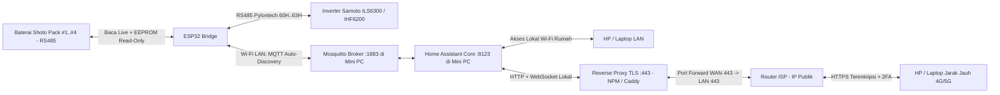

# Panduan Lengkap Step-by-Step: Integrasi BMS Shoto <-> Samoto ke Home Assistant (Mini PC + LAN + IP Publik)

Panduan ini menjelaskan langkah demi langkah dari nol sampai sistem siap dipantau dan dikontrol 24/7 melalui **Home Assistant** di **Mini PC** — baik saat Anda berada di rumah (**jaringan lokal/LAN**) maupun dari luar kota (**jarak jauh via IP Publik** menggunakan *port forwarding* router yang aman).

> [!IMPORTANT]
> **Prinsip Keselamatan Utama:**
> 1. **100% Read-Only ke BMS Shoto:** ESP32 dan Home Assistant **tidak pernah** menulis/mengubah setting internal EEPROM baterai Shoto.
> 2. **Inverter Tetap Prioritas Utama:** Komunikasi RS485 ke inverter Samoto (`ILS6300` / `IHF6200` / `ILS3600`) berjalan di jalur terpisah (`Core 1`). Jika Wi-Fi atau Mini PC mati, **bridge inverter tetap berjalan normal tanpa putus beban**.
> 3. **Akses IP Publik Wajib HTTPS (Port `443` saja):** Jangan pernah membuka langsung port `8123` (HTTP polos) atau `1883` (MQTT) ke internet.

---

## Daftar Isi
- [Bab 1: Gambaran Umum & Arsitektur Sistem](#bab-1-gambaran-umum--arsitektur-sistem)
- [Bab 2: Persiapan Hardware, Jaringan & IP Publik](#bab-2-persiapan-hardware-jaringan--ip-publik)
- [Bab 3: Instalasi Home Assistant di Mini PC](#bab-3-instalasi-home-assistant-di-mini-pc)
- [Bab 4: Instalasi & Konfigurasi Mosquitto MQTT Broker](#bab-4-instalasi--konfigurasi-mosquitto-mqtt-broker)
- [Bab 5: Konfigurasi & Flash Firmware ESP32 Bridge (Mode Home Assistant)](#bab-5-konfigurasi--flash-firmware-esp32-bridge-mode-home-assistant)
- [Bab 6: Setup Dashboard Lengkap & Function Action Menu](#bab-6-setup-dashboard-lengkap--function-action-menu)
- [Bab 7: Setup Akses Jarak Jauh via IP Publik & Port Forwarding Router](#bab-7-setup-akses-jarak-jauh-via-ip-publik--port-forwarding-router)
- [Bab 8: Pengujian End-to-End, Notifikasi HP & Troubleshooting](#bab-8-pengujian-end-to-end-notifikasi-hp--troubleshooting)

---

## Bab 1: Gambaran Umum & Arsitektur Sistem

### Alur Data Sistem



### Istilah Penting yang Perlu Dipahami
| Istilah | Arti Sederhana |
|---|---|
| **Home Assistant (HA)** | Server pemantau & otomatisasi rumah/PLTS yang diinstal di Mini PC. |
| **MQTT & Auto-Discovery** | Protokol pesan ringan untuk ESP32 mengirim puluhan sensor (tegangan sel, SOC, parameter EEPROM) sehingga otomatis muncul di HA tanpa input manual satu per satu. |
| **Mosquitto Broker** | "Kantor pos" MQTT lokal di Mini PC tempat ESP32 dan Home Assistant bertukar data. |
| **Reverse Proxy (NPM / Caddy)** | Penjaga pintu depan berbasis HTTPS yang mengenkripsi trafik internet masuk ke port `443` sebelum diteruskan secara lokal ke HA (`8123`). |
| **Port Forwarding (NAT)** | Aturan di router ISP untuk mengarahkan koneksi dari **IP Publik** di internet menuju Mini PC di jaringan rumah. |
| **2FA (Two-Factor Auth)** | Kode OTP 6 digit dari aplikasi HP (Google Authenticator / Authy) agar akun tidak bisa dibobol meski password bocor. |
| **Maintenance Unlock** | Pengaman 2 langkah di dashboard HA supaya tombol sensitif (seperti *Restart ESP32* atau ubah batas arus `CCL/DCL`) tidak kepencet tidak sengaja dari HP. Otomatis mengunci lagi dalam 5 menit. |

---

## Bab 2: Persiapan Hardware, Jaringan & IP Publik

### Checklist Persiapan
- [ ] **Mini PC x86_64** (Intel N100/Celeron/i3/i5 atau Ryzen, minimal RAM `4 GB`, SSD `32 GB+`, **wajib terhubung ke router via kabel LAN RJ45** agar stabil 24/7).
- [ ] **Flashdisk USB minimal `8 GB`** + laptop/PC untuk membuat installer Home Assistant.
- [ ] **ESP32 Bridge** yang sudah terpasang kabel RS485 ke baterai Shoto & inverter Samoto (mengacu [wiring diagram aktual](file:///Users/opusoctopus/Downloads/shoto_samoto_bridge/diagrams/diy-xy-k485.png)), dalam jangkauan sinyal **Wi-Fi 2.4 GHz** yang stabil.
- [ ] **IP Publik aktif dari ISP** + login admin Router ISP (Mikrotik / Huawei ONT / ZTE / TP-Link).
- [ ] *(Sangat Disarankan)* Nama **domain / subdomain** atau akun gratis **DuckDNS** (`namapltssaya.duckdns.org`) yang diarahkan ke IP Publik agar sertifikat HTTPS (gembok hijau browser) terbit otomatis dan aplikasi HP Android/iOS berfungsi tanpa error sertifikat.

### Kunci IP LAN Statis (DHCP Reservation) di Router
Sebelum instalasi, siapkan alamat IP tetap di jaringan lokal agar tidak pernah berubah saat listrik/router restart:

1. Login ke halaman admin router Anda (biasanya `192.168.1.1` atau `192.168.0.1`).
2. Masuk ke menu **LAN → DHCP Server / Address Reservation / Static Lease**.
3. Daftarkan MAC Address **Mini PC (port LAN Ethernet)** ke IP tetap, misalnya:
   - **Mini PC Home Assistant:** `192.168.1.50` *(gunakan IP contoh ini atau sesuaikan subnet router Anda di seluruh panduan)*
4. Setelah ESP32 menyala nanti, daftarkan juga MAC Address Wi-Fi **ESP32 Bridge** ke IP tetap, misalnya:
   - **ESP32 Bridge #1 (`ILS6300`):** `192.168.1.61`
   - **ESP32 Bridge #2 (`IHF6200`, jika ada):** `192.168.1.62`

---

## Bab 3: Instalasi Home Assistant di Mini PC

Ada 2 cara instalasi. **Pilih Opsi A (HAOS)** jika Mini PC khusus didedikasikan sebagai server Home Assistant (paling stabil, ada *Add-on Store* 1 klik).

### Opsi A (Direkomendasikan): Home Assistant OS (HAOS) Bare-Metal

#### 1. Siapkan BIOS Mini PC
Sambungkan monitor & keyboard ke Mini PC, nyalakan lalu tekan `DEL` / `F2` masuk ke BIOS:
- **Boot Mode:** `UEFI` *(matikan Legacy/CSM)*.
- **Secure Boot:** `Disabled`.
- **Restore on AC Power Loss / Auto Power On:** `Power On` *(**Sangat Penting** untuk sistem PLTS agar Mini PC otomatis menyala sendiri setelah pemadaman atau maintenance MCB)*.
- Simpan & keluar BIOS (`Save & Exit`).

#### 2. Buat USB Live Installer & Flash HAOS ke SSD Mini PC
1. Di laptop Anda, download **Ubuntu Desktop ISO** dan **BalenaEtcher** (`https://etcher.balena.io/`).
2. Flash Ubuntu ISO ke flashdisk USB menggunakan BalenaEtcher, lalu colokkan USB ke Mini PC dan boot dari USB (*Try Ubuntu*).
3. Di dalam Ubuntu Mini PC, buka browser dan download image resmi **Home Assistant OS Generic x86-64** (`haos_generic-x86-64-xx.img.xz`) dari:
   `https://www.home-assistant.io/installation/generic-x86-64`
4. Buka aplikasi **Disks** (`gnome-disks`) di Ubuntu:
   - Pilih **SSD internal Mini PC** (periksa ukuran disk dengan teliti, jangan sampai salah pilih flashdisk USB!).
   - Klik ikon titik tiga di kanan atas → **Restore Disk Image...** → pilih file `haos_generic-x86-64-xx.img.xz` → klik **Start Restoring**.
5. Setelah selesai, **Shutdown**, cabut flashdisk USB, lalu nyalakan ulang Mini PC dengan kabel LAN terpasang.

#### 3. Onboarding Awal Home Assistant
1. Tunggu 3–5 menit hingga Mini PC selesai inisialisasi pertama.
2. Dari laptop/HP di Wi-Fi rumah yang sama, buka browser ke:
   `http://192.168.1.50:8123` *(atau `http://homeassistant.local:8123`)*.
3. Buat **Nama, Username, dan Password Admin yang kuat** (kombinasi huruf besar/kecil, angka, simbol — karena nanti bisa diakses dari internet!).
4. Atur lokasi rumah, zona waktu (`Asia/Jakarta`), dan mata uang (`IDR`).
5. **Wajib Aktifkan 2FA (Two-Factor Authentication):**
   - Klik profil nama Anda (pojok kiri bawah dashboard HA) → tab **Security** → aktifkan **Authenticator app (TOTP)** → scan QR code pakai **Google Authenticator / Aegis / Authy** di HP Anda.

---

### Opsi B (Alternatif): Docker Compose di Ubuntu/Debian Server
Gunakan opsi ini **hanya jika** Mini PC sudah menjalankan Ubuntu/Debian untuk aplikasi lain:

1. Pastikan Docker Engine & Docker Compose plugin sudah terpasang di Mini PC.
2. Salin direktori konfigurasi [homeassistant/](file:///Users/opusoctopus/Downloads/shoto_samoto_bridge/homeassistant/docker-compose.yml) dari repo ini ke `/opt/shoto-ha/` di Mini PC.
3. Salin `/opt/shoto-ha/.env.example` menjadi `/opt/shoto-ha/.env` lalu sesuaikan password/domain.
4. Jalankan stack:
   ```bash
   cd /opt/shoto-ha
   docker compose up -d
   ```
5. Buka `http://192.168.1.50:8123` dan selesaikan onboarding + aktifkan 2FA sama seperti langkah Opsi A.

*(Catatan: Pada Opsi B Docker, layanan add-on tidak ada di UI HA karena Mosquitto & Reverse Proxy Caddy sudah langsung berjalan sebagai container di `docker-compose.yml`.)*

---

## Bab 4: Instalasi & Konfigurasi Mosquitto MQTT Broker

*(Jika Anda memakai **Opsi A HAOS**, ikuti langkah di bawah ini.)*

1. Di Home Assistant, buka **Settings → Add-ons → Add-on Store** (kanan bawah).
2. Cari dan klik **Mosquitto broker** → klik **Install** → tunggu selesai, lalu **Start** dan aktifkan **Start on boot** + **Watchdog**.
3. Buat **user khusus untuk ESP32 Bridge** agar tidak memakai akun admin utama:
   - Buka **Settings → People → Users** *(aktifkan **Advanced Mode** di profil Anda jika menu Users belum terlihat)* → **Add User**.
   - Isi Name: `Shoto Bridge`, Username: `shoto_bridge`, Password: `<buat password kuat khusus MQTT>`, centang **Local access only** → **Create**.
4. Aktifkan integrasi **MQTT** di Home Assistant:
   - Buka **Settings → Devices & Services → Integrations**.
   - Jika kartu **MQTT** sudah muncul otomatis, klik **Configure → Submit**.
   - Jika belum muncul, klik **+ Add Integration** → cari `MQTT` → isi:
     - Broker: `core-mosquitto` *(untuk HAOS)* atau `127.0.0.1`
     - Port: `1883`
     - Username & Password: isi akun `shoto_bridge` yang baru dibuat.

> [!TIP]
> Port `1883` hanya dipakai komunikasi internal antara ESP32 dan Mini PC di Wi-Fi/LAN rumah. **Jangan di-port-forward ke internet.**

---

## Bab 5: Konfigurasi & Flash Firmware ESP32 Bridge (Mode Home Assistant)

### 1. Siapkan Kredensial Wi-Fi & MQTT (`secrets.h`)
1. Masuk ke folder firmware [firmware/shoto_samoto_bridge/](file:///Users/opusoctopus/Downloads/shoto_samoto_bridge/firmware/shoto_samoto_bridge/shoto_samoto_bridge.ino).
2. Salin berkas contoh `secrets.h.example` menjadi `secrets.h`:
   ```cpp
   #define WIFI_SSID       "NAMA_WIFI_RUMAH_24GHZ"
   #define WIFI_PASS       "PASSWORD_WIFI_ANDA"
   #define MQTT_HOST       "192.168.1.50"   // IP LAN statis Mini PC
   #define MQTT_PORT       1883
   #define MQTT_USER       "shoto_bridge"
   #define MQTT_PASS       "PASSWORD_MQTT_YANG_DIBUAT_DI_BAB_4"
   #define OTA_PASS        "PASSWORD_OTA_OPSIONAL"
   ```
   *(File `secrets.h` otomatis diabaikan oleh `.gitignore` sehingga kredensial Wi-Fi/MQTT Anda tidak akan ikut ter-upload ke Git.)*

### 2. Aktifkan Mode Home Assistant di `config.h`
Buka [config.h](file:///Users/opusoctopus/Downloads/shoto_samoto_bridge/firmware/shoto_samoto_bridge/config.h) dan ubah baris konfigurasi HA menjadi:
```cpp
#define ENABLE_HA_MQTT        1
#define HA_DEVICE_ID          "shoto_ils6300"         // Unik per unit (mis. "shoto_ihf6200" untuk unit lain)
#define HA_SITE_NAME          "PLTS Samoto ILS6300"   // Nama tampilan di Home Assistant
#define MQTT_TOPIC_PREFIX     "shoto_bridge/ils6300"
```

> [!IMPORTANT]
> Jika Anda memiliki lebih dari 1 sistem inverter/ESP32 (misalnya 1 di **ILS6300** dan 1 di **IHF6200**), cukup bedakan `HA_DEVICE_ID` & `MQTT_TOPIC_PREFIX` untuk masing-masing ESP32 agar keduanya tampil rapi dalam 1 dashboard Mini PC tanpa bentrok!

### 3. Install Library & Flash Firmware
- **Jika memakai Arduino IDE 2.x:**
  1. Buka **Library Manager** (`Ctrl+Shift+I` / `Cmd+Shift+I`), cari **`PubSubClient`** by Nick O'Leary → **Install**.
  2. Buka [shoto_samoto_bridge.ino](file:///Users/opusoctopus/Downloads/shoto_samoto_bridge/firmware/shoto_samoto_bridge/shoto_samoto_bridge.ino).
  3. Pilih Board `ESP32 Dev Module` *(atau `ESP32S3 Dev Module` jika pakai Waveshare S3)* dan Port USB ESP32 → klik **Upload**.
- **Jika memakai PlatformIO:**
  ```bash
  cd firmware/shoto_samoto_bridge
  pio run -e diy_esp32_wroom32 -t upload
  ```

### 4. Verifikasi Awal di Serial Monitor (`115200 baud`)
Pastikan baris berikut muncul tanpa error:
- `[PACK+] Pack#1 (addr=1) ONLINE ...` & `[PACK+] Pack#2 (addr=2) ONLINE ...`
- `[BAT TBD_BINARY] packs=2 valid=YES ...`
- `[HA MQTT] WiFi connected IP=192.168.1.xx RSSI=-xxdBm`
- `[HA MQTT] Broker connected, Discovery published`
- Ketik `diag` → pastikan `mode=PYL_FULL (63H+61H+62H)`, `inhibit=0`, `mtxMiss=0`.

---

## Bab 6: Setup Dashboard Lengkap & Function Action Menu

Begitu ESP32 terhubung ke Mosquitto, buka **Settings → Devices & Services → MQTT → Devices → `PLTS Samoto ILS6300`**. Seluruh sensor, parameter EEPROM, dan kontrol sudah terdaftar otomatis!

### Memasang Dashboard 4 Tampilan (*4-View Dashboard*)
1. Di Home Assistant, buka **Settings → Dashboards → + Add Dashboard → New dashboard from scratch**.
2. Beri judul: `Shoto BMS & Inverter` (ikon `mdi:battery-charging-high`) → **Create**.
3. Buka dashboard baru tersebut → klik ikon **Pensil (Edit)** di pojok kanan atas → klik ikon **titik tiga** di kanan atas → **Raw configuration editor**.
4. Salin seluruh isi file `homeassistant/dashboards/shoto_bms_dashboard.yaml` lalu tempelkan ke editor → klik **Save** → **Done**.
5. Pasang juga file otomasi notifikasi dari `homeassistant/automations_shoto_bms.yaml` dan script dari `homeassistant/scripts_shoto_bms.yaml`.

### Daftar Lengkap Parameter yang Tampil

| View Dashboard | Informasi yang Ditampilkan |
|---|---|
| **1. Overview & Power Flow** | • `Bank SOC (%)`, `rawSOC (%)`, `SOH (%)`, `Bank Voltage (V)`, `Bank Current (A)`, `Bank Power (W)` *(charge/discharge real-time)*, `Sisa Kapasitas (Ah)`<br>• `Bridge Status` (`ACTIVE` / `MONITOR_ONLY`), `Bank Valid` (`YES` / `INHIBIT` + alasan inhibit)<br>• `Active Packs` (`2/4`), `Protocol` (`TBD_BINARY`), `Inverter Mode` (`PYL_FULL 63H+61H+62H`)<br>• Limit Aktif `63H` ke Inverter: `CVL (53.60 V)`, `DVL (46.00 V)`, `CCL (60.0 A)`, `DCL (100.0 A)`<br>• Grafik histori 24 jam Tegangan, Arus, SOC, dan Suhu |
| **2. Packs & 15-Cell Matrix** | • Untuk setiap slot **Pack #1..#4**: Status `ONLINE/OFFLINE`, `V`, `I`, `SOC`, `SOH`, `Cycles`, `Prot Flags`, `Warn/Fault Flags`, `Miss Count`<br>• **Seluruh 15 Tegangan Sel (`C01..C15`) per pack** dalam mV, `Cell Min`, `Cell Max`, dan `Cell ΔV` (selisih tertinggi–terendah)<br>• Seluruh **5 Sensor Suhu (`T1..T5`)** per pack + suhu min/max/rata-rata |
| **3. Shoto EEPROM Audit (Read-Only)** | • **13 Register Proteksi (`cmd 0x06..0x50`)**: `Cell OV/Rec (3.850/3.340 V)`, `Cell UV/Rec (2.000/3.200 V)`, `Pack OV/Rec (57.00/50.10 V)`, `Pack UV/Rec (40.00/48.00 V)`, `Const Charge V (52.00 V)`, `Const Charge I (50.0 A)`, `Cell Sleep V (3.200 V)`, `UV Off Interval`, `Sleep Time (1440 min)`<br>• **Seluruh 43 Tag Alarm (`cmd 0x43`)**: Cell OV/UV (`3.700/2.500 V`), Pack OV/UV (`54.00/42.00 V`), Charge/Discharge OC (`105/100 A`), suhu Chg OT/UT (`60/-5 °C`), Dsg OT/UT (`85/-20 °C`), MOS OT (`110 °C`), Env OT/UT (`65/-20 °C`), Low SOC (`20%/25%`), Cell `ΔV` (`1000/500 mV`) beserta semua delay & recovery<br>• Timestamp audit terakhir + tombol **Audit EEPROM** |
| **4. Action Center & Diagnostics** | • Menu Aksi lengkap (lihat tabel fungsi di bawah)<br>• Counter frame inverter (`60H`, `61H`, `62H`, `63H`, `mtxMiss`), `peakDV`, `dvRetry`, frame hex TX terakhir<br>• Kesehatan ESP32 (`Wi-Fi RSSI`, `Free Heap`, `Uptime`) |

### Panduan Function Action Menu & Keamanan 2 Langkah

| Kategori | Nama Kontrol di Dashboard | Wajib Unlock? | Fungsi & Efek Nyata |
|---|---|---|---|
| **Pengaman** | **Maintenance Unlock (Switch)** | — | Membuka izin sementara selama **5 menit** (*auto-relock*) untuk aksi sensitif agar tidak kepencet dari HP. |
| **Diagnostik Aman** | **Rescan All Packs (Button)** | Tidak | Memindai ulang slot `Pack #1..#4` di RS485 secara instan (mis. setelah pasang baterai baru). |
| **Diagnostik Aman** | **Audit EEPROM — All / Pack 1 / Pack 2 (Button)** | Tidak | Membaca ulang seluruh 13 proteksi + 43 alarm EEPROM Shoto secara **100% read-only**. |
| **Diagnostik Aman** | **Reset Diag Counters (Button)** | Tidak | Me-reset hitungan `inhibit`, `peakDV`, `dvRetry` di monitor (tidak memutus daya inverter). |
| **Diagnostik Aman** | **Re-Publish Discovery (Button)** | Tidak | Mendaftarkan ulang entitas MQTT ke Home Assistant tanpa restart ESP32. |
| **Mode Log** | **Auto Cell Log (Switch)** | Tidak | Mengaktifkan/mematikan log sel di Serial Monitor USB. |
| **Kritis (Guarded)** | **Bridge Mode (`ACTIVE` / `MONITOR_ONLY`)** | **YA** | Memindahkan ESP32 antara mode aktif membalas inverter vs mode intip pasif *(perhatian: pindah ke `MONITOR_ONLY` akan memutus komunikasi BMS ke inverter)*. |
| **Kritis (Guarded)** | **Dynamic Pack Discovery (`ON`/`OFF`)** | **YA** | Mengaktifkan/mematikan deteksi hot-plug baterai paralel otomatis. |
| **Policy Safety** | **Slider `CVL` (`51.0–54.4 V`), `DVL` (`44.0–48.0 V`), `CCL` (`10–90 A`), `DCL` (`10–120 A`), `Max ΔV` (`0.5–1.5 V`)** | **YA** | Mengatur batas arus/tegangan yang dikirim ke inverter melalui frame `63H` dan otomatis tersimpan di NVS ESP32. Tetap dibatasi keras agar aman untuk LFP 15S. |
| **Policy Safety** | **Reset Policy Safe Defaults (Button)** | **YA** | Mengembalikan batas `63H` ke standar awet 24/7 (`CVL=53.6V`, `DVL=46.0V`, `CCL=30A/pack max 90A`, `DCL=50A/pack max 120A`). |
| **Sistem** | **Restart ESP32 Bridge (Button)** | **YA** | Me-reboot ESP32 dari jarak jauh *(komunikasi RS485 ke inverter jeda ±3 detik saat boot)*. |

---

## Bab 7: Setup Akses Jarak Jauh via IP Publik & Port Forwarding Router

> [!CAUTION]
> **JANGAN PERNAH** men-forward port **`8123`** (Home Assistant tanpa enkripsi), port **`1883`** (Mosquitto MQTT), port **`22`** (SSH), atau port OTA ESP32 langsung di router ke internet. Jika password terendus atau aplikasi HP mencoba terhubung tanpa HTTPS, sistem berisiko dibobol. **Hanya buka port `443` (HTTPS)** lewat Reverse Proxy!

### Langkah 7.1 — Arahkan Subdomain / DuckDNS ke IP Publik Anda
Meskipun akses dilakukan menuju **IP Publik yang sudah Anda miliki**, sertifikat HTTPS resmi (Let's Encrypt) dan aplikasi resmi **Home Assistant Companion App** membutuhkan nama host/domain yang menunjuk ke IP Publik tersebut:
1. **Jika Anda sudah punya domain sendiri:** Buat *DNS A Record* (misalnya `plts.domainanda.com` → arahkan ke IP Publik Anda).
2. **Jika belum punya domain (Gratis via DuckDNS):**
   - Buka `https://www.duckdns.org` → login → buat subdomain (contoh: `plts-shoto-anda.duckdns.org`) → isi kolom IP dengan **IP Publik** Anda → klik **update ip**.
   - *(Opsional jika IP Publik Anda suatu saat bisa berubah / dinamis)*: Pasang add-on **DuckDNS** di HAOS atau cron di Mini PC agar IP terus diperbarui otomatis. *(Jika IP Publik Anda sudah **Static IP**, Anda tidak perlu updater tambahan; cukup catat domain atau gunakan DuckDNS sebagai alias HTTPS ke Static IP tersebut.)*

> [!NOTE]
> **Bagaimana jika terpaksa mengakses lewat IP Publik mentah tanpa nama domain sama sekali?** Secara teknis hanya disarankan jika digabung **VPN (WireGuard / Tailscale)** karena sertifikat SSL publik resmi (Let's Encrypt) hanya terbit untuk nama domain, bukan alamat IP mentah. Menggunakan nama subdomain/DuckDNS gratis yang diarahkan ke IP Publik Anda adalah cara termudah agar HTTPS gembok hijau dan notifikasi HP berjalan lancar.

### Langkah 7.2 — Install & Konfigurasi Nginx Proxy Manager (Reverse Proxy)
*(Untuk pengguna **HAOS Opsi A**. Jika memakai Docker Opsi B, gunakan `Caddyfile.example` di `docker-compose.yml`.)*

1. Di Home Assistant, buka **Settings → Add-ons → Add-on Store** → cari **Nginx Proxy Manager** *(dari repositori Community Add-ons)* → **Install** → **Start** → aktifkan **Start on boot**.
2. Klik **Open Web UI** pada Nginx Proxy Manager (login default awal biasanya `admin@example.com` / `changeme`, langsung ganti email & password Anda saat masuk pertama kali!).
3. Masuk ke **Hosts → Proxy Hosts → Add Proxy Host**:
   - **Tab Details:**
     - **Domain Names:** `plts-shoto-anda.duckdns.org` *(tekan Enter)*
     - **Scheme:** `http`
     - **Forward Hostname / IP:** `192.168.1.50` *(IP LAN Mini PC Anda)*
     - **Forward Port:** `8123`
     - **Websockets Support:** **ON (WAJIB!)**
     - **Block Common Exploits:** **ON**
   - **Tab SSL:**
     - **SSL Certificate:** pilih **Request a new SSL Certificate**
     - **Force SSL:** **ON**
     - **HTTP/2 Support:** **ON**
     - Centang **I Agree to the Let's Encrypt Terms of Service** → klik **Save** *(pastikan port forwarding Langkah 7.3 di bawah sudah aktif terlebih dahulu jika memakai HTTP-01 challenge)*.

### Langkah 7.3 — Atur Port Forwarding di Router ISP

Login ke admin router Anda, lalu buka menu **NAT / Port Forwarding / Virtual Server** dan buat aturan tepat seperti tabel berikut:

| Nama Rule | Protokol | External / WAN Port | Internal / LAN IP (Mini PC) | Internal / LAN Port | Status |
|---|---|---|---|---|---|
| `HA-HTTPS` | **TCP** | **`443`** | `192.168.1.50` | **`443`** | **WAJIB AKTIF** |
| `HA-SSL-Renew` *(opsional)* | TCP | `80` | `192.168.1.50` | `80` | Hanya perlu untuk verifikasi HTTP Let's Encrypt; bisa dimatikan setelah SSL terbit atau bila pakai DNS-01 |

**Daftar Port yang DILARANG di-Forward di Router:**
- ❌ `8123` (Home Assistant HTTP polos)
- ❌ `1883` (Mosquitto MQTT — hanya untuk Wi-Fi lokal ESP32)
- ❌ `22` (SSH)
- ❌ `81` (Admin UI Nginx Proxy Manager — hanya boleh dibuka dari LAN)
- ❌ `3232` (ESP32 OTA)

### Langkah 7.4 — Konfigurasi Keamanan `configuration.yaml` di Home Assistant
Agar Home Assistant menerima koneksi dari Nginx Proxy Manager sekaligus memblokir *brute-force login* dari internet, tambahkan blok berikut ke `/config/configuration.yaml` di Mini PC (lihat juga referensi lengkap di [homeassistant/configuration.yaml](file:///Users/opusoctopus/Downloads/shoto_samoto_bridge/homeassistant/configuration.yaml)):

```yaml
http:
  use_x_forwarded_for: true
  trusted_proxies:
    - 127.0.0.1
    - ::1
    - 172.30.33.0/24   # Subnet internal Add-on HAOS (termasuk Nginx Proxy Manager)
    - 172.16.0.0/12    # Subnet internal Docker Bridge (jika pakai Opsi B)
    - 192.168.1.50     # IP LAN Mini PC
  ip_ban_enabled: true
  login_attempts_threshold: 5
```

Setelah menyimpan file: buka **Developer Tools → Check Configuration** (pastikan hijau/valid), lalu klik **Restart Home Assistant**.

### Langkah 7.5 — Setting Aplikasi HP (Home Assistant Companion App)
Install aplikasi **Home Assistant** dari Play Store / App Store di HP Anda:
1. Login pertama kali memakai alamat publik `https://plts-shoto-anda.duckdns.org` + username + password + kode **2FA**.
2. Masuk ke **Settings (di dalam app) → Companion App → pilih Server Anda**:
   - **Home Assistant URL (External):** `https://plts-shoto-anda.duckdns.org`
   - **Internal Connection URL:** `http://192.168.1.50:8123`
   - **Home Network Wi-Fi SSID:** pilih **nama Wi-Fi rumah Anda**
3. Hasilnya: saat Anda berada di rumah (terhubung Wi-Fi rumah), aplikasi otomatis memakai jalur lokal kilat `http://192.168.1.50:8123`; begitu keluar rumah menggunakan 4G/5G, aplikasi otomatis berpindah mulus ke jalur **HTTPS IP Publik** Anda!

> [!TIP]
> **Jika router ISP tidak mendukung Hairpin NAT / NAT Loopback** (akses `https://domain` gagal saat HP sedang memakai Wi-Fi rumah, tetapi berhasil saat memakai 4G/5G): itu normal pada beberapa modem ONT ISP. Solusinya sudah beres otomatis karena Anda telah mengisi **Internal Connection URL** + **Home Network Wi-Fi SSID** di Companion App di atas, dan di laptop saat di rumah cukup buka `http://192.168.1.50:8123`.

---

## Bab 8: Pengujian End-to-End, Notifikasi HP & Troubleshooting

### Checklist Verifikasi 10 Poin Sebelum Ditinggal 24/7
1. [ ] **Akses LAN:** Buka `http://192.168.1.50:8123` dari laptop/HP di rumah → seluruh 4 view dashboard muncul tanpa entitas `unavailable`.
2. [ ] **Data Live Akurat:** Bandingkan `Bank V`, `Bank I`, `SOC`, `CVL/DVL/CCL/DCL`, dan tegangan sel `C01..C15` di HA dengan Serial Monitor ESP32 (`diag` / `packs`) → angka sama dan update setiap 3–5 detik.
3. [ ] **Read-Only EEPROM Muncul Lengkap:** Di tab **Shoto EEPROM Audit**, ke-13 nilai proteksi (`Cell OV/UV`, `Pack OV/UV`, `Const Charge V`) dan ke-43 parameter alarm (`cmd 0x43`) terbaca lengkap.
4. [ ] **Status Inverter Normal:** `Inverter Mode = PYL_FULL (63H+61H+62H)`, `mtxMiss = 0`, `Bank Valid = YES`, `Inhibit = 0`.
5. [ ] **Uji Putus Wi-Fi (Resilience Test):** Matikan Wi-Fi router selama 3 menit sambil memantau Serial Monitor ESP32 (`diag`). Pastikan ESP32 **tidak reboot** dan `inv_bridge_task` **tetap membalas inverter `ILS6300`/`IHF6200` dengan `inhibit=0` & `mtxMiss=0`**. Saat Wi-Fi menyala lagi, HA otomatis kembali `online`.
6. [ ] **Uji Pengaman Action Menu:** Coba klik **Restart ESP32** saat `Maintenance Unlock = OFF` → harus ditolak dan ESP32 tidak restart.
7. [ ] **Uji Action Menu Aktif:** Nyalakan `Maintenance Unlock = ON`, klik **Audit EEPROM (All)** → timestamp audit ter-update, lalu biarkan 5 menit dan pastikan `Maintenance Unlock` kembali `OFF` otomatis.
8. [ ] **Uji Notifikasi HP:** Klik tombol **Test Notifikasi HA** di tab Action Center → notifikasi masuk ke Companion App HP Anda.
9. [ ] **Uji Akses Jarak Jauh via IP Publik:** Matikan Wi-Fi di HP (pakai jaringan **4G/5G seluler**), buka `https://plts-shoto-anda.duckdns.org` → login + verifikasi **2FA TOTP** → dashboard tampil real-time.
10. [ ] **Uji Port Tertutup:** Cek dari luar jaringan bahwa hanya port `443` yang terbuka; port `8123`, `1883`, `22` harus **tertutup/filtered**.

### Tabel Troubleshooting Cepat

| Gejala / Error | Penyebab Paling Umum | Solusi Cepat |
|---|---|---|
| Muncul **`400 Bad Request`** saat akses lewat IP Publik / domain | `use_x_forwarded_for` atau IP Nginx Proxy Manager belum terdaftar di `trusted_proxies` | Tambahkan subnet `172.30.33.0/24` (HAOS) / `172.16.0.0/12` (Docker) & `192.168.1.50` di `configuration.yaml` (Langkah 7.4) lalu restart HA. |
| Tidak bisa diakses dari **4G/5G**, padahal IP Publik sudah benar | 1) ISP memakai **CGNAT** (IP di WAN modem `10.x.x.x` / `100.64.x.x` berbeda dengan IP yang tampil di `whatismyipaddress.com`)<br>2) Modem dalam mode *double router* | 1) Hubungi ISP minta *Public IPv4 non-CGNAT*, **atau** gunakan tunnel gratis aman seperti **Cloudflare Tunnel / Tailscale** tanpa port forwarding.<br>2) Cek IP WAN di router harus sama persis dengan IP Publik. |
| Bisa dibuka dari **4G/5G**, tetapi **gagal dari Wi-Fi rumah** saat memakai alamat HTTPS | Router ISP tidak mendukung *Hairpin NAT / NAT Loopback* | Di rumah selalu buka `http://192.168.1.50:8123` (dan isi *Internal URL* di Companion App sesuai Langkah 7.5). |
| Semua sensor Shoto di HA bertuliskan **`Unavailable`** | ESP32 belum terhubung ke Wi-Fi 2.4 GHz atau user/password Mosquitto salah | Cek Serial Monitor ESP32 (`115200 baud`): lihat pesan `[HA MQTT]`. Pastikan SSID Wi-Fi adalah **2.4 GHz** (bukan 5 GHz saja) dan user `shoto_bridge` cocok. |
| WebSocket error / dashboard di IP Publik muter terus tidak mau load | **WebSockets Support** di Nginx Proxy Manager belum dicentang | Edit Proxy Host di NPM → aktifkan **Websockets Support = ON** → Save. |
| Terkunci sendiri dari HP saat salah ketik password | Fitur `ip_ban_enabled: true` memblokir IP setelah 5× gagal | Buka `/config/ip_bans.yaml` dari terminal/File Editor di LAN, hapus entri IP terkait, lalu restart Home Assistant. |
