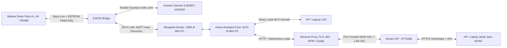

# Panduan Lengkap Step-by-Step: Integrasi BMS Shoto <-> Samoto ke Home Assistant (Mini PC + LAN + IP Publik)

[Peta repositori](../../README.md) · [Panduan hardware](GUIDE.md) · [Wiki offline](../WIKI-SHOTO-SAMOTO.html)

Panduan ini menjelaskan langkah demi langkah dari nol sampai sistem siap dipantau dan dikontrol 24/7 melalui **Home Assistant** di **Mini PC** — baik saat Anda berada di rumah (**jaringan lokal/LAN**) maupun dari luar kota (**jarak jauh via IP Publik** menggunakan *port forwarding* router yang aman).

> [!IMPORTANT]
> **Prinsip Keselamatan Utama:**
> 1. **100% Read-Only ke BMS Shoto:** ESP32 dan Home Assistant **tidak pernah** menulis/mengubah setting internal EEPROM baterai Shoto.
> 2. **Inverter Tetap Prioritas Utama:** Komunikasi RS485 ke inverter Samoto (`ILS6300` / `IHF6200` / `ILS3600`) berjalan di jalur terpisah (`Core 1`). Jika Wi-Fi atau Mini PC mati, **bridge inverter tetap berjalan normal tanpa putus beban**.
> 3. **Akses IP Publik Wajib HTTPS (Port `443` saja):** Jangan pernah membuka langsung port `8123` (HTTP polos) atau `1883` (MQTT) ke internet.

---

## Daftar Isi
- [Bab 1: Gambaran Umum & Arsitektur Sistem](#bab-1-gambaran-umum--arsitektur-sistem)
- [Bab 2: Persiapan Hardware, Jaringan & IP Publik](#bab-2-persiapan-hardware-jaringan--ip-publik)
- [Bab 3: Instalasi Home Assistant di Mini PC](#bab-3-instalasi-home-assistant-di-mini-pc)
- [Bab 4: Instalasi & Konfigurasi Mosquitto MQTT Broker](#bab-4-instalasi--konfigurasi-mosquitto-mqtt-broker)
- [Bab 5: Konfigurasi & Flash Firmware ESP32 Bridge (Mode Home Assistant)](#bab-5-konfigurasi--flash-firmware-esp32-bridge-mode-home-assistant)
- [Bab 6: Setup Dashboard Lengkap & Function Action Menu](#bab-6-setup-dashboard-lengkap--function-action-menu)
- [Bab 7: Setup Akses Jarak Jauh via IP Publik & Port Forwarding Router](#bab-7-setup-akses-jarak-jauh-via-ip-publik--port-forwarding-router)
- [Bab 8: Pengujian End-to-End, Notifikasi HP & Troubleshooting](#bab-8-pengujian-end-to-end-notifikasi-hp--troubleshooting)

---

## Bab 1: Gambaran Umum & Arsitektur Sistem

### Alur Data Sistem



### Istilah Penting yang Perlu Dipahami
| Istilah | Arti Sederhana |
|---|---|
| **Home Assistant (HA)** | Server pemantau & otomatisasi rumah/PLTS yang diinstal di Mini PC. |
| **MQTT & Auto-Discovery** | Protokol pesan ringan untuk ESP32 mengirim puluhan sensor (tegangan sel, SOC, parameter EEPROM) sehingga otomatis muncul di HA tanpa input manual satu per satu. |
| **Mosquitto Broker** | "Kantor pos" MQTT lokal di Mini PC tempat ESP32 dan Home Assistant bertukar data. |
| **Reverse Proxy (NPM / Caddy)** | Penjaga pintu depan berbasis HTTPS yang mengenkripsi trafik internet masuk ke port `443` sebelum diteruskan secara lokal ke HA (`8123`). |
| **Port Forwarding (NAT)** | Aturan di router ISP untuk mengarahkan koneksi dari **IP Publik** di internet menuju Mini PC di jaringan rumah. |
| **2FA (Two-Factor Auth)** | Kode OTP 6 digit dari aplikasi HP (Google Authenticator / Authy) agar akun tidak bisa dibobol meski password bocor. |
| **Maintenance Unlock** | Pengaman 2 langkah di dashboard HA supaya tombol sensitif (seperti *Restart ESP32* atau ubah batas arus `CCL/DCL`) tidak kepencet tidak sengaja dari HP. Otomatis mengunci lagi dalam 5 menit. |

---

## Bab 2: Persiapan Hardware, Jaringan & IP Publik

### Checklist Persiapan
- [ ] **Mini PC x86_64** (Intel N100/Celeron/i3/i5 atau Ryzen, minimal RAM `4 GB`, SSD `32 GB+`, **wajib terhubung ke router via kabel LAN RJ45** agar stabil 24/7).
- [ ] **Flashdisk USB minimal `8 GB`** + laptop/PC untuk membuat installer Home Assistant.
- [ ] **ESP32 Bridge** yang sudah terpasang kabel RS485 ke baterai Shoto & inverter Samoto (mengacu [wiring diagram aktual](../diagrams/diy-xy-k485.png)), dalam jangkauan sinyal **Wi-Fi 2.4 GHz** yang stabil.
- [ ] **IP Publik aktif dari ISP** + login admin Router ISP (Mikrotik / Huawei ONT / ZTE / TP-Link).
- [ ] *(Sangat Disarankan)* Nama **domain / subdomain** atau akun gratis **DuckDNS** (`namapltssaya.duckdns.org`) yang diarahkan ke IP Publik agar sertifikat HTTPS (gembok hijau browser) terbit otomatis dan aplikasi HP Android/iOS berfungsi tanpa error sertifikat.

### Kunci IP LAN Statis (DHCP Reservation) di Router
Sebelum instalasi, siapkan alamat IP tetap di jaringan lokal agar tidak pernah berubah saat listrik/router restart:

1. Login ke halaman admin router Anda (biasanya `192.168.1.1` atau `192.168.0.1`).
2. Masuk ke menu **LAN → DHCP Server / Address Reservation / Static Lease**.
3. Daftarkan MAC Address **Mini PC (port LAN Ethernet)** ke IP tetap, misalnya:
   - **Mini PC Home Assistant:** `192.168.10.250` *(gunakan IP contoh ini atau sesuaikan subnet router Anda di seluruh panduan)*
4. Setelah ESP32 menyala nanti, daftarkan juga MAC Address Wi-Fi **ESP32 Bridge** ke IP tetap, misalnya:
   - **ESP32 Bridge #1 (`IHF6200`):** DHCP atau IP statis mis. `192.168.10.61`
   - **ESP32 Bridge #2 (`ILS6300`, jika ditambah nanti):** DHCP atau IP statis mis. `192.168.10.62`

---

## Bab 3: Instalasi Home Assistant di Mini PC

Ada 2 cara instalasi. **Pilih Opsi A (HAOS)** jika Mini PC khusus didedikasikan sebagai server Home Assistant (paling stabil, ada *Add-on Store* 1 klik).

### Opsi A (Direkomendasikan): Home Assistant OS (HAOS) Bare-Metal

#### 1. Siapkan BIOS Mini PC
Sambungkan monitor & keyboard ke Mini PC, nyalakan lalu tekan `DEL` / `F2` masuk ke BIOS:
- **Boot Mode:** `UEFI` *(matikan Legacy/CSM)*.
- **Secure Boot:** `Disabled`.
- **Restore on AC Power Loss / Auto Power On:** `Power On` *(**Sangat Penting** untuk sistem PLTS agar Mini PC otomatis menyala sendiri setelah pemadaman atau maintenance MCB)*.
- Simpan & keluar BIOS (`Save & Exit`).

#### 2. Buat USB Live Installer & Flash HAOS ke SSD Mini PC
1. Di laptop Anda, download **Ubuntu Desktop ISO** dan **BalenaEtcher** (`https://etcher.balena.io/`).
2. Flash Ubuntu ISO ke flashdisk USB menggunakan BalenaEtcher, lalu colokkan USB ke Mini PC dan boot dari USB (*Try Ubuntu*).
3. Di dalam Ubuntu Mini PC, buka browser dan download image resmi **Home Assistant OS Generic x86-64** (`haos_generic-x86-64-xx.img.xz`) dari:
   `https://www.home-assistant.io/installation/generic-x86-64`
4. Buka aplikasi **Disks** (`gnome-disks`) di Ubuntu:
   - Pilih **SSD internal Mini PC** (periksa ukuran disk dengan teliti, jangan sampai salah pilih flashdisk USB!).
   - Klik ikon titik tiga di kanan atas → **Restore Disk Image...** → pilih file `haos_generic-x86-64-xx.img.xz` → klik **Start Restoring**.
5. Setelah selesai, **Shutdown**, cabut flashdisk USB, lalu nyalakan ulang Mini PC dengan kabel LAN terpasang.

#### 3. Onboarding Awal Home Assistant
1. Tunggu 3–5 menit hingga Mini PC selesai inisialisasi pertama.
2. Dari laptop/HP di Wi-Fi rumah yang sama, buka browser ke:
   `http://192.168.10.250:8123` *(atau `http://homeassistant.local:8123`)*.
3. Buat **Nama, Username, dan Password Admin yang kuat** (kombinasi huruf besar/kecil, angka, simbol — karena nanti bisa diakses dari internet!).
4. Atur lokasi rumah, zona waktu (`Asia/Jakarta`), dan mata uang (`IDR`).
5. **Wajib Aktifkan 2FA (Two-Factor Authentication):**
   - Klik profil nama Anda (pojok kiri bawah dashboard HA) → tab **Security** → aktifkan **Authenticator app (TOTP)** → scan QR code pakai **Google Authenticator / Aegis / Authy** di HP Anda.

---

### Opsi B (Alternatif): Docker Compose di Ubuntu/Debian Server
Gunakan opsi ini **hanya jika** Mini PC sudah menjalankan Ubuntu/Debian untuk aplikasi lain:

1. Pastikan Docker Engine & Docker Compose plugin sudah terpasang di Mini PC.
2. Salin direktori konfigurasi [homeassistant/](../../homeassistant/docker-compose.yml) dari repo ini ke `/opt/shoto-ha/` di Mini PC.
3. Salin `/opt/shoto-ha/.env.example` menjadi `/opt/shoto-ha/.env` lalu sesuaikan password/domain.
4. Jalankan stack:
   ```bash
   cd /opt/shoto-ha
   docker compose up -d
   ```
5. Buka `http://192.168.10.250:8123` dan selesaikan onboarding + aktifkan 2FA sama seperti langkah Opsi A.

*(Catatan: Pada Opsi B Docker, layanan add-on tidak ada di UI HA karena Mosquitto & Reverse Proxy Caddy sudah langsung berjalan sebagai container di `docker-compose.yml`.)*

---

## Bab 4: Instalasi & Konfigurasi Mosquitto MQTT Broker

*(Jika Anda memakai **Opsi A HAOS**, ikuti langkah di bawah ini.)*

1. Di Home Assistant, buka **Settings → Add-ons → Add-on Store** (kanan bawah).
2. Cari dan klik **Mosquitto broker** → klik **Install** → tunggu selesai, lalu **Start** dan aktifkan **Start on boot** + **Watchdog**.
3. Buat **user khusus untuk ESP32 Bridge** agar tidak memakai akun admin utama:
   - Buka **Settings → People → Users** *(aktifkan **Advanced Mode** di profil Anda jika menu Users belum terlihat)* → **Add User**.
   - Isi Name: `Shoto Bridge`, Username: `shoto_bridge`, Password: `<buat password kuat khusus MQTT>`, centang **Local access only** → **Create**.
4. Aktifkan integrasi **MQTT** di Home Assistant:
   - Buka **Settings → Devices & Services → Integrations**.
   - Jika kartu **MQTT** sudah muncul otomatis, klik **Configure → Submit**.
   - Jika belum muncul, klik **+ Add Integration** → cari `MQTT` → isi:
     - Broker: `core-mosquitto` *(untuk HAOS)* atau `127.0.0.1`
     - Port: `1883`
     - Username & Password: isi akun `shoto_bridge` yang baru dibuat.

> [!TIP]
> Port `1883` hanya dipakai komunikasi internal antara ESP32 dan Mini PC di Wi-Fi/LAN rumah. **Jangan di-port-forward ke internet.**

---

## Bab 5: Konfigurasi & Flash Firmware ESP32 Bridge (Mode Home Assistant)

### 1. Siapkan Kredensial Wi-Fi & MQTT (`secrets.h`)
1. Masuk ke folder firmware [firmware/shoto_samoto_bridge/](../../firmware/shoto_samoto_bridge/shoto_samoto_bridge.ino).
2. Salin berkas contoh `secrets.h.example` menjadi `secrets.h`:
   ```cpp
   #define WIFI_SSID       "NAMA_WIFI_RUMAH_24GHZ"
   #define WIFI_PASS       "PASSWORD_WIFI_ANDA"
   #define MQTT_HOST       "192.168.10.250"   // IP LAN statis Mini PC
   #define MQTT_PORT       1883
   #define MQTT_USER       "shoto_bridge"
   #define MQTT_PASS       "PASSWORD_MQTT_YANG_DIBUAT_DI_BAB_4"
   #define OTA_PASS        "PASSWORD_OTA_OPSIONAL"
   ```
   *(File `secrets.h` otomatis diabaikan oleh `.gitignore` sehingga kredensial Wi-Fi/MQTT Anda tidak akan ikut ter-upload ke Git.)*

### 2. Aktifkan Profil Unit & Mode Home Assistant di `config.h`
Buka [config.h](../../firmware/shoto_samoto_bridge/config.h). Cukup pilih **profil unit inverter** sebelum klik Upload:

- **Untuk ESP32 #1 — Samoto IHF6200 (default aktif, 3-pack):** biarkan default apa adanya (`SITE_PROFILE_IHF6200` aktif):
  ```cpp
  #ifndef SITE_PROFILE_ILS6300
    #define SITE_PROFILE_IHF6200   // Inverter #1: Samoto IHF6200 (default aktif)
  #endif
  // #define SITE_PROFILE_ILS6300
  ```
  Menghasilkan: `HA_DEVICE_ID = "shoto_ihf6200"`, `HA_SITE_NAME = "PLTS Samoto IHF6200"`, `MQTT_TOPIC_PREFIX = "shoto_bridge/ihf6200"`.

- **Untuk ESP32 #2 — Samoto ILS6300 (2-pack Shoto BMS saat ini):** cukup buka komentar baris `#define SITE_PROFILE_ILS6300`:
  ```cpp
  #define SITE_PROFILE_ILS6300  // Inverter #2: Samoto ILS6300
  ```
  Menghasilkan: `HA_DEVICE_ID = "shoto_ils6300"`, `HA_SITE_NAME = "PLTS Samoto ILS6300"`, `MQTT_TOPIC_PREFIX = "shoto_bridge/ils6300"`.

> [!IMPORTANT]
> **Kedua ESP32 berbagi broker Mosquitto & file `secrets.h` yang sama persis tanpa bentrok!**  
> Karena `client_id` MQTT (`shoto_ihf6200_esp32` vs `shoto_ils6300_esp32`), `MQTT_TOPIC_PREFIX` (`shoto_bridge/ihf6200` vs `shoto_bridge/ils6300`), hostname OTA, serta seluruh **`212` Entity ID** di Home Assistant otomatis terisolasi per profil.
>
> **Catatan Setup Inverter #2 (`ILS6300` + 2 Pack Shoto BMS):**
> - Dengan `DYNAMIC_PACK_DISCOVERY = true`, bridge otomatis mendeteksi **2 pack online (`200 Ah`)** dan mengirim limit aman `CVL = 53.6 V`, `DVL = 46.0 V`, `CCL = 60.0 A` (`30 A/pack`), `DCL = 100.0 A` (`50 A/pack`), serta otomatis naik jika kelak ditambah ke 3–4 pack.
> - Di sisi kabel & menu `ILS6300`: pastikan port BMS RS485 memakai **`Pin 2 (Oranye) = A(+)`**, **`Pin 1 (Putih-Oranye) = B(-)`**, serta menu **`24 BTT = USER`**, **`25 BnS = On`**, **`31 BPO = 0`**.

### 3. Install Library & Flash Firmware
- **Jika memakai Arduino IDE 2.x:**
  1. Buka **Library Manager** (`Ctrl+Shift+I` / `Cmd+Shift+I`), cari **`PubSubClient`** by Nick O'Leary → **Install**.
  2. Buka [shoto_samoto_bridge.ino](../../firmware/shoto_samoto_bridge/shoto_samoto_bridge.ino).
  3. Untuk ESP32 #1 (`IHF6200`) biarkan `config.h` default; untuk ESP32 #2 (`ILS6300`) uncomment `#define SITE_PROFILE_ILS6300`.
  4. Pilih Board `ESP32 Dev Module` *(atau `ESP32S3 Dev Module` jika pakai Waveshare S3)* dan Port USB ESP32 → klik **Upload**.
- **Jika memakai PlatformIO (tidak perlu edit `config.h`):**
  ```bash
  cd firmware/shoto_samoto_bridge
  # Flash Inverter #1 (IHF6200):
  pio run -e diy_esp32_wroom32 -t upload
  # Flash Inverter #2 (ILS6300):
  pio run -e diy_esp32_wroom32_ils6300 -t upload
  ```
  *(Untuk board Waveshare ESP32-S3, ganti `diy_esp32_wroom32` menjadi `waveshare_esp32s3` atau `waveshare_esp32s3_ils6300`.)*

### 4. Verifikasi di Serial Monitor dan broker

Pada Serial Monitor 115200 baud, baris `[HA MQTT] Connected to 192.168.10.250:1883` menunjukkan broker menerima koneksi. Untuk memastikan perangkat kedua terdaftar, buka **Settings → Devices & services → MQTT → Configure → Listen to a topic** di Home Assistant dan periksa:

| Topik ILS6300 | Hasil yang diharapkan |
|---|---|
| `shoto_bridge/ils6300/status` | `online` |
| `shoto_bridge/ils6300/bank` | Telemetri bank dari ESP32 kedua |
| `homeassistant/+/shoto_ils6300/+/config` | Pesan discovery dengan `device.identifiers` berisi `shoto_ils6300` |

**Jika hanya perangkat IHF6200 yang muncul**, periksa apakah status `shoto_bridge/ihf6200/status` berulang kali berubah `offline → online` dan apakah `uptime_s` di `shoto_bridge/ihf6200/diag` bergantian antara dua rangkaian nilai. Pada 27 November 2026, pola ini terjadi setelah ESP32 kedua ditambahkan. Broker menerima 212 konfigurasi IHF6200 dan tidak menerima konfigurasi ILS6300. Kedua ESP32 memakai profil default yang membentuk client ID `shoto_ihf6200_esp32` dan satu identitas discovery. Broker memutus sesi lama ketika klien dengan ID yang sama masuk.

Upload ulang hanya ESP32 kedua dengan `SITE_PROFILE_ILS6300` di Arduino IDE atau environment PlatformIO berakhiran `_ils6300`. Gunakan satu integrasi MQTT yang sudah berjalan. Setelah upload, verifikasi dua topik status yang berbeda, kedua perangkat di **MQTT → Devices**, dan telemetri bank masing-masing.

**Hasil setelah upload ulang, 27 November 2026.** ESP32 Dev Kit kedua memakai build `-DSITE_PROFILE_ILS6300`. Broker mengirim ulang 212 konfigurasi retained untuk setiap ID dan kedua topik status tetap `online` selama observasi 32 detik. IHF6200 mengirim data bank valid dengan tiga pack. ILS6300 mengirim telemetri `packs=0`, `valid=false`. Serial `diag` juga mencatat `bat_ok=0` dan inverter `rx=0`. Discovery ILS6300 sudah tersedia meski jalur RS485 belum menghasilkan telemetri atau polling.

Untuk pemeriksaan RS485 sesudah pack dipasang, cek `[PACK+]` untuk alamat 1 dan 2 pada ILS6300 serta `[BAT TBD_BINARY] packs=2 valid=YES`. Perintah Serial `diag` memperlihatkan apakah polling inverter berjalan (`63H/61H/62H`, `inhibit=0`, `mtxMiss=0`). Discovery tetap dapat dikirim sebelum baterai dan inverter berkomunikasi.

---

## Bab 6: Setup Dashboard Lengkap & Function Action Menu

Begitu masing-masing ESP32 terhubung ke Mosquitto, buka **Settings → Devices & Services → MQTT → Devices**. Akan muncul 2 device terpisah otomatis:
- **`PLTS Samoto IHF6200`** (seluruh entity `*_shoto_ihf6200_*`)
- **`PLTS Samoto ILS6300`** (seluruh entity `*_shoto_ils6300_*`)

### Memasang 2 Dashboard Terpisah (*Multi-Inverter Sidebar Dashboards*)

Agar monitoring **IHF6200** dan **ILS6300** terpisah rapi di menu sidebar Home Assistant (masing-masing punya 4 view lengkap dan kontrol `Maintenance Unlock` sendiri):

1. **Buat Dashboard #1 — Inverter `IHF6200`:**
   - Buka **Settings → Dashboards → + Add Dashboard → New dashboard from scratch**.
   - Isi **Title:** `PLTS IHF6200`, **Icon:** `mdi:battery-charging-high`, URL slug (mis. `shoto-ihf6200`), centang **Show in sidebar** → **Create**.
   - Buka dashboard `PLTS IHF6200` → klik ikon **Pensil (Edit)** di pojok kanan atas → klik ikon **titik tiga (`⋮`)** → **Raw configuration editor**.
   - Hapus isi default, salin seluruh isi [shoto_bms_dashboard.yaml](../../homeassistant/dashboards/shoto_bms_dashboard.yaml) → tempelkan → klik **Save** → **Done**.

2. **Buat Dashboard #2 — Inverter `ILS6300`:**
   - Ulangi **Settings → Dashboards → + Add Dashboard → New dashboard from scratch**.
   - Isi **Title:** `PLTS ILS6300`, **Icon:** `mdi:solar-power`, URL slug (mis. `shoto-ils6300`), centang **Show in sidebar** → **Create**.
   - Buka dashboard `PLTS ILS6300` → ikon **Pensil (Edit)** → **titik tiga (`⋮`)** → **Raw configuration editor**.
   - Salin seluruh isi [shoto_ils6300_dashboard.yaml](../../homeassistant/dashboards/shoto_ils6300_dashboard.yaml) → tempelkan → klik **Save** → **Done**.

3. **Pasang Otomasi & Script Kedua Inverter Secara Bersamaan (Tanpa Bentrok):**
   Seluruh ID otomasi, alias, `notification_id`, dan nama script antara IHF6200 dan ILS6300 sudah dipisah total:
   - **Cara cepat lewat File Editor / Studio Code di `/config/`:**
     Salin 4 file berikut dari folder `homeassistant/` ke `/config/` di Home Assistant:
     - [automations_shoto_bms.yaml](../../homeassistant/automations_shoto_bms.yaml) *(IHF6200)*
     - [automations_shoto_ils6300.yaml](../../homeassistant/automations_shoto_ils6300.yaml) *(ILS6300)*
     - [scripts_shoto_bms.yaml](../../homeassistant/scripts_shoto_bms.yaml) *(IHF6200)*
     - [scripts_shoto_ils6300.yaml](../../homeassistant/scripts_shoto_ils6300.yaml) *(ILS6300)*
     Lalu tambahkan baris *named include* ini di `/config/configuration.yaml`:
     ```yaml
     automation shoto_ihf6200: !include automations_shoto_bms.yaml
     automation shoto_ils6300: !include automations_shoto_ils6300.yaml
     script shoto_ihf6200: !include scripts_shoto_bms.yaml
     script shoto_ils6300: !include scripts_shoto_ils6300.yaml
     ```
     Terakhir buka **Developer Tools → Check Configuration** (pastikan hijau/valid) → **Restart Home Assistant**.

### Rencana dashboard PV, beban, dan PLN untuk dua inverter

Untuk pemasangan meter PZEM-004T dan PZEM-017, gunakan [panduan paket monitor energi](GUIDE-SAMOTO-ENERGY.md). Paket ini memasang dashboard **Energi IHF6200** dan **Energi ILS6300** secara terpisah. Rencana di bawah mencakup ringkasan lintas inverter dan pembacaan langsung telemetri MPPT melalui inverter.

Tambahkan dashboard **PLTS Ringkasan** di Home Assistant untuk membandingkan IHF6200 dan ILS6300 dalam satu layar. Hubungkan masing-masing kolom ke dashboard detail yang sudah ada. Tambahkan data inverter ke view **Overview & Power Flow** setelah sumber angkanya tervalidasi. View Packs, EEPROM dan diagnostik tetap menjadi tempat pemeriksaan BMS.

| Data | Sumber dan status |
|---|---|
| SOC, tegangan, arus, daya baterai DC, jumlah pack, sel, suhu BMS | Sudah tersedia dari bridge MQTT `shoto_bridge/ihf6200` dan `shoto_bridge/ils6300`. Daya bank dihitung dari tegangan dikali arus. Tanda positif berarti charge dan negatif berarti discharge. Gunakan status validitas bank saat membuat agregat atau sensor energi. |
| PV (W, V, A), per MPPT jika tersedia | Telemetri inverter. IHF6200 sudah memiliki jalur dongle Siseli pada instalasi proyek. Samoto mendokumentasikan RS232 2400 baud. Untuk ILS6300, Samoto mencantumkan tegangan dan arus PV di LCD. Port, pinout dan protokol telemetri ILS6300 menunggu konfirmasi unit fisik/vendor. |
| Output AC, beban (W dan %), tegangan (V), frekuensi (Hz) | Telemetri inverter atau meter daya aktif AC pada keluaran yang ingin dipantau. Simpan VA sebagai entitas terpisah jika sumber juga melaporkannya. |
| PLN masuk (V, Hz, W, kWh), mode aktual dan alarm | Ambil mode kerja, bypass dan kode fault dari inverter jika tersedia. Pakai pengukuran daya aktif AC input atau meter PLN untuk W/kWh. PLN terdeteksi pada input saja belum membuktikan beban disuplai lewat bypass. `PYL_FULL` mengukur pola komunikasi BMS. |
| Produksi/konsumsi harian dan bulanan (kWh) | Prioritaskan counter energi kumulatif dari sumber yang sudah diverifikasi. Bila hanya ada W, buat estimasi kWh dengan HA Integral, lalu gunakan Utility Meter untuk ringkasan harian/bulanan. |

[Spesifikasi IHF6200](https://samoto.co.id/products/ihf-6200/) · [Spesifikasi ILS6300](https://samoto.co.id/products/ils-6300/) · [Home Assistant Integral](https://www.home-assistant.io/integrations/integration/) · [Utility Meter](https://www.home-assistant.io/integrations/utility_meter/)

1. **Mulai dari data siap pakai.** Isi dua kolom dengan SOC, daya baterai, tegangan, jumlah pack, Bank Valid, status bridge dan tautan detail. Verifikasi kedua prefix MQTT serta nama entitas aktual di HA sebelum menautkan kartu. Gunakan kartu bawaan Tile, Entities dan History Graph.
2. **Pilot telemetri IHF6200.** Cek apakah dongle Siseli menyediakan cara ekspor/API baca yang terdokumentasi untuk perangkat dan akun ini. Bila belum ada jalur yang bisa dipakai, validasi satu pembaca serial lokal lewat port COM/RS232 dengan kabel sesuai pinout Samoto dan hanya perintah baca yang terverifikasi. Jika port yang sama sedang ditempati dongle, jadwalkan uji pergantian. Gunakan satu master serial pada port tersebut. Bandingkan PV W, beban W, AC input dan mode dengan LCD/Siseli pada waktu yang sama. Gunakan prioritas data lokal jika hasil pilot stabil.
3. **Validasi ILS6300 secara terpisah.** Identifikasi port monitoring, model dongle jika ada, firmware dan dokumentasi protokol resmi. Jika tersedia, ulangi pengujian dengan LCD ILS6300. Jika hanya ada tampilan LCD tanpa keluaran digital yang terverifikasi, meter AC terpisah dapat mengisi data PLN dan beban. PV pada ILS6300 tetap berstatus belum tersedia sampai ada sumber pembacaan yang sesuai. Pasang meter panel AC atau PV DC hanya melalui teknisi dengan perangkat yang sesuai untuk titik ukur.
4. **Terbitkan telemetri inverter per unit.** Gunakan identitas HA terpisah dari BMS, misalnya `samoto_ihf6200` dan `samoto_ils6300`. Mulai dengan topik `samoto/ihf6200/telemetry` dan `samoto/ils6300/telemetry`, identitas MQTT unik, timestamp pengambilan, status koneksi, dan batas kedaluwarsa berdasarkan interval polling. Dengan pembaca serial lokal, mulai sekitar 5–10 detik per sampel dan ukur latensinya. Labeli kartu yang datanya putus sebagai tidak tersedia. Nilai 0 W dipakai untuk hasil ukur valid seperti PV malam hari. Pisahkan jalur ini dari bus RS485 BMS dan publish baca-saja.
5. **Lengkapi ringkasan dan histori.** Sediakan baris PV W, beban W, PLN W, SOC, dan arah baterai per inverter. Tambahkan grafik 24 jam untuk PV, beban, PLN dan daya baterai dalam W serta grafik SOC terpisah dalam %. Untuk menganalisis alih sumber, sejajarkan histori bypass/error inverter dengan SOC, CCL/DCL dan `Bank Valid` dari BMS. Tampilkan angka gabungan PV hanya bila kedua pengukuran valid dan mengukur dua rangkaian PV yang berbeda.
6. **Aktifkan statistik energi.** Masukkan sumber produksi PV masing-masing ke Home Assistant Energy. Untuk baterai, pisahkan besaran charge dan discharge menjadi dua aliran energi. Gunakan kelas `power` / `measurement` untuk W dan `energy` / `total_increasing` untuk counter kumulatif yang sesuai. Jika PLN diukur di satu meter utama bersama, pakai meter utama sekali di Energy. Meter input cabang dan meter keluaran inverter bisa ditampilkan per unit. Hindari menjumlahkan meter utama dan cabang untuk total yang sama. Tambahkan ekspor PLN hanya bila alirannya memang terukur.
7. **Terima setelah uji siang dan malam.** Cocokkan arah daya dan satuan pada kedua LCD dan bandingkan total harian dengan sumber pengukur. Uji saat PV aktif, PV malam, perubahan beban, charge/discharge, alih ke PLN yang terjadi dalam operasi normal, dan sumber telemetri offline. Pastikan data yang kedaluwarsa tidak menambah kWh. Cek statistik HA sebelum mengaktifkan ringkasan energi.

[Home Assistant Energy](https://www.home-assistant.io/docs/energy/) · [Sensor PLN](https://www.home-assistant.io/docs/energy/electricity-grid/) · [FAQ sensor energi](https://www.home-assistant.io/docs/energy/faq/)

### Belanja hardware PLN dan panel surya

**Paket utama, estimasi Rp210–330 ribu** untuk barang inti dengan asumsi PLN 1 fase dan adaptor Autonics SCM-US48I proyek tersedia untuk dipakai. Beli satu **PZEM-016 RS485 100 A lengkap dengan CT** untuk impor PLN dan satu **USB–RS232** untuk pilot IHF6200 jika jalur baca dongle Siseli belum bisa diintegrasikan. Pilih adaptor RS232 setelah pinout kabel monitoring cocok. Jika hanya membeli meter PLN dan memakai kembali Autonics, acuan meter sekitar Rp153–187 ribu. Tanpa Autonics, alternatif adaptor USB–RS485 terisolasi dua kanal sekitar Rp399 ribu, sehingga paket inti sekitar Rp610–725 ribu. Perkiraan ini memakai harga listing per 28 November 2026 dan belum memasukkan kabel khusus Samoto, suplai sesuai varian meter, box, proteksi, ongkir, atau jasa teknisi.

Satu meter di jalur utama rumah memberi total PLN. Dua meter di cabang AC input memberi rincian PLN per inverter. Jika keduanya dipakai, Home Assistant Energy mengambil total dari meter utama sekali. Satu meter di output AC memberi data beban, dengan kemungkinan kontribusi PV, baterai dan PLN. Gunakan bus Modbus meter tersendiri dari RS485 BMS. Jika meter masuk lewat USB Mini PC, pastikan HAOS VirtualBox melihat adaptor dan gunakan pemetaan port persisten bila tersedia. [Home Assistant Modbus](https://www.home-assistant.io/integrations/modbus/) · [Home Assistant Energy](https://www.home-assistant.io/docs/energy/electricity-grid/)

#### Pilihan pengukuran AC

Harga acuan adalah harga yang ditampilkan sumber untuk listing atau varian tersebut. Cocokkan SKU, isi kit, stok dan harga saat checkout.

| Opsi | Harga acuan | Kegunaan dan listing |
|---|---:|---|
| Peacefair PZEM-016 100 A CT | Rp152.500–186.500 | Prioritas untuk impor PLN satu fase. Baca W, kWh, V, A, Hz dan PF via RS485 Modbus. Cek variasi yang menyertakan CT. [Shopee](https://shopee.co.id/Peacefair-PZEM-016-100A-AC-Communication-Module-RS485-Multi-Meter-6in1-i.126515461.4479329834) · [Peacefair](https://en.peacefair.cn/product/771.html) |
| PZEM-004T V3 100 A CT | Rp169.000–204.000 | UART TTL melalui ESP32 pengukur khusus, dengan ESPHome `pzemac` untuk V3. Pilih level logika sesuai varian dan enclosure listrik. [Shopee Rp169.000](https://shopee.co.id/Modul-PZEM-004T-V3.0-V4.0-AC-Power-Meter-Voltmeter-Ammeter-TTL-100A-i.40647041.50719804442) · [Shopee Rp204.000](https://shopee.co.id/PZEM-004T-V3---V4-%E2%80%93-Sensor-AC-Meter-Watt-Volt-Ampere-100A-80%E2%80%93260V-Open-CT-i.62956347.22256578878) · [ESPHome](https://esphome.io/components/sensor/pzemac/) |
| PZEM-014 10 A RS485 | Rp128.600 | Untuk sirkuit AC kecil dalam ratingnya. Alternatif jika perlu Modbus RS485 pada cabang kecil. [AMSAN](https://amsanelectronics.com/shop/peacefair-pzem-014-10a-ac-communication-module-rs485-multi-meter-6in1/) |
| PZEM-004T 10 A | Mulai Rp130.000 pada listing gabungan | Varian shunt untuk sirkuit kecil dalam ratingnya. Pilih 100 A CT untuk rencana meter utama. [Shopee](https://shopee.co.id/PZEM-004T-10A-100A-AC-80V-260V-Volt-Ampere-Watt-meter-TTL-interface-i.975438764.22678049006) |
| Tuya PJ-MGW1103 Wi-Fi 80 A | Rp233.900 | Opsi murah tanpa USB di Mini PC. Konfirmasi SKU dan entitas W/kWh yang benar-benar muncul di integrasi Tuya sebelum membeli. [Shopee](https://shopee.co.id/TECNOPRO-Tuya-Smart-Energy-Meter-80A-WiFi-with-Current-Transformer-Clamp-kWh-PJ-MGW1103-i.55395146.27158240231) · [HA Tuya](https://www.home-assistant.io/integrations/tuya/) |
| Tuya Wi‑Fi clamp 2 kanal 80 A | Rp576.000 | Kandidat dua cabang satu fase. Konfirmasi data per kanal di HA dan dukungan impor/ekspor pada SKU tersebut. Tetap mengukur AC. [Shopee](https://shopee.co.id/Tuya-Smart-Life-WiFi-Energy-Meter-80A-Bidirectional-2-Channel-with-Clamp-App-Monitor-Solar-Export-and-Import-Power-AC110V-240V-i.1569090129.40710411149) |
| Tuya Zigbee clamp 1/2 kanal 80 A | Rp1.008.800–1.149.600 | Minta model dan fingerprint Zigbee sebelum beli. Model yang tampak sama dapat mengekspos entitas berbeda. [Shopee](https://shopee.co.id/Tuya-Smart-ZigBee-Energy-Meter-Birection-1-2-annel-with-Current-Transformer-Clamp-App-Monitor-Power-80A-110V-240V-50-60Hz-i.1661380915.56152499788) · [Contoh model terdaftar di Zigbee2MQTT](https://www.zigbee2mqtt.io/devices/PJ-MGW1203.html) |
| DDS238-2 ZN/S RS485 | Rp568.000, listing saat terindeks habis | Meter DIN satu fase alternatif. Minta varian Modbus dan register map. [Shopee](https://shopee.co.id/Din-Rail-kWh-Meter-Voltage-Current-DDS238-2-ZN-S-with-RS485-MODBUS-RTU-i.126515461.9597713563) |
| CHINT DDSU666 5(80)A RS485 | Rp812.812 | Meter DIN satu fase. Versi katalog ini menyediakan impor dan ekspor kWh. Konfirmasi SKU RS485 saat beli. [ElektroBee](https://elektrobee.id/komponen/power-meter/) · [Katalog CHINT](https://www.chintglobal.com/sg/en/products/instruments-meters/electricity-meter/ddsu666.html) |
| Peacefair PZIOT E01 | Rp229.000 | Meter DIN AC Wi‑Fi/Bluetooth. Konfirmasi antarmuka dan entitas yang dapat dibaca HA. [AMSAN](https://amsanelectronics.com/shop/pziot-e01-ac-din-rail-multifunction-meter-100a-wifi-bluetooth-pzem/) |
| AT2PW 100 A | Rp361.000 | Meter DIN AC dengan Wi‑Fi dan RS485 menurut listing pemasok. Minta register map dan pastikan varian yang dibeli. [AMSAN](https://amsanelectronics.com/shop/at2pw-220v-ac-100a-wifi-din-rail-kwh-meter-rs485-volt-ampere-watt/) |
| SONOFF POWCT 100 A | Rp729.900 | Meter clamp Wi-Fi dengan eWeLink. Validasi jalur integrasi dan entitas energi sebelum beli. [Shopee Official Store](https://shopee.co.id/SONOFF-Smart-Switch-POWCT-POW-Ring-100A-Smart-Power-Meter-Energy-Monitoring-Smart-Home-Automation-i.823333532.28011000513) · [SONOFF](https://support.sonoff.tech/powct-usermanual/) |
| Shelly EM Gen3 + CT 50 A | Rp1.121.201 | Meter Wi-Fi dengan integrasi lokal HA. Cek batas arus, titik yang satu fase, serta apakah CT kedua perlu dibeli terpisah. [Shopee](https://shopee.co.id/Shelly-EM-Gen3-Smart-Meter-WiFi-Clamp-50A-Pengukur-Listrik-Daya-Monitoring-Energi-Rumah-Tanpa-Hub-Support-Alexa-Google-Home-i.1493895295.51608094969) · [Shelly](https://www.shelly.com/products/shelly-em-gen3) · [HA Shelly](https://www.home-assistant.io/integrations/shelly/) |
| PZEM-6L24 RS485 | Rp616.000–751.000 | Kandidat bila PLN tiga fase. Cocokkan tipe CT dan register map. [Shopee](https://shopee.co.id/Pzem-6L24-3-Phase-Ac-Energy-Meter-Module-100A-380V-RS485-Modbus-Rtu-i.1452000884.47216068528) |
| Shelly Pro 3EM 120 A | Rp2.750.000 | Opsi tiga fase dengan LAN dan integrasi lokal. [Shopee](https://shopee.co.id/Shelly-Pro-3EM-DIN-Rail-Mount-3-Phase-Smart-Energy-Meter-with-Wi-Fi-LAN-Bluetooth-Connectivity-3%C3%97120A-CT-Interfaces-60-Day-Historical-Logging-MODBUS-MQTT-Support-i.1493895295.48154519172) · [HA Shelly](https://www.home-assistant.io/integrations/shelly/) |
| TP-Link Tapo P110 | Rp159.000–169.000 | Pengukuran satu alat colok dalam rating unit. [Shopee Rp159.000](https://shopee.co.id/TP-Link-TAPO-P110-Smart-Plug-WiFi-IoT-with-Energy-Monitoring-i.53634567.40981892333) · [HA TP-Link](https://www.home-assistant.io/integrations/tplink/) |
| PZEM-061 panel LCD AC | Rp135.000 | Tampilan lokal cadangan, tanpa jalur HA yang terverifikasi untuk listing ini. [Shopee](https://shopee.co.id/Power-meter-digital-pzem-061-watt-ampere-voltmeter-220Vac-100A-i.123330097.24969490621) |

#### Pembaca data PV, adaptor dan komponen pendukung

| Opsi | Harga acuan | Kegunaan dan listing |
|---|---:|---|
| Dongle Siseli IHF6200 yang ada | Rp0 untuk reuse | Data tetap tersedia di portal. Integrasi HA menunggu antarmuka baca/ekspor yang terdokumentasi. [Dongle Samoto](https://samoto.co.id/products/dongle-wifi-kit/) |
| USB–RS232 DB9 CH340/HL-340 | Rp55.000–60.000 | Pilot COM IHF6200 setelah kabel, jenis konektor, pinout dan protokol dicek. Pilih level RS232. [Shopee Rp55.000](https://shopee.co.id/Kabel-Adapter-USB-to-Serial-RS232-UART-DB9-MALE-HL-340-HL340-CH340-HL-340-HL340-USB-to-Serial-RS232-i.352308685.51752619634) · [Shopee Rp60.000](https://shopee.co.id/Kabel-USB-TO-Serial-UART-RS232-Male-DB9-Adapter-Konverter-HL-340-CH340-i.21375728.23461304629) |
| UGREEN USB–RS232 DB9 20201 | Rp139.000 | Alternatif USB–RS232 dengan DB9 female. Tetap perlu kabel sesuai port inverter. [Shopee](https://shopee.co.id/UGREEN-Converter-Adapter-Kabel-USB-to-Serial-DB9-RS232-Female-20201-i.1082522935.24450449463) |
| ESP32 DevKit + MAX3232 | Rp75.000 + Rp9.000–10.500 | Alternatif pembaca Wi-Fi untuk port RS232 yang jauh dari Mini PC. Memerlukan firmware pembaca khusus dan verifikasi level serta isolasi untuk instalasi tetap. [ESP32](https://shopee.co.id/ESP32-DevKit-V1-DOIT-ESP-32-WROOM-32-30-Pin-Type-C-CP2102-CH340-NodeMCU-WiFi-Bluetooth-BLE-IoT-Development-Board-i.1928431343.51067781603) · [MAX3232](https://shopee.co.id/MAX3232-RS232-to-TTL-Serial-Port-Converter-module-DB9-Connector-i.65450634.12542395086) |
| Autonics SCM-US48I yang ada | Rp0 untuk reuse | Gunakan sebagai USB–RS485 meter PLN jika sudah bebas dari kebutuhan servis lain. [Inventaris hardware proyek](../../PROJECT_CONTEXT.md) |
| Kabel USB–RS485 untuk PZEM | Rp63.000 | Adaptor murah untuk cek kompatibilitas. Isolasi galvanik belum terverifikasi dari listing ini. [AMSAN](https://amsanelectronics.com/shop/usb-to-rs485-kabel-converter-adapter-peacefair-pzem/) |
| Waveshare USB TO 2CH RS485 | Rp399.000 | Alternatif USB–RS485 terisolasi pada sisi USB. Cocok untuk Modbus PLN di Mini PC. [Shopee](https://shopee.co.id/Waveshare-USB-TO-2CH-RS485-Industrial-Grade-Isolated-Converter-USB-TO-2CH-RS485-i.14439227.42128322174) · [Waveshare](https://www.waveshare.com/product/usb-to-2ch-rs485.htm) |
| Waveshare USB TO RS485 (B) | Rp207.000–245.000 | USB–RS485 dengan proteksi TVS/ESD. Untuk kebutuhan isolasi galvanik, pilih model yang menyatakan isolasi di spesifikasi. [Shopee](https://shopee.co.id/USB-to-RS485-CH343G-Converter-Waveshare-i.18856404.22449193378) · [Waveshare](https://www.waveshare.com/usb-to-rs485-b.htm) |
| Waveshare USB TO RS232/485/TTL | Rp529.000 | Alternatif adaptor isolasi multi-antarmuka. Cocokkan SKU dan mode dengan port yang dibaca. [Shopee](https://shopee.co.id/USB-TO-RS232-485-TTL-Interface-Converter-Waveshare-i.18856404.21662154259) · [Waveshare](https://www.waveshare.com/usb-to-rs232-485-ttl.htm) |
| USR-TCP232-304 RS485–Ethernet | Rp425.000–565.000 | Opsi jika meter RS485 jauh dari Mini PC dan LAN tersedia. Cocokkan mode gateway, misalnya RTU over TCP untuk serial transparan. [Shopee Rp425.000](https://shopee.co.id/Serial-Converter-USR-IOT-TCP232-304-RS-485-to-Ethernet-TCP-IP-i.232226799.27618240293) · [HA Modbus](https://www.home-assistant.io/integrations/modbus/) |
| SONOFF ZBDongle‑E | Rp425.900 | Coordinator hanya jika memilih meter Zigbee dan belum punya coordinator yang kompatibel. [Shopee Official Store](https://shopee.co.id/Sonoff-ZBDongle-E-Zigbee-3.0-USB-Dongle-Plus-Universal-Zigbee-Iot-i.823333532.24669738189) |
| Box panel dan kabel data | Mulai Rp26.000 untuk contoh box DIN 4 grup. Contoh RS485 shielded Rp42.500/m | Teknisi memilih enclosure yang menutup terminal, dengan ukuran, rating dan proteksi yang sesuai perangkat. [Box Broco](https://shopee.co.id/Broco-Electrical-17204-Box-MCB-4-Group-Outbow-i.1425143806.27171584875) · [Contoh kabel data](https://shopee.co.id/Kabel-Belden-RS-485-Multi-Pair-9841-24-AWG-1-Pair-Konduktor-Kontrol-RS485-isi-2-1Pair-isi2-24AWG-Shielded-Eceran-Per-Meter-Meteran-i.949703535.22429678009) |

#### Meter langsung untuk PV DC

Samoto mencantumkan input PV maksimum **500 V DC pada IHF6200** dan **245 V DC pada ILS6300**. Ini batas input inverter. Pilih alat ukur berdasarkan **Voc maksimum string pada suhu terendah**, arus rangkaian, isolasi, serta rating instalasi. Meter AC dan clamp CT AC dipakai untuk PLN atau keluaran AC. Pemasangan panel PLN serta string PV DC diserahkan ke teknisi. [Samoto IHF6200](https://samoto.co.id/products/ihf-6200/) · [Samoto ILS6300](https://samoto.co.id/products/ils-6300/)

| Opsi | Harga acuan | Kesesuaian |
|---|---:|---|
| PZEM-003 RS485 10 A / 300 V DC | Rp199.189 | Referensi kelas produk untuk rangkaian DC yang sesuai rating. Batas 10 A dan 300 V membuatnya tidak cocok sebagai pilihan umum untuk kedua string Samoto. [Shopee](https://shopee.co.id/PZEM-003-10A-0-300V-DC-Watt-Meter-Voltage-Current-Power-Energy-RS485-i.5622377.3290140447) |
| PZEM-017 RS485 300 V DC + shunt | Rp261.450 untuk listing 100 A | Di bawah batas input PV IHF6200. Untuk ILS6300, rating nominal saja belum cukup untuk merekomendasikan pemasangan. Data string, isolasi, proteksi dan metode ukur harus dievaluasi. [Shopee](https://shopee.co.id/PZEM-017-100A-0-300V-DC-Watt-Meter-Voltage-Current-Power-Energy-Sensor-Module-RS485-w-Shunt-Resistor-i.5623654.9359803197) · [Peacefair](https://en.peacefair.cn/product/786.html) |
| Acrel DJSF1352-RN atau RN/D | Minta penawaran | Kandidat meter PV DC industri hingga 1000 V dengan jenis sensor arus dan kanal sesuai konfigurasi. Pilih RN/D jika dua kanal independen dibutuhkan dan SKU mendukung. [Pemasok Indonesia](https://meterin.id/produk/dc-multifunction-meter-djsf1352-rn/) · [Acrel RN/D](https://www.acrelpower.com/id/djsf1352-rn-d-ul-certified-dual-circuits-dc-energy-meter/) |
| Acrel PZ72L-DE | Minta penawaran | Kandidat panel-mount hingga 1000 V DC dengan Modbus, sensor arus yang cocok, dan enclosure yang sesuai. Stok marketplace Indonesia belum terverifikasi. [Panduan pemilihan Acrel](https://www.acrel-electric.ke/uploads/file/energy-meter-module-selection-for-ev-charger.pdf) |

**Urutan belanja.** Pasang pengukuran impor PLN dahulu. Untuk PV, gunakan data MPPT inverter dan pilot koneksi IHF6200 sebelum memesan adaptor kedua. Jika ILS6300 hanya menawarkan data di LCD dan dibutuhkan rekaman PV otomatis, minta penawaran meter DC industri beserta sensor arus dan instalasinya. Integrasi panel AC dan PV tetap mengikuti rencana telemetri baca-saja per unit.

### Daftar Lengkap Parameter yang Tampil

| View Dashboard | Informasi yang Ditampilkan |
|---|---|
| **1. Overview & Power Flow** | • `Bank SOC (%)`, `rawSOC (%)`, `SOH (%)`, `Bank Voltage (V)`, `Bank Current (A)`, `Bank Power (W)` *(charge/discharge real-time)*, `Sisa Kapasitas (Ah)`<br>• `Bridge Status` (`ACTIVE` / `MONITOR_ONLY`), `Bank Valid` (`YES` / `INHIBIT` + alasan inhibit)<br>• `Active Packs` (`2/4`), `Protocol` (`TBD_BINARY`), `Inverter Mode` (`PYL_FULL 63H+61H+62H`)<br>• Limit Aktif `63H` ke Inverter: `CVL (53.60 V)`, `DVL (46.00 V)`, `CCL (60.0 A)`, `DCL (100.0 A)`<br>• Grafik histori 24 jam Tegangan, Arus, SOC, dan Suhu |
| **2. Packs & 15-Cell Matrix** | • Untuk setiap slot **Pack #1..#4**: Status `ONLINE/OFFLINE`, `V`, `I`, `SOC`, `SOH`, `Cycles`, `Prot Flags`, `Warn/Fault Flags`, `Miss Count`<br>• **Seluruh 15 Tegangan Sel (`C01..C15`) per pack** dalam mV, `Cell Min`, `Cell Max`, dan `Cell ΔV` (selisih tertinggi–terendah)<br>• Seluruh **5 Sensor Suhu (`T1..T5`)** per pack + suhu min/max/rata-rata |
| **3. Shoto EEPROM Audit (Read-Only)** | • **13 Register Proteksi (`cmd 0x06..0x50`)**: `Cell OV/Rec (3.850/3.340 V)`, `Cell UV/Rec (2.000/3.200 V)`, `Pack OV/Rec (57.00/50.10 V)`, `Pack UV/Rec (40.00/48.00 V)`, `Const Charge V (52.00 V)`, `Const Charge I (50.0 A)`, `Cell Sleep V (3.200 V)`, `UV Off Interval`, `Sleep Time (1440 min)`<br>• **Seluruh 43 Tag Alarm (`cmd 0x43`)**: Cell OV/UV (`3.700/2.500 V`), Pack OV/UV (`54.00/42.00 V`), Charge/Discharge OC (`105/100 A`), suhu Chg OT/UT (`60/-5 °C`), Dsg OT/UT (`85/-20 °C`), MOS OT (`110 °C`), Env OT/UT (`65/-20 °C`), Low SOC (`20%/25%`), Cell `ΔV` (`1000/500 mV`) beserta semua delay & recovery<br>• Timestamp audit terakhir + tombol **Audit EEPROM** |
| **4. Action Center & Diagnostics** | • Menu Aksi lengkap (lihat tabel fungsi di bawah)<br>• Counter frame inverter (`60H`, `61H`, `62H`, `63H`, `mtxMiss`), `peakDV`, `dvRetry`, frame hex TX terakhir<br>• Kesehatan ESP32 (`Wi-Fi RSSI`, `Free Heap`, `Uptime`) |

### Panduan Function Action Menu & Keamanan 2 Langkah

| Kategori | Nama Kontrol di Dashboard | Wajib Unlock? | Fungsi & Efek Nyata |
|---|---|---|---|
| **Pengaman** | **Maintenance Unlock (Switch)** | — | Membuka izin sementara selama **5 menit** (*auto-relock*) untuk aksi sensitif agar tidak kepencet dari HP. |
| **Diagnostik Aman** | **Rescan All Packs (Button)** | Tidak | Memindai ulang slot `Pack #1..#4` di RS485 secara instan (mis. setelah pasang baterai baru). |
| **Diagnostik Aman** | **Audit EEPROM — All / Pack 1 / Pack 2 (Button)** | Tidak | Membaca ulang seluruh 13 proteksi + 43 alarm EEPROM Shoto secara **100% read-only**. |
| **Diagnostik Aman** | **Reset Diag Counters (Button)** | Tidak | Me-reset hitungan `inhibit`, `peakDV`, `dvRetry` di monitor (tidak memutus daya inverter). |
| **Diagnostik Aman** | **Re-Publish Discovery (Button)** | Tidak | Mendaftarkan ulang entitas MQTT ke Home Assistant tanpa restart ESP32. |
| **Mode Log** | **Auto Cell Log (Switch)** | Tidak | Mengaktifkan/mematikan log sel di Serial Monitor USB. |
| **Kritis (Guarded)** | **Bridge Mode (`ACTIVE` / `MONITOR_ONLY`)** | **YA** | Memindahkan ESP32 antara mode aktif membalas inverter vs mode intip pasif *(perhatian: pindah ke `MONITOR_ONLY` akan memutus komunikasi BMS ke inverter)*. |
| **Kritis (Guarded)** | **Dynamic Pack Discovery (`ON`/`OFF`)** | **YA** | Mengaktifkan/mematikan deteksi hot-plug baterai paralel otomatis. |
| **Policy Safety** | **Slider `CVL` (`51.0–54.4 V`), `DVL` (`44.0–48.0 V`), `CCL` (`10–90 A`), `DCL` (`10–120 A`), `Max ΔV` (`0.5–1.5 V`)** | **YA** | Mengatur batas arus/tegangan yang dikirim ke inverter melalui frame `63H` dan otomatis tersimpan di NVS ESP32. Tetap dibatasi keras agar aman untuk LFP 15S. |
| **Policy Safety** | **Reset Policy Safe Defaults (Button)** | **YA** | Mengembalikan batas `63H` ke standar awet 24/7 (`CVL=53.6V`, `DVL=46.0V`, `CCL=30A/pack max 90A`, `DCL=50A/pack max 120A`). |
| **Sistem** | **Restart ESP32 Bridge (Button)** | **YA** | Me-reboot ESP32 dari jarak jauh *(komunikasi RS485 ke inverter jeda ±3 detik saat boot)*. |

---

## Bab 7: Setup Akses Jarak Jauh via IP Publik & Port Forwarding Router

> [!CAUTION]
> **JANGAN PERNAH** men-forward port **`8123`** (Home Assistant tanpa enkripsi), port **`1883`** (Mosquitto MQTT), port **`22`** (SSH), atau port OTA ESP32 langsung di router ke internet. Jika password terendus atau aplikasi HP mencoba terhubung tanpa HTTPS, sistem berisiko dibobol. **Hanya buka port `443` (HTTPS)** lewat Reverse Proxy!

### Langkah 7.1 — Arahkan Subdomain / DuckDNS ke IP Publik Anda
Meskipun akses dilakukan menuju **IP Publik yang sudah Anda miliki**, sertifikat HTTPS resmi (Let's Encrypt) dan aplikasi resmi **Home Assistant Companion App** membutuhkan nama host/domain yang menunjuk ke IP Publik tersebut:
1. **Jika Anda sudah punya domain sendiri:** Buat *DNS A Record* (misalnya `plts.domainanda.com` → arahkan ke IP Publik Anda).
2. **Jika belum punya domain (Gratis via DuckDNS):**
   - Buka `https://www.duckdns.org` → login → buat subdomain (contoh: `plts.duckdns.org`) → isi kolom IP dengan **IP Publik** Anda → klik **update ip**.
   - *(Opsional jika IP Publik Anda suatu saat bisa berubah / dinamis)*: Pasang add-on **DuckDNS** di HAOS atau cron di Mini PC agar IP terus diperbarui otomatis. *(Jika IP Publik Anda sudah **Static IP**, Anda tidak perlu updater tambahan; cukup catat domain atau gunakan DuckDNS sebagai alias HTTPS ke Static IP tersebut.)*

> [!NOTE]
> **Bagaimana jika terpaksa mengakses lewat IP Publik mentah tanpa nama domain sama sekali?** Secara teknis hanya disarankan jika digabung **VPN (WireGuard / Tailscale)** karena sertifikat SSL publik resmi (Let's Encrypt) hanya terbit untuk nama domain, bukan alamat IP mentah. Menggunakan nama subdomain/DuckDNS gratis yang diarahkan ke IP Publik Anda adalah cara termudah agar HTTPS gembok hijau dan notifikasi HP berjalan lancar.

### Langkah 7.2 — Install & Konfigurasi Nginx Proxy Manager (Reverse Proxy)
*(Untuk pengguna **HAOS Opsi A**. Jika memakai Docker Opsi B, gunakan `Caddyfile.example` di `docker-compose.yml`.)*

1. Di Home Assistant, buka **Settings → Add-ons → Add-on Store** → cari **Nginx Proxy Manager** *(dari repositori Community Add-ons)* → **Install** → **Start** → aktifkan **Start on boot**.
2. Klik **Open Web UI** pada Nginx Proxy Manager (login default awal biasanya `admin@example.com` / `changeme`, langsung ganti email & password Anda saat masuk pertama kali!).
3. Masuk ke **Hosts → Proxy Hosts → Add Proxy Host**:
   - **Tab Details:**
     - **Domain Names:** `plts.duckdns.org` *(tekan Enter)*
     - **Scheme:** `http`
     - **Forward Hostname / IP:** `192.168.10.250` *(IP LAN Mini PC Anda)*
     - **Forward Port:** `8123`
     - **Websockets Support:** **ON (WAJIB!)**
     - **Block Common Exploits:** **ON**
   - **Tab SSL:**
     - **SSL Certificate:** pilih **Request a new SSL Certificate**
     - **Force SSL:** **ON**
     - **HTTP/2 Support:** **ON**
     - Centang **I Agree to the Let's Encrypt Terms of Service** → klik **Save** *(pastikan port forwarding Langkah 7.3 di bawah sudah aktif terlebih dahulu jika memakai HTTP-01 challenge)*.

### Langkah 7.3 — Atur Port Forwarding di Router ISP

Login ke admin router Anda, lalu buka menu **NAT / Port Forwarding / Virtual Server** dan buat aturan tepat seperti tabel berikut:

| Nama Rule | Protokol | External / WAN Port | Internal / LAN IP (Mini PC) | Internal / LAN Port | Status |
|---|---|---|---|---|---|
| `HA-HTTPS` | **TCP** | **`443`** | `192.168.10.250` | **`443`** | **WAJIB AKTIF** |
| `HA-SSL-Renew` *(opsional)* | TCP | `80` | `192.168.10.250` | `80` | Hanya perlu untuk verifikasi HTTP Let's Encrypt; bisa dimatikan setelah SSL terbit atau bila pakai DNS-01 |

**Daftar Port yang DILARANG di-Forward di Router:**
- ❌ `8123` (Home Assistant HTTP polos)
- ❌ `1883` (Mosquitto MQTT — hanya untuk Wi-Fi lokal ESP32)
- ❌ `22` (SSH)
- ❌ `81` (Admin UI Nginx Proxy Manager — hanya boleh dibuka dari LAN)
- ❌ `3232` (ESP32 OTA)

### Langkah 7.4 — Konfigurasi Keamanan `configuration.yaml` di Home Assistant
Agar Home Assistant menerima koneksi dari Nginx Proxy Manager sekaligus memblokir *brute-force login* dari internet, tambahkan blok berikut ke `/config/configuration.yaml` di Mini PC (lihat juga referensi lengkap di [homeassistant/configuration.yaml](../../homeassistant/configuration.yaml)):

```yaml
http:
  use_x_forwarded_for: true
  trusted_proxies:
    - 127.0.0.1
    - ::1
    - 172.30.33.0/24   # Subnet internal Add-on HAOS (termasuk Nginx Proxy Manager)
    - 172.16.0.0/12    # Subnet internal Docker Bridge (jika pakai Opsi B)
    - 192.168.10.250     # IP LAN Mini PC
  ip_ban_enabled: true
  login_attempts_threshold: 5
```

Setelah menyimpan file: buka **Developer Tools → Check Configuration** (pastikan hijau/valid), lalu klik **Restart Home Assistant**.

### Langkah 7.5 — Setting Aplikasi HP (Home Assistant Companion App)
Install aplikasi **Home Assistant** dari Play Store / App Store di HP Anda:
1. Login pertama kali memakai alamat publik `https://plts.duckdns.org` + username + password + kode **2FA**.
2. Masuk ke **Settings (di dalam app) → Companion App → pilih Server Anda**:
   - **Home Assistant URL (External):** `https://plts.duckdns.org`
   - **Internal Connection URL:** `http://192.168.10.250:8123`
   - **Home Network Wi-Fi SSID:** pilih **nama Wi-Fi rumah Anda**
3. Hasilnya: saat Anda berada di rumah (terhubung Wi-Fi rumah), aplikasi otomatis memakai jalur lokal kilat `http://192.168.10.250:8123`; begitu keluar rumah menggunakan 4G/5G, aplikasi otomatis berpindah mulus ke jalur **HTTPS IP Publik** Anda!

> [!TIP]
> **Jika router ISP tidak mendukung Hairpin NAT / NAT Loopback** (akses `https://domain` gagal saat HP sedang memakai Wi-Fi rumah, tetapi berhasil saat memakai 4G/5G): itu normal pada beberapa modem ONT ISP. Solusinya sudah beres otomatis karena Anda telah mengisi **Internal Connection URL** + **Home Network Wi-Fi SSID** di Companion App di atas, dan di laptop saat di rumah cukup buka `http://192.168.10.250:8123`.

---

## Bab 8: Pengujian End-to-End, Notifikasi HP & Troubleshooting

### Checklist Verifikasi 10 Poin Sebelum Ditinggal 24/7
1. [ ] **Akses LAN:** Buka `http://192.168.10.250:8123` dari laptop/HP di rumah → seluruh 4 view dashboard muncul tanpa entitas `unavailable`.
2. [ ] **Data Live Akurat:** Bandingkan `Bank V`, `Bank I`, `SOC`, `CVL/DVL/CCL/DCL`, dan tegangan sel `C01..C15` di HA dengan Serial Monitor ESP32 (`diag` / `packs`) → angka sama dan update setiap 3–5 detik.
3. [ ] **Read-Only EEPROM Muncul Lengkap:** Di tab **Shoto EEPROM Audit**, ke-13 nilai proteksi (`Cell OV/UV`, `Pack OV/UV`, `Const Charge V`) dan ke-43 parameter alarm (`cmd 0x43`) terbaca lengkap.
4. [ ] **Status Inverter Normal:** `Inverter Mode = PYL_FULL (63H+61H+62H)`, `mtxMiss = 0`, `Bank Valid = YES`, `Inhibit = 0`.
5. [ ] **Uji Putus Wi-Fi (Resilience Test):** Matikan Wi-Fi router selama 3 menit sambil memantau Serial Monitor ESP32 (`diag`). Pastikan ESP32 **tidak reboot** dan `inv_bridge_task` **tetap membalas inverter `ILS6300`/`IHF6200` dengan `inhibit=0` & `mtxMiss=0`**. Saat Wi-Fi menyala lagi, HA otomatis kembali `online`.
6. [ ] **Uji Pengaman Action Menu:** Coba klik **Restart ESP32** saat `Maintenance Unlock = OFF` → harus ditolak dan ESP32 tidak restart.
7. [ ] **Uji Action Menu Aktif:** Nyalakan `Maintenance Unlock = ON`, klik **Audit EEPROM (All)** → timestamp audit ter-update, lalu biarkan 5 menit dan pastikan `Maintenance Unlock` kembali `OFF` otomatis.
8. [ ] **Uji Notifikasi HP:** Klik tombol **Test Notifikasi HA** di tab Action Center → notifikasi masuk ke Companion App HP Anda.
9. [ ] **Uji Akses Jarak Jauh via IP Publik:** Matikan Wi-Fi di HP (pakai jaringan **4G/5G seluler**), buka `https://plts.duckdns.org` → login + verifikasi **2FA TOTP** → dashboard tampil real-time.
10. [ ] **Uji Port Tertutup:** Cek dari luar jaringan bahwa hanya port `443` yang terbuka; port `8123`, `1883`, `22` harus **tertutup/filtered**.

### Tabel Troubleshooting Cepat

| Gejala / Error | Penyebab Paling Umum | Solusi Cepat |
|---|---|---|
| Muncul **`400 Bad Request`** saat akses lewat IP Publik / domain | `use_x_forwarded_for` atau IP Nginx Proxy Manager belum terdaftar di `trusted_proxies` | Tambahkan subnet `172.30.33.0/24` (HAOS) / `172.16.0.0/12` (Docker) & `192.168.10.250` di `configuration.yaml` (Langkah 7.4) lalu restart HA. |
| Tidak bisa diakses dari **4G/5G**, padahal IP Publik sudah benar | 1) ISP memakai **CGNAT** (IP di WAN modem `10.x.x.x` / `100.64.x.x` berbeda dengan IP yang tampil di `whatismyipaddress.com`)<br>2) Modem dalam mode *double router* | 1) Hubungi ISP minta *Public IPv4 non-CGNAT*, **atau** gunakan tunnel gratis aman seperti **Cloudflare Tunnel / Tailscale** tanpa port forwarding.<br>2) Cek IP WAN di router harus sama persis dengan IP Publik. |
| Bisa dibuka dari **4G/5G**, tetapi **gagal dari Wi-Fi rumah** saat memakai alamat HTTPS | Router ISP tidak mendukung *Hairpin NAT / NAT Loopback* | Di rumah selalu buka `http://192.168.10.250:8123` (dan isi *Internal URL* di Companion App sesuai Langkah 7.5). |
| Semua sensor Shoto di HA bertuliskan **`Unavailable`** | ESP32 belum terhubung ke Wi-Fi 2.4 GHz atau user/password Mosquitto salah | Cek Serial Monitor ESP32 (`115200 baud`): lihat pesan `[HA MQTT]`. Pastikan SSID Wi-Fi adalah **2.4 GHz** (bukan 5 GHz saja) dan user `shoto_bridge` cocok. |
| WebSocket error / dashboard di IP Publik muter terus tidak mau load | **WebSockets Support** di Nginx Proxy Manager belum dicentang | Edit Proxy Host di NPM → aktifkan **Websockets Support = ON** → Save. |
| Terkunci sendiri dari HP saat salah ketik password | Fitur `ip_ban_enabled: true` memblokir IP setelah 5× gagal | Buka `/config/ip_bans.yaml` dari terminal/File Editor di LAN, hapus entri IP terkait, lalu restart Home Assistant. |

---

### Prosedur Diagnosa 100%: Issue Auto-Switch ke PLN & Inverter Membaca `Battery = 0%` (Faktor Firmware ESP32)

> **Konteks:** Pada kondisi sehat, `inv_bridge_task` (`Core 1`, prioritas `3`) membalas request inverter `63H`/`61H`/`62H` dalam `< 6 ms` waktu proses (`< 127 ms` total wire time 9600 baud), masih di dalam window jeda polling `IHF6200` (`170–212 ms`). Namun apabila inverter menampilkan **`Battery = 0%`** dan **auto-switch ke PLN** (meski tegangan baterai masih `49–50 V` > batas manual `46 V`), terdapat **3 mekanisme di firmware/sistem** yang dapat memicunya:
> 1. **`INHIBIT` Aktif (`bank.core.valid == false`):** Bridge tetap membalas inverter, tetapi mengirim **`SOC = 0%`** pada frame `61H`, **`CCL = 0 A / DCL = 0 A / Allow Discharge = No (0x00)`** pada `63H`, dan bit **`System Fault`** pada `62H`. Begitu terjadi walau sesaat (`1–2 detik`), inverter berpindah ke PLN dan dapat **terkunci di PLN** hingga memenuhi batas *Return To Battery* inverter. Pemicu timing sisi baterai: `INHIBIT_STALE` (`> 9000 ms` akibat beberapa kali timeout `2 × 500 ms` per pack + poll/audit EEPROM), `INHIBIT_DELTA_V` (`> 1.0 V` setelah `1×` retry), atau `INHIBIT_CRITICAL`.
> 2. **Balasan Diam / Ter-drop (`return 0`):** Bridge sengaja diam bila `Bridge Mode = MONITOR_ONLY` (atau tersimpan di NVS), `Packs = 0/4`, terjadi `Inv Mutex Miss > 0` (mutex `g_snap_mutex` tertahan `> 10 ms` di Core 0 ketika Wi-Fi/MQTT sibuk), kabel RS485 inverter longgar/terbalik, atau setting Menu inverter bukan `PYL` (`IHF6200`) / `BTT=USER + BnS=On` (`ILS6300`).
> 3. **ESP32 Reboot Sesaat (Brownout / WDT):** Aktifnya radio Wi-Fi `ENABLE_HA_MQTT = 1` menaikkan lonjakan arus TX (`250–400 mA`) + beban `2× XY-K485`; adaptor/kabel 5 V yang lemah memicu reset berulang (`Uptime` kecil) sehingga komunikasi ke inverter putus `~3 detik` tiap restart.

#### 6 Data Wajib Diambil Saat Kejadian Terulang (HA View 4 atau Serial `diag` + `status` + `packs`)
Catat atau screenshot **6 kelompok nilai berikut** dari **View 4: *Action Center & Diagnostics*** pada dashboard HA terkait (atau jalankan `diag` + `status` di Serial Monitor `115200 baud`):
1. **Status Bank & Mode:** `Bank Valid` (`YES`/`INHIBIT`), `Bank SOC`, `Active Packs` (`?/4`), `Bridge Mode` (`ACTIVE`/`MONITOR_ONLY`).
2. **Diagnostik Timing & Inhibit:** `Inhibit Count`, `Alasan Inhibit` (`NONE`/`STALE`/`DELTA_V`/`CRITICAL`/`NO_PACKS`), `Peak Poll Age (ms)`, `Peak Pack Delta V (V)`, `Battery Poll OK` vs `Battery Poll Errors`.
3. **Diagnostik Sisi Inverter:** `Mode Inverter` (`PYL_FULL` / `SCAN_61H_ONLY` / `IDLE_OTHER`), `Inverter RX Count` vs `Inverter TX Count`, `Inv 61H / 62H / 63H`, **`Inverter Mutex Miss`**.
4. **Frame TX Terakhir:** **`Last TX 61H Frame`** dan **`Last TX 63H Frame`** *(byte hex SOC di frame `61H` menunjukkan apakah ESP32 benar-benar mengirim literal `00` = `0%` atau SOC normal)*.
5. **Stabilitas Daya ESP32:** **`Uptime (s)`** dan **`Wi-Fi RSSI`** *(uptime yang kembali kecil menandakan reboot/brownout)*.
6. **Observasi Inverter:** Apakah angka `0%` di LCD inverter **terus-menerus** atau **normal lalu mendadak drop ke `0%` sesaat** saat pindah ke PLN, serta pastikan `Menu 05 = PYL` (`IHF6200`) / `Menu 24=USER, 25=On, 31=0` (`ILS6300`).

#### Studi Kasus Lapangan: Kecocokan 1:1 Data `solar.siseli.com` (`52.1 V` + `0%` + `Charge 0 A` + `Error 04`)

> **Snapshot `solar.siseli.com` saat `IHF6200` pindah ke PLN:**
> - `battery voltage` = **`52.1 V`** *(~3,47 V/sel pada 15S LFP — baterai dalam kondisi hampir penuh, bukan kosong)*
> - `battery capacity` = **`0%`**
> - `battery status` = **`charge`**
> - `battery type` = **`PYL`**
> - `battery charge current` = **`0 A`**
> - `error inverter kode` = **`4`** (*Low Battery / Undervoltage* — dipicu oleh bacaan `0%` di mode `PYL` meski tegangan masih `52.1 V` > batas manual `46 V`)
>
> **Kecocokan 1:1 dengan Jalur Kode Firmware Bridge:** Kombinasi **`52.1 V` + `0%` + `charge 0 A` + `Error 04`** cocok persis dengan salah satu dari **2 kondisi** berikut:
>
> 1. **Kondisi A — Firmware ESP32 masuk `INHIBIT` (`bank.core.valid == false`)**
>    Di [`bridge_protocols.hpp`](../../firmware/shoto_samoto_bridge/bridge_protocols.hpp#L1250-L1270), saat `INHIBIT` aktif, bridge **tetap membalas** inverter dengan:
>    - **`61H`:** tegangan asli (**`52.1 V`**), tetapi **`SOC = 0%`** dan arus **`0 A`**.
>    - **`63H`:** **`CCL = 0 A`**, **`DCL = 0 A`**, **`Allow Charge = No`**, **`Allow Discharge = No` (`0x00`)** → membuat `battery charge current = 0 A`.
>    - **`62H`:** bit **`System Fault`** ON.
>    - **Perhatikan tegangan `52.1 V` (zona puncak LFP 15S):** di zona ini ada **3 pemicu `INHIBIT` paling mungkin**:
>      - **`INHIBIT_CRITICAL`** — ada 1 sel melonjak **`>= 3750 mV`** saat charging ([`bridge_protocols.hpp`](../../firmware/shoto_samoto_bridge/bridge_protocols.hpp#L456-L463)).
>      - **`INHIBIT_DELTA_V`** — selisih tegangan antar 3 pack **`> 1,0 V`** (misalnya 1 pack lebih dulu penuh / cut-off MOSFET charge).
>      - **`INHIBIT_STALE`** — salah satu pack gagal dibaca **`> 9000 ms`**.
> 2. **Kondisi B — Komunikasi RS485 Inverter ↔ ESP32 terputus / timeout (`BMS Communication Normal = No`)**
>    Di mode **`PYL`**, bila inverter berhenti menerima balasan `61H/63H` (mis. `Bridge Mode = MONITOR_ONLY`, `Inv Mutex Miss > 0`, kabel RS485 longgar, atau ESP32 reboot brownout), inverter tetap membaca tegangan terminal DC (**`52.1 V`**), menjatuhkan `battery capacity` ke **`0%`**, memunculkan **Error `04`**, dan menahan `charge current = 0 A`.
>
> **Cara membedakan Kond. A vs Kond. B dalam 30 detik:**
> - Cek panel *BMS Status* di `solar.siseli.com` saat kejadian: **`BMS Communication Normal = Yes`** berarti **100% Kondisi A (`INHIBIT` ESP32)**; **`No`** berarti **Kondisi B (putus komunikasi / reboot ESP32)**.
> - Buka **HA View 4** (`PLTS IHF6200`) untuk melihat counter pastinya: `Inhibit Count` & `Alasan Inhibit` (`CRITICAL` / `DELTA_V` / `STALE`), `Peak Poll Age (ms)`, `Peak Pack Delta V (V)`, `Bank Prot Flags` & `Cell Max (mV)` di zona `52.1 V`, `Inverter Mutex Miss`, `Battery Poll Errors`, serta grafik **`Uptime`** (cek apakah sempat jatuh ke `0`).
>
> **Pembuktian Live (`2026-11-26` & `2026-11-27`):**
> 1. Tangkapan layar dashboard HA `PLTS IHF6200` (`2026-11-26 21:26 WIB`) membuktikan **`Alasan Inhibit = CRITICAL`** (**Kondisi A 100% terkonfirmasi**).
> 2. **Akar Masalah Terbukti dari 4 Screenshot Histori HA (`2026-11-27` pagi):** Pemicu `INHIBIT_CRITICAL` **bukan** Cell OV saat charging `52.1 V`, melainkan **glitch 1-sampel `prot_flags = 4` (`0x0004` = *Cell UV Prot* `min_cell_mv <= 2550 mV`)** selama **1 siklus poll (~3 detik)** lalu langsung kembali ke `0`:
>    - **Pack 3:** `0 → 4` pada `03:09:44 AM` → kembali `0` pada `03:09:47 AM` (**3 detik**), tepat serentak dengan `Bank Inhibit Reason → CRITICAL` (`03:09:44 AM`).
>    - **Pack 2:** `0 → 4` pada `05:35:56 AM` → kembali `0` pada `05:35:59 AM` (**3 detik**).
>    - **Pack 1:** `0 → 4` pada `06:08:41 AM` → kembali `0` pada `06:08:44 AM` (**3 detik**).
>    - **Bukti Grafik `Pack 1/2/3 Cell Min` (`03:09–06:08 AM`):** Ketiga baterai rata lurus di **`~3.260–3.290 mV`** (saat capture `3.323–3.327 mV`), kecuali 1 jarum vertikal 1-sampel di mana `Pack 1 Cell Min` jatuh sesaat dari `~3.265 mV` ke **`~2.250 mV`** (`-1.015 mV`) lalu langsung pulih ke `~3.265 mV` sementara `Pack 2 & Pack 3` pada bus DC yang sama tetap rata. Penurunan `1,015 V` ini masih lolos cek `cell_sum_v < 3.0 V` (`bridge_protocols.hpp:438`), lalu memicu `min_cell_mv <= 2550 mV` → `prot_flags = 4`.
>    - *(Catatan sekunder: tampak juga 1× restart singkat ESP32 pukul `02:38–02:39 AM` dan reconnect MQTT 10 detik pukul `09:29:00–09:29:10 AM`.)*
> 3. **Mengapa hanya 3 detik bisa bikin inverter Error 04 & pindah ke PLN?** Secara fisika sel LFP `100 Ah` tidak mungkin drop `1 V` selama 3 detik saja — ini 100% **glitch bacaan AFE/balancing 1-frame internal Shoto** (`Cell UV Alarm Delay` EEPROM Shoto sendiri `3000 ms`, `Cell UV Prot = 2000 mV`). Firmware ESP32 sudah memiliki `1×` re-poll konfirmasi (*anti-glitch*) untuk `INHIBIT_DELTA_V`, **tetapi belum untuk `INHIBIT_CRITICAL`** sehingga 1 frame glitch langsung mengirim `SOC = 0%` + `0 A` → inverter Error `04` dan *latch* di PLN.
> 4. **Perbaikan Firmware 2-Lapis (Sudah Diterapkan & Terverifikasi):**
>    - **Anti-Glitch `1×` Re-Poll Konfirmasi ([`shoto_samoto_bridge.ino`](../../firmware/shoto_samoto_bridge/shoto_samoto_bridge.ino)):** setiap kali `pack_needs_prot_recheck()` mendeteksi `prot_flags != 0`, `critical`, atau penolakan charge/discharge, ESP32 menunggu `150 ms` lalu mem-poll ulang **hanya slot pack tersebut** sebelum mengirim status ke `g_bank`/inverter, disertai counter **`protRetry=OK/FAIL`** di Serial CLI `status`/`diag`.
>    - ***Directional OV/UV Protection* ([`bridge_protocols.hpp`](../../firmware/shoto_samoto_bridge/bridge_protocols.hpp#L456-L471)):** jika gangguan tetap ada setelah konfirmasi, OV (`>= 3650/3750 mV` sel atau `>= 56.5 V` pack) memblokir **Charge saja** (`CCL = 0 A`, `63H = 0x40`, tetap `Allow Discharge = Yes` & SOC asli tanpa `Error 04`); UV (`<= 2550 mV` sel atau `<= 40.5 V` pack) memblokir **Discharge saja** (`DCL = 0 A`, `63H = 0x80`, tetap `Allow Charge = Yes` agar bisa langsung charge). Termal ekstrem (`OT >= 65 °C` / `UT <= -10 °C`) & konflik OV+UV tetap `INHIBIT_CRITICAL` penuh. *(Re-flash ESP32 agar aktif live.)*
>
> **Dekoder 6 Pemicu `CRITICAL` dari Histori `Bank Prot Flags` ([`bridge_protocols.hpp`](../../firmware/shoto_samoto_bridge/bridge_protocols.hpp#L456-L463)):**
>
> | Nilai Desimal `Prot Flags` | Bit Hex | Arti Pemicu `INHIBIT_CRITICAL` |
> |---|---|---|
> | `1` | `0x0001` | **Cell OV Prot** (`max_cell_mv >= 3750 mV`) |
> | `2` | `0x0002` | **Pack OV Prot** (`bus_v >= 56.5 V`) |
> | `4` | `0x0004` | **Cell UV Prot** (`min_cell_mv <= 2550 mV` — **terbukti di `P3/P2/P1` selama 3 detik!**) |
> | `8` | `0x0008` | **Pack UV Prot** (`bus_v <= 40.5 V`) |
> | `512` | `0x0200` | **Over Temp Prot** (`max_temp_c >= 65.0 °C`) |
> | `1024` | `0x0400` | **Under Temp Prot** (`min_temp_c <= -10.0 °C`, mis. sensor suhu tak terpasang terbaca `0x00` = `-50 °C`) |

#### Tabel Interpretasi Hasil Diagnosa → Akar Masalah Pasti
| Pola Temuan di View 4 HA / `diag` | Akar Masalah 100% Terbukti | Tindakan Perbaikan |
|---|---|---|
| `Inhibit Count > 0` + `Alasan = STALE` + `Peak Poll Age > 9000 ms` + `Bat Err` naik | Miss timing baca baterai melewati batas `POLICY_FRESHNESS_MS (9000 ms)` sehingga bridge mengirim `0%` + `0 A` | Cek kabel/konektor cascade RJ45 Shoto & Endloop `120 Ω`; jika hanya sesaat saat miss/audit, naikkan `POLICY_FRESHNESS_MS` atau percepat timeout poll `TBD_BINARY`. |
| `Inhibit Count > 0` + `Alasan = DELTA_V` (`Peak Delta V > 1.0 V`) | Selisih tegangan antar pack melampaui `POLICY_MAX_DELTA_V` saat beban berat/imbalance | Cek pembagian arus `Pack #1..#4` di View 2 (terminal busbar kencang & kabel sama panjang); naikkan `Policy Max Delta V` sementara di View 4 bila perlu sambil seimbangkan pack. |
| **`Inverter Mutex Miss > 0`** | Task inverter (`Core 1`) gagal mengambil `g_snap_mutex` dalam `10 ms` sehingga balasan frame inverter di-drop | Tambah timeout mutex `inv_bridge_task` atau pisahkan lock/copy snapshot non-blocking di `bat_poll_task`/`ha_mqtt_task`. |
| `Bridge Mode = MONITOR_ONLY` | Bridge berada di mode intip (terbawa dari NVS/config) sehingga tidak membalas inverter | Buka `Maintenance Unlock` di View 4 → ubah `Mode Bridge Inverter` ke `ACTIVE`. |
| `Mode Inverter = IDLE_OTHER` / `SCAN_61H_ONLY` atau `Inv RX = 0` | Kabel RS485 ke inverter (`Pin 1/2`) terbalik/putus atau setting Menu BMS inverter belum aktif | Cek `Pin 2 Oranye = A(+)`, `Pin 1 Putih-Oranye = B(-)`, serta `Menu 05 = PYL` (`IHF6200`) / `24=USER, 25=On, 31=0` (`ILS6300`). |
| **`Uptime` sering reset ke angka kecil (`< 300 s`)** | ESP32 reboot karena brownout catu daya saat puncak TX Wi-Fi atau Watchdog Reset | Ganti adaptor `5 V >= 2 A` + kabel USB berkualitas (atau pakai catu terisolasi `Waveshare TTL TO RS485 (C)`), hindari suplai USB port laptop/port lemah. |
| `Bank Valid = YES`, `Inhibit = 0`, `mtxMiss = 0`, `Uptime` stabil, dan byte SOC di `Last TX 61H` bukan `00` | Bridge mengirim SOC normal; peralihan/pembacaan `0%` berasal dari logika internal/kabel/register inverter | Cek setting internal inverter (*Return To Mains Voltage/SOC*, *BMS Low Power SOC*, paralel config) di LCD atau portal inverter. |

---

### Catatan Audit Gap Daya Bank `±100 W` (Dashboard HA vs LCD Inverter)

* **Mengapa `Daya Bank (W)` di HA sering terbaca `±60–150 W` lebih besar daripada angka beban di LCD inverter?**
  1. **Perbedaan titik ukur (penyebab utama `~60–120 W`):** HA menghitung **daya DC murni di terminal baterai** (`V_bank × Σ I_pack`), sedangkan layar utama LCD inverter umumnya menampilkan **beban AC output**. Inverter hybrid `5–6.2 kW` memakai **`~50–75 W`** *self-consumption* ditambah rugi konversi DC→AC **`~7–10%`**. *(Contoh: beban AC `500 W` menyedot `~595–610 W` dari baterai).*
  2. **Toleransi *zero-offset* shunt BMS paralel (`±20–50 W`):** Penjumlahan toleransi sensor arus pada 2–3 pack paralel (`±0.2–0.4 A/pack × 50 V`).
  3. **Jeda refresh sekunder (`~2.5–5.5 detik`):** Siklus `POLL_INTERVAL_MS = 1500 ms` + poll berurutan antar-pack + `HA_TELEMETRY_INTERVAL_MS = 3000 ms` hanya memengaruhi selisih sesaat ketika beban baru berubah mendadak; jika beban diam `> 15 detik` dan gap stabil di `~100 W`, itu murni rugi inverter + shunt (normal).
* **Apakah parameter lain juga memiliki gap?**
  * **`Arus Bank (A)` & `Tegangan Bank (V)`:** Gap kecil (`±0.5–2.0 A` beda kalibrasi shunt BMS vs inverter; `±0.1–0.5 V` *voltage drop* kabel DC + MCB/fuse).
  * **`SOC (%)`, `CVL/DVL/CCL/DCL`, `Sel Min/Max (mV)`, & `Suhu (°C)`:** **Tidak ada gap titik ukur** (sumber digital sama persis dari frame `61H`/`63H`; SOC hanya beda pembulatan desimal vs integer `±1%`, dan suhu beda tetap `0.05 °C` karena offset `273.1 K`, kecuali saat `INHIBIT` di mana inverter menerima `0%` sedangkan HA menampilkan `raw_soc`).
