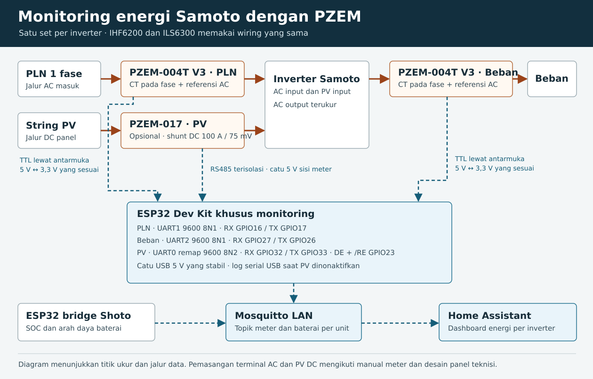

# Panduan monitor energi Samoto IHF6200 dan ILS6300

Satu ESP32 khusus monitoring membaca PLN, output AC dan PV pada satu inverter. Home Assistant menerima data meter dari ESP32 tersebut dan data baterai dari bridge Shoto yang sudah berjalan. Pilih profil IHF6200 dan ILS6300 secara terpisah agar identitas MQTT dan entitas dashboard unik. Wiring pada kedua model sama.

## A. Titik ukur dan batas penggunaan

| Pengukuran | Data | Sumber |
|---|---|---|
| PLN masuk | V, A, W, Hz, faktor daya, total kWh dan periode | PZEM-004T V3.0 100 A + CT, pada cabang AC input inverter |
| Beban inverter | V, A, W, Hz, faktor daya, total kWh dan periode | PZEM-004T V3.0 100 A + CT kedua, pada keluaran AC yang dipilih |
| Panel surya | V DC, A DC, W, total kWh dan periode | PZEM-017 RS485 + shunt 100 A yang sesuai, satu input PV yang lolos verifikasi |
| Baterai Shoto | SOC, V, A dan W bertanda, arah serta daya charge/discharge | MQTT bridge yang sudah ada, `shoto_bridge/<site>/bank` |

PZEM-004T di jalur input mengukur konsumsi PLN pada cabang inverter yang hanya mengimpor. PZEM-004T melaporkan besaran daya tanpa arah. Instalasi yang dapat mengekspor ke PLN memerlukan meter dua arah untuk memisahkan impor dan ekspor. Meter keluaran mengukur energi yang diterima beban dari semua sumber. Titik keluaran kedua pada inverter dengan lebih dari satu output perlu meter tersendiri bila ingin mengukur keduanya secara independen. Pada dua cabang PLN terpisah, dua counter cabang bisa dipakai untuk total kedua inverter. Jika sudah memakai meter PLN utama untuk total rumah, gunakan angka cabang untuk rincian agar pengukuran yang sama tidak dihitung dua kali.

**PZEM-017 dibatasi hingga 300 V DC.** Datasheet Samoto mencantumkan batas input PV **500 V DC untuk IHF6200** dan **245 V DC untuk ILS6300**. Rating inverter menunjukkan batas desain inverter. Voc string pada suhu terendah yang diperkirakan harus dihitung dari modul dan konfigurasi yang benar-benar terpasang. Profil standar kedua model menonaktifkan PV. Aktifkan hanya setelah teknisi memverifikasi Voc dengan margin terhadap batas meter, rating keseluruhan instalasi, isolasi, proteksi, serta persyaratan PV pada manual Samoto. Untuk string IHF6200 di luar rentang PZEM-017, gunakan sumber read-only dari inverter atau meter DC industri dengan rating yang memadai. Sumber alternatif tersebut perlu integrasi tersendiri.

Pekerjaan PLN dan PV DC dilakukan teknisi panel. Diagram menunjukkan titik ukur dan pin data. Pin terminal daya, proteksi, dan rangkaian shunt mengikuti manual meter serta desain panel untuk unit yang dipasang.

[Samoto IHF6200](https://samoto.co.id/products/ihf-6200/) · [Samoto ILS6300](https://samoto.co.id/products/ils-6300/) · [Peacefair PZEM-017](https://en.peacefair.cn/product/786.html) · [Manual PZEM-017](https://www.rcscomponents.kiev.ua/datasheets/pzem-017%20-datasheet.pdf) · [Manual PZEM-004T V3.0](https://arduino.ua/files/PZEM-004T-V3_0-Datasheet-User-Manual.pdf)

## B. Kebutuhan hardware dan wiring

| Komponen | Per inverter | Untuk dua inverter |
|---|---:|---:|
| ESP32 Dev Kit WROOM-32 untuk monitoring dan catu 5 V stabil | 1 | 2 |
| PZEM-004T **V3.0 100 A** dengan CT bawaan yang cocok | 2 | 4 |
| Antarmuka UART 3,3 V ↔ 5 V yang sesuai per PZEM-004T | 2 | 4 |
| PZEM-017 RS485 dengan shunt 100 A yang dipasangkan pabrikan | 1 jika PV memenuhi syarat | Maksimum 2 |
| Transceiver RS485 terisolasi dengan kontrol DE dan /RE, sisi logika 3,3 V, serta catu sisi lapangan untuk port PZEM-017 | 1 set jika PV aktif | Maksimum 2 set |
| Enclosure, proteksi, terminal, isolasi dan catu antarmuka sesuai manual | Sesuai panel | Sesuai panel |

Jika baru ada satu PZEM-004T pada unit tertentu, pasang sebagai **meter PLN** dahulu. Data beban inverter muncul setelah meter kedua dipasang di UART beban. Firmware mengekspos data yang belum terbaca sebagai `Unavailable` di HA.



| Titik | Port ESP32 | Pin data | Antarmuka |
|---|---|---|---|
| PZEM-004T PLN | UART1, 9600 8N1 | RX GPIO16, TX GPIO17 | TTL per port, TX berpasangan dengan RX melalui penyesuai level |
| PZEM-004T beban | UART2, 9600 8N1 | RX GPIO27, TX GPIO26 | TTL per port, TX berpasangan dengan RX melalui penyesuai level |
| PZEM-017 PV | UART0 dipindah ke GPIO32/33, 9600 8N2 | RX GPIO32, TX GPIO33, DE + /RE GPIO23 | RS485 half-duplex pada bus meter sendiri, kontrol arah aktif HIGH |

Pada tiap PZEM-004T, pasang CT pada **satu konduktor fase** dari sirkuit yang sama dengan referensi tegangan meter. Sambungkan TX meter ke RX ESP32 dan RX meter ke TX ESP32 melalui antarmuka yang sesuai. Ikuti label port TTL pada meter untuk VCC 5 V dan GND. Sisi ESP32 bekerja pada 3,3 V. Pasang CT sesuai prosedur pabrikan pada panel tanpa tegangan.

Pada PZEM-017, hubungkan A/B ke pasangan bus transceiver sesuai label kedua modul. Terminal RS485 meter pasif dan memerlukan catu 5 V eksternal dengan kapasitas **lebih dari 100 mA** menurut manual. Gunakan catu dan referensi GND pada sisi lapangan isolator. Pertahankan pemisahan GND lapangan dan host. Jika ingin meter tetap hidup saat PV di bawah 7 V, gunakan catu kerja 5 V independen melalui micro USB meter sesuai manual. Gunakan sumber yang sesuai secara elektrik. Port USB komputer tidak diperuntukkan sebagai catu ini.

Pada transceiver RS485 manual, hubungkan DI ke TX, RO ke RX, serta DE dan /RE ke GPIO23. Gunakan transceiver dengan kondisi menerima saat ESP32 reset. Pisahkan bus meter dari RS485 BMS dan Pylontech. Saat PV aktif, UART0 dipakai untuk PV setelah aplikasi berjalan. USB tetap dapat digunakan untuk upload. Diagnostik aplikasi beralih ke status meter di MQTT.

## C. Build dan instal firmware

1. Siapkan folder [`firmware/samoto_energy_monitor/`](../../firmware/samoto_energy_monitor/). Salin `energy_local.example.h` menjadi **`energy_local.h`** dan isi Wi‑Fi serta broker MQTT yang sudah dipakai Home Assistant. File lokal tersebut diabaikan oleh Git.
2. Untuk **Arduino IDE**, buka `samoto_energy_monitor.ino`, instal **PubSubClient** dan pilih board **ESP32 Dev Module**. Aktifkan satu `ENERGY_SITE_IHF6200` atau `ENERGY_SITE_ILS6300` di `energy_local.h`. Gunakan DIO, 40 MHz dan upload 115200. Cocokkan port USB dengan ESP32 monitoring.
3. Untuk **PlatformIO**, biarkan dua baris `ENERGY_SITE_*` dalam file lokal tetap berupa komentar. Environment memilih profil. Gunakan salah satu per board.

   ```bash
   pio run -d firmware/samoto_energy_monitor -e energy_ihf6200 -t upload
   pio run -d firmware/samoto_energy_monitor -e energy_ils6300 -t upload
   ```

4. Uji PLN dan beban lebih dulu. Setelan default `0xF8` adalah alamat umum Peacefair untuk **satu meter pada satu jalur**. Jika meter unit tertentu memerlukan alamat unicast, isi `ENERGY_GRID_ADDR`, `ENERGY_LOAD_ADDR` atau `ENERGY_PV_ADDR` sesuai alamat aktualnya. Firmware tidak mengatur alamat meter.
5. Setelah instalasi PV disetujui teknisi, isi `ENERGY_PV_DESIGN_VOC_V` dengan Voc maksimum desain dalam V bulat, dibulatkan ke atas, dan set `ENERGY_ENABLE_PV=1`. Build menolak nilai kosong, 300 V atau lebih, dan nilai di atas batas input model. Pembatas ini memvalidasi konfigurasi dan telemetri. Proteksi elektrik tetap berada pada desain instalasi. Meter harus melaporkan setelan shunt **100 A** pada register holding `0x0003`. Firmware menampilkan status bila register belum terbaca atau setelannya berbeda. Cocokkan shunt fisik dan pengaturan dengan prosedur vendor sebelum komisioning.
6. Uji pembacaan pada tingkat PV yang rendah jika meter memakai catu kerja independen. Pembacaan 0 W tampil jika meter mengirim pengukuran 0 W. Jika meter tidak mendapat catu kerja dan berhenti melapor pada malam hari, kanal PV menjadi unavailable.

| Profil | MQTT client ID | Prefix meter | Sumber baterai |
|---|---|---|---|
| IHF6200 | `samoto-energy-ihf6200` | `samoto_energy/ihf6200` | `shoto_bridge/ihf6200/bank` |
| ILS6300 | `samoto-energy-ils6300` | `samoto_energy/ils6300` | `shoto_bridge/ils6300/bank` |

Firmware membaca input register meter dengan `04H` dan memeriksa setelan shunt PZEM-017 dengan `03H`. Pemeriksaan alamat, panjang data, CRC, dan rentang dilakukan sebelum publish. Topik MQTT memakai `<prefix>/status`, `<prefix>/grid`, `<prefix>/load`, dan `<prefix>/pv`. Telemetri dikirim setiap sekitar 5 detik tanpa retensi. Status perangkat memakai LWT retained. Ketika pembacaan gagal, meter dikirim dengan `ok=false` dan alasan. HA menandai meter unavailable dan memakai expiry 20 detik bila pesan berhenti. Untuk data baterai, HA memakai `valid`, `has_telem`, LWT bridge dan expiry 15 detik. Daya (+) berarti charge, daya (−) berarti discharge. Kode monitor hanya mengirim telemetri MQTT.

## D. Tambahkan paket serta dashboard Home Assistant

| Unit | Paket HA | Dashboard |
|---|---|---|
| IHF6200 | [samoto_energy_ihf6200.yaml](../../homeassistant/packages/samoto_energy_ihf6200.yaml) | [samoto_energy_ihf6200_dashboard.yaml](../../homeassistant/dashboards/samoto_energy_ihf6200_dashboard.yaml) |
| ILS6300 | [samoto_energy_ils6300.yaml](../../homeassistant/packages/samoto_energy_ils6300.yaml) | [samoto_energy_ils6300_dashboard.yaml](../../homeassistant/dashboards/samoto_energy_ils6300_dashboard.yaml) |

1. Salin kedua paket yang dibutuhkan ke **`/config/packages/`** pada HA yang sudah memiliki integrasi MQTT. Di konfigurasi instalasi HA Anda, aktifkan package include bila belum ada. Jika sudah ada blok `homeassistant:`, gabungkan kunci `packages` ke blok itu.

   ```yaml
   homeassistant:
     packages: !include_dir_named packages
   ```

2. Jalankan **Developer Tools → YAML → Check configuration**. Setelah hasil valid, restart Home Assistant. Paket memakai `default_entity_id` untuk nama dashboard, jadi pastikan versi HA mendukung kunci tersebut. Periksa sensor dengan prefix `samoto_energy_ihf6200_` dan `samoto_energy_ils6300_` di Developer Tools → States.
3. Di **Settings → Dashboards**, buat dua dashboard manual baru dengan judul **Energi IHF6200** dan **Energi ILS6300**. Buka **Edit → Raw configuration editor**, tempel YAML dashboard yang sesuai, lalu simpan. View **Langsung** berisi meter dan grafik daya 24 jam. View **Energi** berisi kWh total, harian, bulanan dan tahunan.
4. Opsional untuk Energy Dashboard bawaan. Tambahkan `sensor.samoto_energy_<site>_grid_energy` sebagai impor PLN dan `sensor.samoto_energy_<site>_pv_energy` sebagai produksi surya setelah masing-masing sumber tervalidasi. Gunakan sensor `*_energy` dari counter kumulatif. Entity periode dari Utility Meter dipakai di dashboard per inverter. Gunakan satu sumber untuk satu batas pengukuran dan pertahankan Recorder untuk sensor energi.

[Home Assistant Packages](https://www.home-assistant.io/docs/configuration/packages/) · [MQTT Sensor](https://www.home-assistant.io/integrations/sensor.mqtt/) · [Utility Meter](https://www.home-assistant.io/integrations/utility_meter/) · [Home Assistant Energy](https://www.home-assistant.io/docs/energy/)

## E. Checklist verifikasi

- [ ] MQTT memperlihatkan dua prefix dan Client ID terpisah. Dashboards membuka unit masing-masing dan data BMS sesuai bank yang terpasang.
- [ ] Cocokkan V, A, W, faktor daya dan Hz meter PLN/beban dengan alat acuan atau LCD pada saat beban stabil. Saat hanya beban output berubah, periksa bahwa sensor keluaran yang merespons.
- [ ] Bandingkan PV V/A/W pada siang hari dan kWh meter dengan sumber acuan untuk PV yang telah divalidasi. Jika PV ditolak atau belum diaktifkan, periksa **Status pengukuran**.
- [ ] Cocokkan arah daya baterai. Charge menghasilkan W positif dan discharge menghasilkan W negatif pada histori. Dashboard menampilkan besaran charge dan discharge secara terpisah.
- [ ] Putuskan komunikasi satu meter pada uji commissioning dan periksa hanya kanal tersebut menjadi unavailable. Uji pemulihan. Daya dan energi telemetri yang gagal terbaca tidak diisi dengan nol.
- [ ] Cek Utility Meter pada pergantian periode sesuai zona waktu HA. Nilai dimulai saat paket dipasang dan periode pertama bisa parsial. `periodically_resetting: false` memungkinkan HA memakai selisih terhadap pembacaan valid terakhir setelah offline. Bila meter mati selama pergantian periode, data agregat saat tersambung kembali tidak bisa direkonstruksi per timestamp.
- [ ] Pantau **Total meter** ketika mendekati batas datasheet sekitar 10.000 kWh. Kolom ini mengikuti counter fisik. Perilaku meter di ujung rentang perlu diperiksa pada unit. Catat angka terakhir sebelum perawatan atau penggantian meter untuk audit statistik.
- [ ] Periksa firmware existing tetap memakai profil bridge semula. Pantau polling PYL/RS485 ketika ESP32 monitoring dimatikan dan dihidupkan.

**Status proyek.** Firmware dan paket ini diverifikasi melalui build serta tes host. Komisioning meter, pengujian dashboard pada instalasi HA, dan rating string aktual masih menunggu uji fisik.
