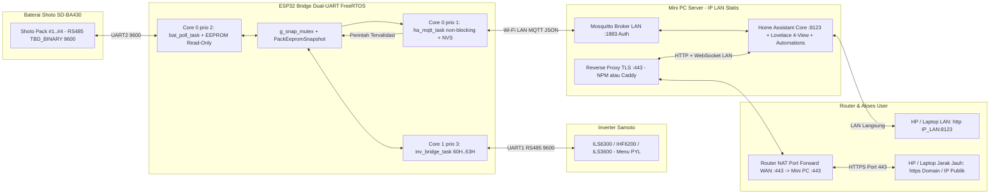

# Integrasi BMS Shoto <-> Samoto Bridge ke Home Assistant — Implementation Plan

> **For agentic workers:** REQUIRED SUB-SKILL: Use superpowers:subagent-driven-development (recommended) or superpowers:executing-plans to implement this plan task-by-task. Steps use checkbox (`- [ ]`) syntax for tracking.

**Goal:** Mengintegrasikan seluruh parameter live (bank, per-pack, 15 sel/pack, suhu, proteksi/alarm, status komunikasi inverter `60H–63H`) dan seluruh parameter EEPROM *read-only* BMS Shoto (`13` register proteksi `cmd 0x06..0x50` + seluruh `43` tag alarm `cmd 0x43`) dari ESP32 Bridge ke Home Assistant pada Mini PC melalui MQTT Auto-Discovery lengkap dengan *Function Action Menu* aman, serta menyediakan akses jaringan lokal (LAN) dan jarak jauh via IP Publik (router port forwarding + HTTPS reverse proxy).

**Architecture:** Sistem dibagi menjadi tiga lapisan terisolasi:
1. **Lapisan ESP32 Bridge ([shoto_samoto_bridge.ino](../../../firmware/shoto_samoto_bridge/shoto_samoto_bridge.ino) + `ha_mqtt_codec.hpp`):** Tugas real-time `bat_poll_task` (Core 0, priority `2`) dan `inv_bridge_task` (Core 1, priority `3`) tetap berjalan independen tanpa ketergantungan jaringan. Tugas baru non-blocking `ha_mqtt_task` (Core 0, priority `1`, stack `8192 B`) hanya menyalin snapshot dari `g_snap_mutex` dalam `< 1 ms`, menerbitkan MQTT Auto-Discovery dan JSON state ke Mosquitto lokal dengan LWT availability, serta mengeksekusi perintah aksi tervalidasi dan tersimpan di NVS (`Preferences`).
2. **Lapisan Server Mini PC:** Menjalankan **Home Assistant OS (HAOS)** bare-metal (opsi utama) atau Docker Compose, **Eclipse Mosquitto MQTT Broker** (hanya LAN port `1883`, autentikasi wajib), dashboard Lovelace 4 tampilan (*Overview*, *Packs & 15-Cell Matrix*, *Shoto EEPROM Audit*, *Action Center & Diagnostics*), otomasi notifikasi instan, dan timer backup *auto-relock*.
3. **Lapisan Akses Jarak Jauh & Keamanan:** Router hanya meneruskan WAN TCP `443` menuju Reverse Proxy di Mini PC (**Nginx Proxy Manager** atau **Caddy**) dengan enkripsi TLS/HTTPS + dukungan WebSocket (`/api/websocket`), `use_x_forwarded_for: true`, `trusted_proxies`, `ip_ban_enabled: true`, dan 2FA TOTP wajib. Port internal `8123`, `1883`, `22`, dan OTA ESP32 tidak pernah diekspos ke internet.

**Architecture Diagram:**



**Tech Stack:** C++17 ([bridge_protocols.hpp](../../../firmware/shoto_samoto_bridge/bridge_protocols.hpp), `ha_mqtt_codec.hpp`), ESP32 Arduino/FreeRTOS (`WiFi`, `PubSubClient`, `Preferences`, `ArduinoOTA`), host unit tests (`g++ -std=gnu++17 -Wall -Wextra -Werror` & `gnu++11`, `python3 -m unittest`), Home Assistant OS / Docker Compose, Eclipse Mosquitto, Nginx Proxy Manager / Caddy + Let's Encrypt, Lovelace YAML.

**Spec:** Diturunkan dari spesifikasi terverifikasi lapangan pada [PROJECT_CONTEXT.md](../../../PROJECT_CONTEXT.md), [config.h](../../../firmware/shoto_samoto_bridge/config.h), [bridge_protocols.hpp](../../../firmware/shoto_samoto_bridge/bridge_protocols.hpp), [shoto_samoto_bridge.ino](../../../firmware/shoto_samoto_bridge/shoto_samoto_bridge.ino), serta hasil readout live `ILS6300 + 2× Shoto` (`2026-11-24`).

## Global Constraints

1. **Strict Read-Only ke BMS Shoto:** ESP32 maupun Home Assistant tidak boleh pernah mengirim perintah tulis EEPROM atau `16× 0xAA` ke baterai Shoto.
2. **Real-Time Bridge Isolation:** `inv_bridge_task` (`Core 1`, priority `3`) wajib mempertahankan `mtxMiss=0` dan `inhibit=0` pada operasi normal; putusnya Wi-Fi atau MQTT tidak boleh memblokir polling RS485 atau memicu reboot ESP32.
3. **Hard Policy Clamps (15S LFP `SD-BA430`):** `CVL` `51.0–54.4 V` (default `53.6 V`), `DVL` `44.0–48.0 V` (default `46.0 V`), `CCL` `10.0–90.0 A` (default skala `45/60/90 A`), `DCL` `10.0–120.0 A` (default skala `80/100/120 A`), `MaxΔV` `0.5–1.5 V` (default `1.0 V`).
4. **Two-Step Safety Gate:** Aksi kritikal (`restart`, `bridge_mode`, `policy_cvl/dvl/ccl/dcl/max_dv`, `policy_reset`) wajib ditolak di sisi ESP32 jika `Maintenance Unlock` tidak aktif (auto-relock otomatis setelah `300000 ms` / 5 menit).
5. **Compile-Time Guard:** `#define ENABLE_HA_MQTT` (default `0` pada build offline, `1` untuk build HA); seluruh 6 varian stub build (`IDF4/IDF5 × Dynamic/Fixed × ENABLE_HA_MQTT=0/1`) wajib lulus `-Wall -Wextra -Werror`.
6. **Multi-Site Topic Isolation:** Setiap ESP32 memakai `HA_DEVICE_ID` & `MQTT_TOPIC_PREFIX` unik (misalnya `shoto_ils6300`, `shoto_ihf6200`) sehingga beberapa inverter dapat dipantau bersamaan dalam 1 Mini PC Home Assistant.
7. **Network Hardening:** Hanya TCP `443` (HTTPS reverse proxy) yang di-forward di router; port `8123`, `1883`, `22`, dan OTA wajib LAN-only; 2FA TOTP dan `ip_ban_enabled: true` wajib aktif.

## Review Focus

1. **Wi-Fi / MQTT broker putus berjam-jam saat beban tinggi:** `ha_mqtt_task` tidak boleh menahan `g_snap_mutex` saat proses connect/reconnect atau memicu WDT reset → dipin di **Task 3** (non-blocking backoff + `mtxMiss=0`) dan diverifikasi live di **Task 7**.
2. **Payload MQTT korup / di luar batas / aksi kritikal saat `Maintenance Unlock = OFF`:** ESP32 wajib menolak `CVL=60V`, `DVL=30V`, `NaN`, atau `restart` ketika terkunci tanpa mengubah state aktif → dipin oleh unit test di **Task 2** (`tests/ha_mqtt_test.cpp`).
3. **Buffer overflow `PubSubClient` / JSON serializer (15 sel + 43 tag alarm):** Setiap chunk payload JSON harus memakai buffer statis `snprintf` (tanpa alokasi heap `String`) dan dijamin `<= 1400 bytes` → dipin oleh unit test batas buffer di **Task 2**.
4. **EEPROM audit (`params all`) pada 2–4 pack memicu `POLICY_FRESHNESS_MS` timeout:** Audit EEPROM berjalan 1 pack per siklus di sela Core 0 dengan `esp_task_wdt_reset()` sehingga usia data live seluruh pack tetap `< POLICY_FRESHNESS_MS` (`9000 ms`) → dipin di **Task 1** & **Task 3**.
5. **Akses IP Publik tanpa TLS / salah konfigurasi `X-Forwarded-For`:** Kesalahan `trusted_proxies` menyebabkan semua login eksternal ditolak (`400 Bad Request`) atau `ip_ban` memblokir IP reverse proxy sendiri → dipin di **Task 4** & **Task 7**.

---

### Task 1: Extend Shoto EEPROM Decoders for All 43 Alarm Tags & Per-Pack Snapshot

**Files:**
- Modify: `firmware/shoto_samoto_bridge/bridge_protocols.hpp:566-651`
- Test: `tests/bridge_test.cpp:730-808`

**Interfaces:**
- Consumes: `parse_tbd_param_u16()`, `parse_tbd_alarm_params_43()`, `TbdAlarmParams` ([bridge_protocols.hpp](../../../firmware/shoto_samoto_bridge/bridge_protocols.hpp#L568-L650)).
- Produces:
  - `struct TbdProtParams` (semua 13 register `cmd 0x06..0x50`: `cell_ov_prot_mv`, `cell_ov_rec_mv`, `cell_uv_prot_mv`, `cell_uv_rec_mv`, `pack_ov_prot_cv`, `pack_ov_rec_cv`, `pack_uv_prot_cv`, `pack_uv_rec_cv`, `const_chg_cv`, `const_chg_ci`, `cell_sleep_mv`, `uv_off_interval`, `sleep_time_min`, `valid`, `audited_ms`).
  - Expanded `struct TbdAlarmParams` mencakup **seluruh 43 tag `0x00..0x2A`** (termasuk `cell_ov_delay_ms`, `cell_uv_delay_ms`, `pack_ov_delay_ms`, `pack_uv_delay_ms`, `chg_oc_ca` / `chg_oc_delay_ms` / `chg_oc_rec_ca`, `dsg_oc_ca` / `dsg_oc_delay_ms` / `dsg_oc_rec_ca`, `chg_ot_c` / `chg_ot_delay_ms` / `chg_ot_rec_c`, `chg_ut_c` / `chg_ut_delay_ms` / `chg_ut_rec_c`, `dsg_ot_c` / `dsg_ot_delay_ms` / `dsg_ot_rec_c`, `dsg_ut_c` / `dsg_ut_delay_ms` / `dsg_ut_rec_c`, `mos_ot_c` / `mos_ot_delay_ms` / `mos_ot_rec_c`, `env_ot_c` / `env_ot_delay_ms` / `env_ot_rec_c`, `env_ut_c` / `env_ut_delay_ms` / `env_ut_rec_c`).
  - `struct PackEepromSnapshot { uint8_t addr = 0; bool valid = false; uint32_t audited_ms = 0; TbdProtParams prot; TbdAlarmParams alarm; };`

- [ ] **Step 1: Write the failing test (Suite 11 in `tests/bridge_test.cpp`)**

Gunakan frame 178-byte `cmd 0x43` hasil capture live `2026-11-24` (`tag 0x00..0x2A`) untuk mengunci dekode semua 43 tag termasuk offset suhu `-50 °C` dan delay `3000 ms`:

```cpp
// Suite 11: Full 43-tag cmd 0x43 EEPROM decoder & TbdProtParams + PackEepromSnapshot
{
    static const uint8_t rx43_live[178] = {
        0x7E,0x01,0x43,0xAC,0x00,0x02,0x0E,0x74,0x01,0x02,0x0B,0xB8,0x02,0x02,0x0E,0x42,
        0x03,0x02,0x09,0xC4,0x04,0x02,0x0B,0xB8,0x05,0x02,0x0C,0x80,0x06,0x02,0x15,0x18,
        0x07,0x02,0x0B,0xB8,0x08,0x02,0x14,0x82,0x09,0x02,0x10,0x68,0x0A,0x02,0x0B,0xB8,
        0x0B,0x02,0x12,0xC0,0x0C,0x02,0x29,0x04,0x0D,0x02,0x0B,0xB8,0x0E,0x02,0x27,0x10,
        0x0F,0x02,0x29,0x04,0x10,0x02,0x0B,0xB8,0x11,0x02,0x27,0x10,0x12,0x02,0x00,0x6E,
        0x13,0x02,0x0B,0xB8,0x14,0x02,0x00,0x69,0x15,0x02,0x00,0x2D,0x16,0x02,0x0B,0xB8,
        0x17,0x02,0x00,0x2F,0x18,0x02,0x00,0x87,0x19,0x02,0x0B,0xB8,0x1A,0x02,0x00,0x82,
        0x1B,0x02,0x00,0x1E,0x1C,0x02,0x0B,0xB8,0x1D,0x02,0x00,0x23,0x1E,0x02,0x00,0xA0,
        0x1F,0x02,0x0B,0xB8,0x20,0x02,0x00,0x96,0x21,0x02,0x00,0x14,0x22,0x02,0x00,0x19,
        0x23,0x02,0x03,0xE8,0x24,0x02,0x01,0xF4,0x25,0x02,0x00,0x73,0x26,0x02,0x0B,0xB8,
        0x27,0x02,0x00,0x6E,0x28,0x02,0x00,0x1E,0x29,0x02,0x0B,0xB8,0x2A,0x02,0x00,0x20,
        0x66,0x0D
    };
    TbdAlarmParams ap{};
    assert(parse_tbd_alarm_params_43(rx43_live, sizeof(rx43_live), 1, ap));
    assert(ap.tag_count == 43);
    assert(ap.chg_oc_ca == 10500 && ap.chg_oc_delay_ms == 3000 && ap.chg_oc_rec_ca == 10000);
    assert(ap.dsg_oc_ca == 10500 && ap.dsg_oc_delay_ms == 3000 && ap.dsg_oc_rec_ca == 10000);
    assert(ap.chg_ot_c == 60 && ap.chg_ot_rec_c == 55);
    assert(ap.chg_ut_c == -5 && ap.chg_ut_rec_c == -3);
    assert(ap.dsg_ot_c == 85 && ap.dsg_ot_rec_c == 80);
    assert(ap.dsg_ut_c == -20 && ap.dsg_ut_rec_c == -15);
    assert(ap.mos_ot_c == 110 && ap.mos_ot_rec_c == 100);
    assert(ap.low_soc_alarm_pct == 20 && ap.low_soc_alarm_rec_pct == 25);
    assert(ap.cell_diff_alarm_mv == 1000 && ap.cell_diff_alarm_rec_mv == 500);
    assert(ap.env_ot_c == 65 && ap.env_ot_rec_c == 60);
    assert(ap.env_ut_c == -20 && ap.env_ut_rec_c == -18);

    PackEepromSnapshot snap{};
    snap.addr = 1;
    snap.alarm = ap;
    snap.prot.pack_uv_prot_cv = 4000;
    snap.prot.const_chg_cv = 5200;
    snap.prot.valid = true;
    snap.valid = snap.prot.valid && snap.alarm.valid;
    assert(snap.valid && snap.prot.const_chg_cv == 5200);
}
```

- [ ] **Step 2: Run test to verify it fails**

Run: `g++ -std=gnu++17 -Wall -Wextra -Werror -Ifirmware/shoto_samoto_bridge tests/bridge_test.cpp -o /tmp/bridge_test && /tmp/bridge_test`
Expected: FAIL compile error (`'struct TbdAlarmParams' has no member named 'chg_oc_ca'` and `PackEepromSnapshot` undeclared).

- [ ] **Step 3: Implement `TbdProtParams`, full `TbdAlarmParams` (43 tags), and `PackEepromSnapshot` in `firmware/shoto_samoto_bridge/bridge_protocols.hpp`**

Tambahkan field delay/suhu/arus ke `TbdAlarmParams` (menggunakan helper `static_cast<int16_t>(v) - 50` untuk tag suhu `0x12, 0x14, 0x15, 0x17, 0x18, 0x1A, 0x1B, 0x1D, 0x1E, 0x20, 0x25, 0x27, 0x28, 0x2A`), serta definisikan `TbdProtParams` dan `PackEepromSnapshot`.

- [ ] **Step 4: Run test to verify it passes**

Run: `g++ -std=gnu++17 -Wall -Wextra -Werror -Ifirmware/shoto_samoto_bridge tests/bridge_test.cpp -o /tmp/bridge_test && /tmp/bridge_test && g++ -std=gnu++11 -Wall -Wextra -Werror -Ifirmware/shoto_samoto_bridge tests/bridge_test.cpp -o /tmp/bridge_test && /tmp/bridge_test && rm -f /tmp/bridge_test`
Expected: PASS (`ALL 11 C++17 bridge protocol & safety suites PASS`) pada `gnu++17` dan `gnu++11`.

- [ ] **Step 5: Commit**

```bash
git add firmware/shoto_samoto_bridge/bridge_protocols.hpp tests/bridge_test.cpp
git commit -m "feat: decode all 43 Shoto EEPROM alarm tags and pack snapshot"
```

---

### Task 2: Portable C++17 Home Assistant MQTT Codec, Discovery Builder & Command Validator

**Files:**
- Create: `firmware/shoto_samoto_bridge/ha_mqtt_codec.hpp`
- Test: `tests/ha_mqtt_test.cpp`

**Interfaces:**
- Consumes: `BankExt`, `PackState`, `PackEepromSnapshot`, `InhibitReason`, `ShotoProtoKind` ([bridge_protocols.hpp](../../../firmware/shoto_samoto_bridge/bridge_protocols.hpp)).
- Produces (`firmware/shoto_samoto_bridge/ha_mqtt_codec.hpp`, pure C++17 tanpa header Arduino):
  - `static constexpr size_t HA_MQTT_MAX_PAYLOAD = 1400u;`
  - `struct RuntimePolicyOverride { float cvl_v; float dvl_v; float ccl_max_a; float dcl_max_a; float max_delta_v; bool modified; };`
  - `enum HaActionType : uint8_t { HA_ACT_NONE=0, HA_ACT_INVALID, HA_ACT_DENIED_LOCKED, HA_ACT_RESCAN, HA_ACT_AUDIT_EEPROM, HA_ACT_RESET_DIAG, HA_ACT_REPUBLISH_DISCOVERY, HA_ACT_RESTART, HA_ACT_SET_BRIDGE_MODE, HA_ACT_SET_DYN_DISCOVERY, HA_ACT_SET_CELL_LOG, HA_ACT_SET_MAINT_UNLOCK, HA_ACT_SET_CVL, HA_ACT_SET_DVL, HA_ACT_SET_CCL, HA_ACT_SET_DCL, HA_ACT_SET_MAX_DV, HA_ACT_RESET_POLICY };`
  - `struct HaActionCmd { HaActionType type = HA_ACT_NONE; bool bool_val = false; uint8_t u8_val = 0; float float_val = 0.0f; };`
  - `struct HaDiagSnapshot` & `struct HaSystemHealth`
  - `void clamp_runtime_policy(RuntimePolicyOverride& pol);`
  - `bool parse_ha_command(const char* suffix, const char* payload, bool maintenance_unlocked, HaActionCmd& out);`
  - `size_t build_bank_state_json(const BankExt& bank, InhibitReason last_inh, bool dyn_disc, bool bridge_active, bool maint_unlock, uint32_t maint_rem_s, const RuntimePolicyOverride& pol, char* out, size_t cap);`
  - `size_t build_diag_state_json(const HaDiagSnapshot& d, const HaSystemHealth& sys, char* out, size_t cap);`
  - `size_t build_pack_state_json(uint8_t slot_1based, bool online, const PackState& p, uint32_t age_ms, uint8_t miss_cnt, char* out, size_t cap);`
  - `size_t build_pack_cells_json(const PackState& p, char* out, size_t cap);`
  - `size_t build_pack_eeprom_json(const PackEepromSnapshot& eep, char* out, size_t cap);`
  - `size_t ha_discovery_entity_count(uint8_t max_packs);`
  - `bool build_ha_discovery_payload(size_t idx, uint8_t max_packs, const char* dev_id, const char* site_name, const char* topic_pfx, const char* sw_ver, char* topic_out, size_t topic_cap, char* payload_out, size_t payload_cap);`

- [ ] **Step 1: Write the failing test (`tests/ha_mqtt_test.cpp`)**

```cpp
// tests/ha_mqtt_test.cpp — mencakup:
// 1. clamp_runtime_policy: clamp CVL=60->54.4, CVL=40->51.0, NaN->default, DVL=46.0, CCL=90.0, DCL=120.0
// 2. parse_ha_command: rescan/audit_eeprom/reset_diag diizinkan saat locked;
//    restart/bridge_mode/policy_cvl ditolak -> HA_ACT_DENIED_LOCKED saat maintenance_unlocked=false,
//    diterima & di-clamp saat maintenance_unlocked=true; payload sampah/NaN -> HA_ACT_INVALID.
// 3. build_*_json: setiap output <= HA_MQTT_MAX_PAYLOAD (1400B), valid JSON braces, memuat semua field bank, 15 sel, 13 proteksi & 43 tag alarm.
// 4. build_ha_discovery_payload: unik object_id tanpa tabrakan across max_packs=4, menggunakan HA_DEVICE_ID & MQTT_TOPIC_PREFIX, menyertakan availability_topic + LWT.
```

- [ ] **Step 2: Run test to verify it fails**

Run: `g++ -std=gnu++17 -Wall -Wextra -Werror -Ifirmware/shoto_samoto_bridge tests/ha_mqtt_test.cpp -o /tmp/ha_mqtt_test`
Expected: FAIL (`ha_mqtt_codec.hpp: No such file or directory`).

- [ ] **Step 3: Implement `firmware/shoto_samoto_bridge/ha_mqtt_codec.hpp`**

Implementasikan encoder `snprintf` deterministik (tanpa `String` heap allocation) agar aman 24/7 dari fragmentasi heap ESP32, validator perintah aksi berjenjang (*Maintenance Unlock* gate), dan generator payload MQTT Discovery untuk seluruh kategori sensor + menu aksi (`button`, `switch`, `select`, `number`) yang me-reference topic dengan `dev_id` & `topic_pfx`.

- [ ] **Step 4: Run test to verify it passes**

Run: `g++ -std=gnu++17 -Wall -Wextra -Werror -Ifirmware/shoto_samoto_bridge tests/ha_mqtt_test.cpp -o /tmp/ha_mqtt_test && /tmp/ha_mqtt_test && g++ -std=gnu++11 -Wall -Wextra -Werror -Ifirmware/shoto_samoto_bridge tests/ha_mqtt_test.cpp -o /tmp/ha_mqtt_test && /tmp/ha_mqtt_test && rm -f /tmp/ha_mqtt_test`
Expected: PASS pada `gnu++17` dan `gnu++11`, semua payload JSON `<= 1400 B` dan valid.

- [ ] **Step 5: Commit**

```bash
git add firmware/shoto_samoto_bridge/ha_mqtt_codec.hpp tests/ha_mqtt_test.cpp
git commit -m "feat: add portable HA MQTT discovery, JSON telemetry codec, and action validator"
```

---

### Task 3: Non-Blocking ESP32 FreeRTOS Wi-Fi/MQTT Task, Multi-Pack `params`, & NVS Policy

**Files:**
- Create: `.gitignore`
- Create: `firmware/shoto_samoto_bridge/secrets.h.example`
- Modify: `firmware/shoto_samoto_bridge/config.h:54-73`
- Modify: `firmware/shoto_samoto_bridge/platformio.ini:1-21`
- Modify: `firmware/shoto_samoto_bridge/shoto_samoto_bridge.ino:13-79,243-459,730-860,1180-1233`

**Interfaces:**
- Consumes: `PackEepromSnapshot` (Task 1), seluruh fungsi `ha_mqtt_codec.hpp` (Task 2).
- Produces:
  - Config guard `#define ENABLE_HA_MQTT 0` (set `1` untuk mode HA), `HA_DEVICE_ID`, `HA_SITE_NAME`, `MQTT_TOPIC_PREFIX`, `HA_TELEMETRY_INTERVAL_MS`, `HA_CELLS_INTERVAL_MS`, `HA_MAINT_UNLOCK_TIMEOUT_MS` di [config.h](../../../firmware/shoto_samoto_bridge/config.h).
  - Multi-pack read-only audit `run_shoto_param_audit(uint8_t addr, BankExt& snap, PackEepromSnapshot* eep_out)` dan CLI `params [1|2|3|4|all]` (saat `all`, menjalankan 1 pack per siklus poll agar live pack age selalu `< POLICY_FRESHNESS_MS` / `9000 ms`).
  - FreeRTOS task `ha_mqtt_task` (Core `0`, priority `1`, stack `8192 B`), NVS persistence via `Preferences` namespace `"shoto_ha"`, non-blocking Wi-Fi/MQTT reconnect backoff (`5s -> 30s`), LWT `online`/`offline`, auto-relock `Maintenance Unlock` setelah `300000 ms`.

- [ ] **Step 1: Write the failing stub check for `ENABLE_HA_MQTT=1` & create `.gitignore` + `secrets.h.example`**

Pastikan `.gitignore` mencantumkan `firmware/shoto_samoto_bridge/secrets.h`, `homeassistant/.env`, `homeassistant/mosquitto/passwd`, dan `/tmp/`. Buat `firmware/shoto_samoto_bridge/secrets.h.example` dengan placeholder `WIFI_SSID`, `WIFI_PASS`, `MQTT_HOST`, `MQTT_PORT`, `MQTT_USER`, `MQTT_PASS`, `OTA_PASS`.
Jalankan stub build dengan `-DENABLE_HA_MQTT=1`:
Run: `python3 -c "print('Verify stub fail before ino update')"` / compile `.ino` stub check dengan `-DENABLE_HA_MQTT=1` → FAIL karena macro `ENABLE_HA_MQTT` belum di-wire.

- [ ] **Step 2: Implement `config.h`, `platformio.ini`, and `shoto_samoto_bridge.ino` updates**

1. Di [platformio.ini](../../../firmware/shoto_samoto_bridge/platformio.ini): tambahkan `lib_deps = knolleary/PubSubClient @ ^2.8` pada kedua environment (`diy_esp32_wroom32`, `waveshare_esp32s3`).
2. Di [config.h](../../../firmware/shoto_samoto_bridge/config.h): tambahkan blok `#ifndef ENABLE_HA_MQTT / #define ENABLE_HA_MQTT 0`, `HA_DEVICE_ID` (`"shoto_ils6300"`), `HA_SITE_NAME` (`"PLTS Samoto ILS6300"`), `MQTT_TOPIC_PREFIX` (`"shoto_bridge/ils6300"`), `HA_TELEMETRY_INTERVAL_MS` (`3000UL`), `HA_CELLS_INTERVAL_MS` (`5000UL`), `HA_MAINT_UNLOCK_TIMEOUT_MS` (`300000UL`).
3. Di [shoto_samoto_bridge.ino](../../../firmware/shoto_samoto_bridge/shoto_samoto_bridge.ino):
   - Simpan `PackEepromSnapshot g_pack_eeprom[MAX_PACKS]` dilindungi `g_snap_mutex`.
   - Perbarui `run_shoto_param_audit()` agar mengisi `PackEepromSnapshot` dan mendukung CLI `params`, `params 1..4`, serta `params all` (antrian slot satu per siklus Core 0 agar pack lain tetap segar `< 9000 ms`).
   - Di bawah `#if ENABLE_HA_MQTT`: tambahkan `WiFi.h`, `PubSubClient.h`, `Preferences.h`, `ArduinoOTA.h` (port LAN only), `__has_include("secrets.h")`, `ha_mqtt_task` (Core 0, prio 1, stack 8192), `PubSubClient::setBufferSize(1600)`, auto-discovery bertahap (1–2 entity per loop agar WDT aman), publish bank/diag/packs/cells/eeprom, handler MQTT command memakai `parse_ha_command()`, clamp via `clamp_runtime_policy()`, simpan ke NVS.

- [ ] **Step 3: Run all 6 `.ino` stub builds & host tests**

Jalankan uji kompilasi C++ stub untuk semua kombinasi:
- `IDF 4` vs `IDF 5`
- `DYNAMIC_PACK_DISCOVERY=true` vs `false`
- `ENABLE_HA_MQTT=0` vs `ENABLE_HA_MQTT=1` (dengan mock stub `WiFi.h`, `PubSubClient.h`, `Preferences.h`, `ArduinoOTA.h` di `/tmp/esp32_stub_inc`, langsung dihapus `rm -rf` setelah selesai)
Pastikan 0 warning dengan `-Wall -Wextra -Werror`.

- [ ] **Step 4: Re-run full host test suite (`bridge_test`, `ha_mqtt_test`, `safety_test`, `test_serial_lab.py`)**

Expected: seluruh test host PASS dan `git status` tidak berisi `secrets.h`.

- [ ] **Step 5: Commit**

```bash
git add .gitignore firmware/shoto_samoto_bridge/secrets.h.example firmware/shoto_samoto_bridge/config.h firmware/shoto_samoto_bridge/platformio.ini firmware/shoto_samoto_bridge/shoto_samoto_bridge.ino
git commit -m "feat: add non-blocking HA MQTT task, multi-pack read-only audit, and NVS policy"
```

---

### Task 4: Mini PC Home Assistant, Mosquitto & Secure Public-IP Reverse Proxy Configuration

**Files:**
- Create: `homeassistant/docker-compose.yml`
- Create: `homeassistant/configuration.yaml`
- Create: `homeassistant/mosquitto/mosquitto.conf`
- Create: `homeassistant/Caddyfile.example`
- Create: `homeassistant/.env.example`

**Interfaces:**
- Consumes: Port LAN `1883` (Mosquitto) & `8123` (Home Assistant), WAN TCP `443` dari Router Port Forwarding.
- Produces: Konfigurasi referensi Mini PC siap pakai untuk **HAOS** (`configuration.yaml`) dan **Docker Compose** (`docker-compose.yml` + Mosquitto + Caddy), lengkap dengan keamanan `http:` reverse proxy (`use_x_forwarded_for: true`, `trusted_proxies`, `ip_ban_enabled: true`, `login_attempts_threshold: 5`) dan optimasi `recorder:` SSD Mini PC (`purge_keep_days: 30`).

- [ ] **Step 1: Write `tests/test_ha_artifacts.py` initial test for core config & proxy hardening**

Buat test Python (`unittest`) yang memeriksa:
- `homeassistant/configuration.yaml` valid YAML dan memuat `use_x_forwarded_for: True`, `ip_ban_enabled: True`, `login_attempts_threshold <= 5`, serta `trusted_proxies`.
- `homeassistant/mosquitto/mosquitto.conf` memuat `allow_anonymous false`.
- `homeassistant/docker-compose.yml` valid YAML dan tidak mengekspos port `1883`/`8123` pada proxy publik.

- [ ] **Step 2: Run test to verify it fails**

Run: `python3 -m unittest tests/test_ha_artifacts.py -v`
Expected: FAIL (`FileNotFoundError` untuk berkas `homeassistant/`).

- [ ] **Step 3: Create the 5 Mini PC & Proxy configuration files**

Buat seluruh berkas konfigurasi di `homeassistant/` dengan komentar penjelasan berbahasa Indonesia untuk memudahkan operator mengedit IP Mini PC, subnet router, dan domain/DuckDNS.

- [ ] **Step 4: Run test to verify it passes**

Run: `python3 -m unittest tests/test_ha_artifacts.py -v`
Expected: PASS.

- [ ] **Step 5: Commit**

```bash
git add homeassistant/docker-compose.yml homeassistant/configuration.yaml homeassistant/mosquitto/mosquitto.conf homeassistant/Caddyfile.example homeassistant/.env.example tests/test_ha_artifacts.py
git commit -m "feat: add Mini PC Home Assistant, Mosquitto, and HTTPS reverse proxy configs"
```

---

### Task 5: Lovelace 4-View Home Assistant Dashboard YAML (Full BMS + EEPROM + Action Menu)

**Files:**
- Create: `homeassistant/dashboards/shoto_bms_dashboard.yaml`
- Modify: `tests/test_ha_artifacts.py`

**Interfaces:**
- Consumes: Daftar `object_id` & unit entitas MQTT Auto-Discovery dari `firmware/shoto_samoto_bridge/ha_mqtt_codec.hpp` (Task 2).
- Produces: Dashboard Lovelace 4 tampilan lengkap (desktop & mobile friendly):
  1. **Overview & Power Flow:** Gauge `SOC`, Tegangan Bank, Arus (`+` Charge / `-` Discharge), Daya (W), Status `BankValid` / `INHIBIT` banner merah otomatis, jumlah pack aktif (`2/4`), Mode Inverter (`PYL_FULL`), `63H` Limit aktif (`CVL/DVL/CCL/DCL`), grafik histori 24 jam.
  2. **Packs & 15-Cell Matrix:** Kartu ringkas `Pack #1..#4` (`V`, `I`, `SOC`, `SOH`, `Cycles`, `prot`, `fault`, `miss`), tabel & grafik bar **seluruh 15 sel (`C01..C15`) per pack** dengan highlight sel min/max & `ΔV`, 5 sensor suhu per pack (`T1..T5`).
  3. **Shoto EEPROM Audit (Read-Only):** Kartu + tabel Markdown lengkap **13 parameter proteksi (`cmd 0x06..0x50`)** dan **43 tag alarm (`cmd 0x43`)** per pack, waktu audit terakhir, serta tombol cepat **Audit EEPROM Read-Only**.
  4. **Action Center & Diagnostics:** Saklar **Maintenance Unlock** (kunci pengaman 2 langkah), tombol diagnostik aman (`Rescan Pack`, `Audit EEPROM All/P1/P2`, `Reset Counter Diag`, `Re-Publish Discovery`), panel kontrol berpenjagaan (*guarded*) saat unlocked (`Bridge Mode ACTIVE/MONITOR_ONLY`, `Dynamic Discovery`, slider `Policy CVL/DVL/CCL/DCL/MaxΔV`, `Reset Policy Aman`, `Restart ESP32`), counter inverter (`60H/61H/62H/63H/mtxMiss`), frame TX terakhir, dan kesehatan ESP32 (`Wi-Fi RSSI`, `Free Heap`, `Uptime`).

- [ ] **Step 1: Add dashboard entity-consistency test to `tests/test_ha_artifacts.py`**

Tambahkan unit test yang mengekstrak seluruh `object_id` discovery dari `ha_mqtt_codec.hpp` lalu memverifikasi bahwa setiap `entity_id` dalam `shoto_bms_dashboard.yaml` cocok persis dengan entity yang didaftarkan firmware (zero typo / zero orphan entity) dan memiliki tepat 4 view.

- [ ] **Step 2: Run test to verify it fails**

Run: `python3 -m unittest tests/test_ha_artifacts.py -v`
Expected: FAIL (`shoto_bms_dashboard.yaml` belum ada).

- [ ] **Step 3: Create `homeassistant/dashboards/shoto_bms_dashboard.yaml`**

Tulis konfigurasi Lovelace YAML dengan 4 view standar bawaan Home Assistant (tanpa ketergantungan wajib custom card HACS agar langsung jalan out-of-the-box setelah instalasi HAOS bersih).

- [ ] **Step 4: Run test to verify it passes**

Run: `python3 -m unittest tests/test_ha_artifacts.py -v`
Expected: PASS.

- [ ] **Step 5: Commit**

```bash
git add homeassistant/dashboards/shoto_bms_dashboard.yaml tests/test_ha_artifacts.py
git commit -m "feat: add 4-view Lovelace dashboard for Shoto BMS, 15 cells, EEPROM, and action menu"
```

---

### Task 6: Home Assistant Safety Automations, Notifications & Action Scripts

**Files:**
- Create: `homeassistant/automations_shoto_bms.yaml`
- Create: `homeassistant/scripts_shoto_bms.yaml`
- Modify: `tests/test_ha_artifacts.py`

**Interfaces:**
- Consumes: Entitas MQTT dari Task 2 dan dashboard action buttons dari Task 5.
- Produces:
  - 7 otomasi kritis & kesehatan sistem (`Bank INHIBIT`, `Pack Offline / Hot-Unplug`, `Low SOC 25% Warning & 20% Critical`, `Cell Imbalance >= 80 mV`, `High Temp >= 48 °C`, `ESP32 Bridge Offline / Inverter 63H Stalled > 2 min`, `Backup Auto-Relock Maintenance Unlock 5 Menit`).
  - 2 script utilitas (`shoto_test_notification`, `shoto_audit_all_packs_and_notify`).

- [ ] **Step 1: Add automation & script validation tests to `tests/test_ha_artifacts.py`**

Validasi YAML, cek ID unik, cek tidak ada entity typo terhadap `ha_mqtt_codec.hpp`, serta pastikan otomasi `Maintenance Unlock` auto-relock aktif maksimal `5 menit`.

- [ ] **Step 2: Run test to verify it fails**

Run: `python3 -m unittest tests/test_ha_artifacts.py -v`
Expected: FAIL (`automations_shoto_bms.yaml` / `scripts_shoto_bms.yaml` belum ada).

- [ ] **Step 3: Create `homeassistant/automations_shoto_bms.yaml` and `homeassistant/scripts_shoto_bms.yaml`**

Tulis semua otomasi dengan pesan notifikasi berbahasa Indonesia yang jelas (menyertakan `reason`, `ΔV`, `SOC`, dan nama site `HA_SITE_NAME`).

- [ ] **Step 4: Run test to verify it passes**

Run: `python3 -m unittest tests/test_ha_artifacts.py -v`
Expected: PASS.

- [ ] **Step 5: Commit**

```bash
git add homeassistant/automations_shoto_bms.yaml homeassistant/scripts_shoto_bms.yaml tests/test_ha_artifacts.py
git commit -m "feat: add Shoto BMS safety alert automations and utility scripts"
```

---

### Task 7: End-to-End Hardware, Resilience & Remote Access Verification

**Files:**
- Modify: `PROJECT_CONTEXT.md` (tambahkan ringkasan arsitektur HA & riwayat changelog).

**Interfaces:**
- Consumes: Firmware lengkap (Task 1–3), konfigurasi Mini PC + Proxy (Task 4), Dashboard + Automations (Task 5–6), dan panduan pengguna ([GUIDE-HOME-ASSISTANT.md](../../guides/GUIDE-HOME-ASSISTANT.md)).
- Produces: Sistem terverifikasi penuh di hardware nyata (`ILS6300` + `2× Shoto SD-BA430`, atau `IHF6200` + `3× Shoto`) melalui LAN dan IP Publik.

- [ ] **Step 1: Run complete host regression & 6-matrix compile verification**

Run:
```bash
python3 -m unittest tests/test_serial_lab.py tests/test_ha_artifacts.py -v && \
g++ -std=gnu++17 -Wall -Wextra -Werror -Ifirmware/shoto_samoto_bridge tests/safety_test.cpp -o /tmp/safety_test && /tmp/safety_test && \
g++ -std=gnu++17 -Wall -Wextra -Werror -Ifirmware/shoto_samoto_bridge tests/bridge_test.cpp -o /tmp/bridge_test && /tmp/bridge_test && \
g++ -std=gnu++17 -Wall -Wextra -Werror -Ifirmware/shoto_samoto_bridge tests/ha_mqtt_test.cpp -o /tmp/ha_mqtt_test && /tmp/ha_mqtt_test && \
rm -f /tmp/safety_test /tmp/bridge_test /tmp/ha_mqtt_test
```
Expected: seluruh suite (`test_serial_lab.py`, `test_ha_artifacts.py`, `safety_test`, `bridge_test` 11 suites, `ha_mqtt_test`) PASS 100%, ditambah 6 stub build ESP32 (`IDF4/IDF5 × Dynamic/Fixed × HA_MQTT=0/1`) lulus zero warning.

- [ ] **Step 2: Live site test on `ILS6300 + 2× Shoto` + Home Assistant verification**

Flash firmware (`ENABLE_HA_MQTT 1`), pantau Serial Monitor (`115200 baud`) & buka Home Assistant:
- Pastikan `mode=PYL_FULL (63H+61H+62H)`, `inhibit=0`, `mtxMiss=0`, `[HA MQTT] Connected`, semua entitas live bank + 2 pack + 30 sel + 13 proteksi + 43 alarm muncul tanpa `unavailable`.

- [ ] **Step 3: Network resilience test (Wi-Fi outage while inverter stays online)**

Matikan Wi-Fi router / blokir port MQTT selama 3 menit saat inverter aktif menyuplai beban:
- Verifikasi di Serial Monitor (`diag`) bahwa `inv_bridge_task` tetap membalas `61H/62H/63H`, `inhibit=0`, `mtxMiss=0`, nol reboot WDT.
- Nyalakan Wi-Fi kembali → verifikasi ESP32 otomatis tersambung ulang ke Mosquitto dan state HA kembali `online`.

- [ ] **Step 4: Action menu safety & Public IP security test**

- Uji klik `Restart ESP32` dan ubah `Policy CVL` saat `Maintenance Unlock = OFF` → wajib ditolak di log serial ESP32 (`[HA CMD] DENIED: locked`).
- Aktifkan `Maintenance Unlock = ON`, ubah `Policy CCL = 55 A` → wajib tersimpan NVS & terpantau di `63H`, lalu kembali terkunci otomatis setelah 5 menit (kembalikan ke default `60 A` / `policy_reset`).
- Uji akses dari HP via jaringan seluler **4G/5G (di luar LAN)** menuju `https://<domain-atau-ip-publik>` → login dengan **2FA TOTP**, verifikasi dashboard tampil real-time, pastikan port `8123`, `1883`, dan `22` tertutup dari luar.

- [ ] **Step 5: Update `PROJECT_CONTEXT.md` & Commit**

Catat milestone integrasi Home Assistant di [PROJECT_CONTEXT.md](../../../PROJECT_CONTEXT.md), lalu commit:
```bash
git add PROJECT_CONTEXT.md
git commit -m "docs: record verified Home Assistant integration milestone"
```
